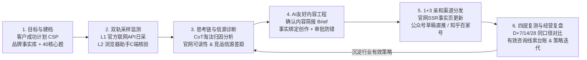

# GeoPro（智脉 GEO）项目立项与方案审查总览

> **文档版本**：v2.0（统一基线版）  
> **更新日期**：2026-11-16  
> **文档定位**：项目单一事实源（Single Source of Truth）总纲，供管理层、产品、研发、内容运营与商务交付团队对齐共识。  
> **适用范围**：中国大陆市场（豆包、DeepSeek、腾讯元宝、Kimi、百度 AI 搜索/文心、通义千问/夸克等主流生成式搜索入口）。

---

## 一、 项目基本信息卡（Project Charter）

| 维度 | 规划内容 |
| :--- | :--- |
| **项目名称** | **GeoPro（智脉 GEO）** —— 中国大陆 AI 友好型品牌监测与内容优化一体化平台 |
| **核心定位** | 面向中国大陆企业品牌与代运营机构（Agency）的 **GEO（生成式引擎优化）监测、诊断、内容工程与效果验证 SaaS 平台** |
| **目标客群** | 1. **高客单/重决策 B2B 企业**（企服 SaaS、工业设备、数字化方案、企业服务） 2. **高对比度消费品牌**（3C 数码、家电、母婴、大健康合规品类、连锁加盟） 3. **数字营销与品牌代运营机构**（SEO/SEM 转型团队、内容营销 Agency、公关公司） |
| **核心痛点** | 据 CNNIC《生成式人工智能应用发展报告（2026）》，截至 2026 年上半年我国生成式 AI 用户超 7 亿，76.0% 用户会用其回答问题，“向 AI 提问选型”正在成为购买决策入口。品牌面临**“AI 不提及、优势说不清、参数过时报错、竞品垄断推荐、优化无抓手、效果难归因”**六大痛点 |
| **核心交付价值** | 围绕客户真实购买问题，打通 **“双轨采样监测 → 思考链（CoT）与信源诊断 → 事实库驱动的 AI 友好内容生产 → 1+3 大陆亲和信源发布 → 四层效果复测归因”** 完整经营闭环 |
| **商业模式** | **SaaS 年度/季度订阅（按品牌数 + 采样配额） + 增值交付服务包（建档诊断 / 内容工程改造 / 代运营）**，软件毛利与人工服务独立核算 |
| **技术路线** | `Next.js 16 (App Router)` + `TypeScript 独立 Worker` + `PostgreSQL 17 (RLS 多租户隔离)` + `Drizzle ORM` + `Better Auth` + `pg-boss` + `Chrome 合规辅助采集插件` |
| **首期周期与目标** | **10 周 MVP 交付周期**（第 1 周 PoC 验证，第 2-7 周研发与首批内容上线，第 8-10 周复测验收与商业化定型）；跑通 1 个垂直行业、3-5 家种子客户付费闭环 |

---

## 二、 原 `geo-prd` 方案深度审查报告

我们对仓库内原有的 17 份规划文档进行了全面交叉审计。总体而言，原方案在**数据真实性、反黑产合规意识、证据可追溯性与工程严谨度**上具备极高水准，但存在**文档碎片化冲突**以及**对中国大陆 AI 搜索独特生态落地不足**的问题。

### 2.1 原方案值得保留的 5 大核心资产（Keep）

1. **三类证据严格隔离**：将搜索候选（`SearchEvidence`）、API 模型回答（`ModelAnswer`）、真实消费者端观察（`ConsumerObservation`）物理分离，严禁混算成一个虚假的“全网 AI 综合排名分”。
2. **指标分母透明可复算**：区分计划槽位 $P$、有效回答 $V$、条件合格回答 $E$、可判断样本 $J_m/J_r$ 与原生引用可观察样本 $C$；缺失数据标 `N/A`，绝不将采集失败当作“0% 提及率”。
3. **品牌事实库（Brand Fact Vault）防幻觉机制**：监测请求绝不夹带客户私有事实库（防止污染测量结果）；内容生成强制绑定经审批的 `fact_id` 与有效期，事实过期自动阻断待发稿件。
4. **合规安全底线清晰**：拒绝收集客户平台明文密码、拒绝服务端共享 Cookie 池黑产群发、拒绝水军伪造百科与虚假用户测评，全面遵循《人工智能生成合成内容标识办法》。
5. **同构全栈工程选型务实**：采用 `Next.js + TypeScript Worker + PostgreSQL` 单语言 Monorepo 架构，避免了早期小团队同时维护前端 TS 与后端 Go/Python 两套领域模型的割裂成本。

### 2.2 原方案存在的 6 大关键问题与本次定制修正（Fix & Upgrade）

| 编号 | 原方案痛点 / 冲突诊断 | 结合大陆行业实战的定制重构方案 |
| :--- | :--- | :--- |
| **P1** | **多版补丁未合并，团队阅读认知分裂** 《初稿 v1.2》《效果导向修改建议》《SEO与14平台分发报告》《架构设计》各自表述一套页面、路由和流程，修订建议停留在纸面未合入主干。 | **建立五册合一规范体系**：废除补丁式文档，统一收敛为《立项总览》《PRD》《可行性调研》《开发 Spec》《资源与排期》五份正交文档及交互式 HTML 门户；统一 6 大业务模块与 URL 路由规范。 |
| **P2** | **忽视中国大陆“围墙花园”信源生态差异** 原方案偏重海外 GEO 思路（大量篇幅放在客户独立站 SEO 审计），忽略了国内公众号、知乎、百家号、头条/抖音生态对不同 AI 引擎的决定性权重。 | **定制“大陆引擎—信源亲和矩阵”与 `1+3+X` 策略**：以 **1 个高响应 SSR 事实官网**为锚点，首版打透 **微信公众号（攻元宝/Kimi）+ 知乎（攻 DeepSeek/豆包/Kimi/夸克）+ 百家号/头条（攻百度 AI/豆包）** 三大核心外部信源池。 |
| **P3** | **API 与真实 App 脱节，纯人工截图不可持续** 原方案指出 API ≠ 同名 App，但将 C 端核验退化为“纯手工复制粘贴截图”。每品牌 40 题跨 5 个平台手工采一次即需 200 次操作，交付人力必然崩溃。 | **首创“双轨三层”合规采集架构**：在 `L1 官方联网 API 自动高频监测` 与人工之间，新增 **`L2 桌面浏览器合规辅助采集插件（GeoPro Capture Extension）`**，在运营实名浏览器中半自动填词、一键结构化提取回答 + 思考链 + 引用卡片，大幅降低手工复制截图工时（具体提效倍数在 S0 实测确认），且不绕过平台验证、不共享账号。 |
| **P4** | **缺失推理模型“思考链（CoT）”归因分析** 2025-2026 大陆主流入口（DeepSeek-R1、豆包深度思考、元宝深度思考）均暴露详细推理过程，原数据模型只存最终回答，丢掉了最宝贵的淘汰原因。 | **新增 `Reasoning Trace（思考链诊断）` 管线**：结构化采集并解析大模型思考过程中的对比维度、采纳依据与淘汰槽点（如“未查到私有部署配置”、“疑似软文缺少客观数据”），直接转化为精准内容修改简报。 |
| **P5** | **AI 友好内容规范缺乏中文 RAG 工程细节** 原方案仅提出“回答-条件-证据-限制”框架，未针对中文大模型切片（Chunking）、实时抓取超时（1.5-3s）和反营销过滤做工程化约束。 | **制定《中国大陆 AI 友好内容工程六大黄金准则》**：语义自包含切片（每段带品牌与品类主语）、首屏 TL;DR 直答表、客观适用边界声明、权威信任锚点与新鲜时间戳、大陆 CDN < 1.5s 直出 HTML、合成内容显隐式合规标识。 |
| **P6** | **范围与排期严重倒挂（8 周塞入 120 人日工作量）** 原分发报告把 14 个平台模板塞进 P0（增 20-30 人日），叠加从零建多租户 RLS、队列、日志解析等，2 名开发在 8 周内绝对无法完成。 | **科学裁剪 MVP 范围并重排为 10 周里程碑**：首版砍掉非核心 10 平台模板与重型日志连接器，聚焦核心纵向闭环；明确 **标准版（4.5 FTE）** 与 **精简版（2.5 FTE）** 两套资源模型及 20% 风险缓冲。 |

---

## 三、 中国大陆 AI 友好型 GEO 业务闭环全景

GeoPro 围绕**“让品牌的真实优势在客户关键提问时刻被 AI 准确理解、可信引用并有效承接”**，构建六步闭环：

### 四层可验收价值漏斗（拒绝单一玄学指标）

为了彻底解决客户“不知道钱花在哪、看不懂效果”的信任危机，平台将交付成果拆解为四个独立可核验层级：

1. **L1 交付执行层（100% 可控）**：官网技术阻塞修复、经审批的品牌事实库、高信息密度选型页/问答稿在目标渠道真实公开上线（凭公开 URL、内容 Hash 与版本快照签收）。
2. **L2 引擎采纳层（前置信号）**：目标页面进入搜索引擎召回池，且在目标 AI 产品的原生参考资料（Citations）或思考链（CoT）中被正向引述，品牌核心参数事实错误率下降。
3. **L3 购买推荐层（核心 GEO 指标）**：在预先冻结的 **30 道非品牌高意图购买问题**中，目标品牌被明确列为“适合选项”的推荐率（Recommendation Rate）及竞品提及份额（SoV）稳步提升。
4. **L4 业务转化层（商业终局）**：通过官网专属落地页承接、可识别 AI Referrer 会话、渠道合规组件及销售询问“您从哪里了解到我们（自报 AI 推荐）”汇总的**有效商业咨询线索（Qualified AI-Associated Leads）**。

---

## 四、 项目规范文档导航索引

为提升团队跨职能沟通效率，请各角色按以下索引查阅对应专册：

| 文档编号与名称 | 核心内容概要 | 核心受众 |
| :--- | :--- | :--- |
| **[01-项目立项与方案审查总览.md](./01-项目立项与方案审查总览.md)** | 立项章程、原 17 份文档深度审查、6 大定制升级决策、商业闭环全景 | 管理层、全体项目成员 |
| **[02-产品需求文档-PRD.md](./02-产品需求文档-PRD.md)** | 用户角色、6 大核心模块功能需求、40+10 问题集规范、AI 友好内容六大准则、`metrics-v2` 指标口径、试点运营 SOP | 产品经理、UI/UX、内容运营、客户成功经理 |
| **[03-中国大陆GEO可行性调研报告.md](./03-中国大陆GEO可行性调研报告.md)** | 大陆 6 大 AI 引擎信源偏好矩阵、采集技术可行性、14 大自媒体接口真实开放边界、数据与 AIGC 标识合规、单品牌财务模型 | 商业负责人、产品、架构师、法务合规 |
| **[04-技术架构与开发规格说明书-Spec.md](./04-技术架构与开发规格说明书-Spec.md)** | Next.js + Worker 架构、Monorepo 目录、统一路由表、PostgreSQL 核心表结构与 RLS、状态机、API 接口契约、Chrome 助手规格 | 技术负责人、全栈开发、AI 工程师、测试与运维 |
| **[05-资源投入与里程碑排期计划.md](./05-资源投入与里程碑排期计划.md)** | 10 周研发与试点甘特计划、G0-G6 阶段门禁、标准/精简双套团队编制、大模型 API 与云资源预算明细、风险预案 | 项目经理（PMO）、各组 TL、管理层 |
| **[../geo-platform-report.html](../geo-platform-report.html)** | **UI 友好的交互式项目全景展示门户**（支持模块切换、架构图解、信源热力矩阵与单客户 ROI 动态测算器） | 汇报演示、跨部门对齐、投资人/管理层审阅 |
