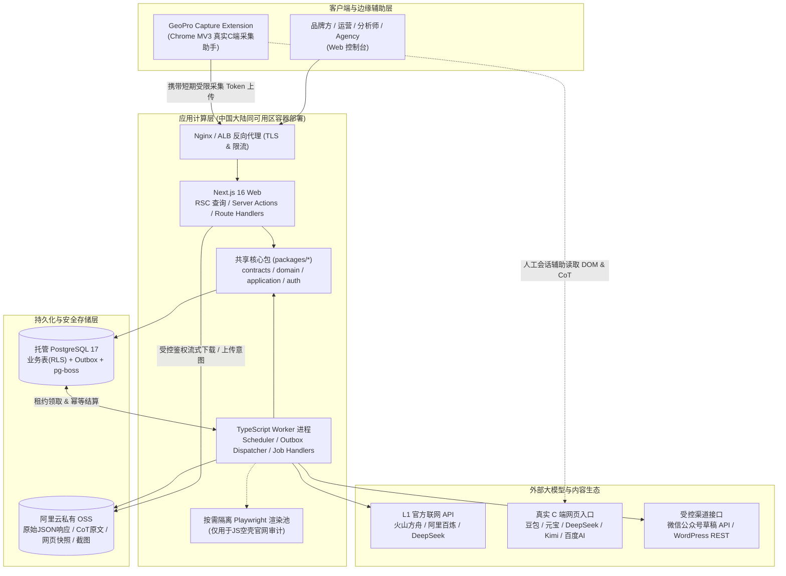

# GeoPro（智脉 GEO）技术架构与开发规格说明书（Engineering Spec）

> **文档版本**：v2.0（统一架构基线版）  
> **更新日期**：2026-11-16  
> **技术栈决定**：`Next.js 16 (App Router)` + `Node.js 24 LTS` + `TypeScript Strict` + `PostgreSQL 17 (RLS)` + `Drizzle ORM` + `Better Auth` + `pg-boss` + `阿里云私有 OSS` + `Manifest V3 Chrome Extension`  
> **关联文档**：[02-PRD](./02-产品需求文档-PRD.md) ｜ [03-可行性调研](./03-中国大陆GEO可行性调研报告.md) ｜ [05-资源与排期](./05-资源投入与里程碑排期计划.md)

---

## 一、 系统总体架构设计

### 1.1 核心架构决策（ADR 摘要）
1. **单语言 Monorepo，双进程物理分离**：`Web 进程（Next.js）` 仅处理页面 SSR、会话鉴权、短事务表单写入与异步任务登记（202 Accepted）；`Worker 进程（独立 Node.js）` 承载长耗时模型联网采样、网页抓取、CoT 语义解析、草稿推送与报告快照生成。严禁在 Next.js Route Handler 或 `after()` 中执行批量采样队列。
2. **基础设施极简收敛**：MVP 首期不引入微服务、不引入 Kafka/RabbitMQ、不引入向量数据库或 ClickHouse。使用 `PostgreSQL 17` 统一承载关系业务表、行级租户安全隔离（RLS）、事务性 Outbox 与 `pg-boss` 持久任务队列，降低 60% 运维复杂度。
3. **三端协同采集**：服务端 `EngineAdapter` 负责 L1 官方联网 API 调度；桌面端 `apps/capture-ext`（Chrome 扩展）负责 L2 真实消费者端（豆包/DeepSeek/元宝/Kimi）DOM/CoT 合规半自动采集；隔离的受控 HTTP/Playwright 负责引用网页快照抓取。

### 1.2 系统拓扑与数据流图



---

## 二、 Monorepo 仓库结构与模块边界规范

采用 `pnpm workspace` 管理，CI 强制检查依赖方向（浏览器端代码严禁导入 `db`、`auth` 服务端、`adapters` 或 `queue`）：

```text
huowang-harness/
├─ apps/
│  ├─ web/                              # Next.js 16 App Router 主控制台
│  │  ├─ src/app/
│  │  │  ├─ (auth)/                     # 登录、组织邀请接受、密码重置
│  │  │  ├─ (console)/w/[workspaceId]/
│  │  │  │  ├─ b/[brandId]/
│  │  │  │  │  ├─ overview/             # 1. 项目总览 (CSP 状态与四层漏斗)
│  │  │  │  │  ├─ foundation/           # 2. 品牌底座、事实库与 40+10 问题集
│  │  │  │  │  ├─ monitoring/           # 3. 双轨监测、CoT 思考链与引用证据库
│  │  │  │  │  ├─ studio/               # 4. 官网审计、内容简报、AI友好创作与审批
│  │  │  │  │  ├─ distribution/         # 5. 1+3 渠道素材包、公众号草稿直推与巡检
│  │  │  │  │  └─ experiments/          # 6. D+7/14/28 复测对比、有效线索台账与报告
│  │  │  │  └─ settings/                # 7. 工作区成员、Agency 委托、配额与账单
│  │  │  └─ api/
│  │  │     ├─ auth/[...all]/           # Better Auth 认证路由
│  │  │     ├─ v1/                      # REST 接口 (轮询、导出、浏览器插件同步接口)
│  │  │     └─ webhooks/[provider]/     # 验签防重放回调入口
│  │  ├─ src/features/                  # 按业务域组织的 UI 组件与薄 Server Actions
│  │  └─ src/server/                    # AuthContext 解析与 server-only 桥接层
│  ├─ worker/                           # 独立 Node.js 24 异步任务执行进程
│  │  ├─ src/main.ts                    # 优雅停机、健康探针与连接池初始化
│  │  ├─ src/scheduler.ts               # 采样槽位日历生成 Tick
│  │  ├─ src/dispatcher.ts              # Transactional Outbox 投递至 pg-boss
│  │  └─ src/handlers/                  # collect / analyze-cot / site-audit / publish / report
│  └─ capture-ext/                      # Chrome Manifest V3 桌面合规采集助手
│     ├─ src/content-scripts/           # 豆包/DeepSeek/元宝/Kimi 页面 DOM & CoT 解析器
│     └─ src/popup/                     # 待办题单队列与一键存证上传面板
├─ packages/
│  ├─ contracts/                        # 跨端共享 Zod Schema、DTO、状态枚举、错误码
│  ├─ domain/                           # 纯函数领域核心：metrics-v2 计算、AI友好度Linter、状态机
│  ├─ application/                      # 业务用例服务 (Use Cases) 与端口接口 (Ports)
│  ├─ db/                               # Drizzle Schema、SQL Migrations、RLS 策略与事务封装
│  ├─ auth/                             # Better Auth 配置与 Agency project_grant 权限引擎
│  ├─ adapters/                         # 火山方舟/百炼采集器、OSS 存储、SSRF安全抓取器、微信草稿适配器
│  ├─ queue/                            # pg-boss 队列封装、租约心跳与退避重试策略
│  └─ observability/                    # Pino 结构化脱敏日志与 TraceId 上下文
├─ docs/                                # 本套规范化项目文档
└─ geo-platform-report.html             # 交互式项目全景信息展示门户
```

---

## 三、 核心数据库模型与多租户隔离规格（PostgreSQL 17 + Drizzle）

### 3.1 双重多租户隔离机制（Application Auth + PostgreSQL RLS）
- 所有租户业务表强制包含 `tenant_id TEXT NOT NULL`，子表采用 `(tenant_id, brand_id)` 复合外键防跨租户挂载。
- 数据库运行角色 `geo_app` **非表 Owner 且无 `BYPASSRLS` 权限**；每次受保护事务在同一连接内执行参数化 `SELECT set_config('app.tenant_id', $1, true)`，确保即使代码漏写 `WHERE` 条件也不会发生跨客户串号泄露。
- 代理商跨租户访问通过 `project_grant` 表显式校验：`agency_tenant_id`、`client_tenant_id`、`allowed_brand_ids`、`permissions`、`expires_at`、`revoked_at`。

### 3.2 核心实体表清单与不变量约束

| 业务域 | 核心数据表 | 关键字段设计 | 核心工程不变量（Invariants） |
| :--- | :--- | :--- | :--- |
| **目标与底座** | `customer_success_plan`<br>`brand` / `brand_entity`<br>`fact` / `fact_version` | `goal_type` (`visibility`/`lead`), `target_engines[]`, `lead_criteria`, `fact_value`, `source_ref`, `valid_until`, `visibility_scope` | 事实审批与内容审批分离；过期或撤销的 `fact_version` 自动阻断关联待发稿件 |
| **问题簇与计划** | `intent_cluster`<br>`prompt_set` / `prompt_version`<br>`measurement_plan` | `buying_stage`, `is_high_intent`, `primary_page_url`, `channel_configs`, `daily_slots`, `budget_cap_cents` | 问题文本、地区或竞品集修改必须新建 `version`，禁止覆盖历史题集污染基线 |
| **双轨采样与 CoT** | `scheduled_sample`<br>`run_attempt`<br>`observation`<br>`analysis_version` | `evidence_type` (`model_answer`/`consumer_observation`/`search_evidence`), `raw_oss_key`, `has_reasoning`, `reasoning_oss_key`, `cot_rejection_tags[]`, `citation_visibility` | 唯一键 `(tenant_id, plan_ver, prompt_ver, channel_id, slot, repeat_idx)`；**`observation` 只追加不可修改**；重试仅增 `attempt` 不扩大分母 $P$ |
| **引用与官网** | `citation` / `source_page`<br>`site_audit_run` / `seo_finding` | `raw_url`, `normalized_url`, `citation_origin`, `ownership_type` (`owned_domain`/`owned_account`/`competitor`/`third_party`), `ssr_readable`, `ttfb_ms` | 共享平台域名（如 `mp.weixin.qq.com`、`zhihu.com`）严禁整域判为自有，必须匹配已登记 `channel_account` 或具体 URL |
| **内容工程与分发** | `content_brief`<br>`content_version`<br>`content_variant`<br>`approval` / `publication` | `bound_fact_ids[]`, `ai_friendly_score`, `lint_findings`, `variant_hash`, `publish_mode` (`M`/`D`/`A`), `remote_status`, `verify_status`, `effective_at` | `approval` 强绑定 `variant_hash + fact_revision`；改一字即令旧审批失效；发布超时进 `unknown` 对账态，**严禁自动盲目重发** |
| **复测、线索与账本** | `experiment` / `exp_window`<br>`qualified_lead`<br>`budget_reservation`<br>`usage_event` / `report_snapshot` | `baseline_snapshot_id`, `window_type` (`D7`/`D14`/`D28`), `evidence_strength` (`referrer`/`landing_utm`/`self_reported`), `sales_accepted`, `cost_micros` | 观察窗口一律按 `effective_at`（真实公开验证时间）起算；供应商真实调用成本（含失败重试）与客户套餐扣费分表独立记账 |

---

## 四、 核心技术契约与接口定义

### 4.1 统一测量与思考链采集契约（`packages/contracts/src/monitoring.ts`）

```ts
export type EvidenceType = 'model_answer' | 'consumer_observation' | 'search_evidence';
export type SearchState = 'triggered' | 'not_triggered' | 'unknown';
export type CitationVisibility = 'complete' | 'partial' | 'unsupported';

export interface CollectedObservationDTO {
  channelId: string;                 // 如 'ark_doubao_pro_search_v1' | 'c_yuanbao_web_deepseek'
  evidenceType: EvidenceType;
  providerRequestId?: string;
  modelVersion: string | 'unknown';
  observedAtUtc: string;
  answerMarkdown: string;
  reasoningMarkdown?: string;        // 新增：DeepSeek/元宝/豆包 深度思考链原文
  rawPayloadOssKey: string;          // 原始 JSON 或 DOM 快照不可变存储键
  screenshotOssKey?: string;         // L2 浏览器采集助手视口存证图
  searchState: SearchState;
  citationVisibility: CitationVisibility;
  nativeCitations: Array<{
    index: number;
    title: string;
    rawUrl: string;
    snippet?: string;
    sourcePlatform?: string;         // 如 '微信公众号' | '知乎' | '企业官网'
  }>;
  usage: {
    promptTokens?: number;
    completionTokens?: number;
    reasoningTokens?: number;
    searchCalls?: number;
    estimatedCostMicros?: number;    // 微元定点整数，未知则为 undefined（绝不填 0）
    costStatus: 'exact' | 'estimated' | 'unknown';
  };
}
```

### 4.2 核心 REST / Action 接口清单

| 方法与端点 | 调用方 | 用途与幂等安全要求 |
| :--- | :--- | :--- |
| `POST /api/v1/brands/:brandId/plans/:planId/runs` | Web 控制台 | 启动采样或手动触发槽位；校验 `Idempotency-Key` 与预算上限；写 Outbox 返回 `202 + operationId` |
| `GET /api/v1/brands/:brandId/capture-tasks` | Chrome 采集助手 | 拉取当前分配给该运营人员的 C 端待采样高意图问题队列（含防污染全新会话指引） |
| `POST /api/v1/brands/:brandId/consumer-observations` | Chrome 采集助手 | 提交真实 C 端回答、CoT 思考链、引用列表与截图对象键；校验采集专用短期 Token 与题目版本 |
| `POST /api/v1/sites/:siteId/audits` | Web 控制台 | 触发官网 AI 可读性与大陆加载耗时（TTFB / SSR vs CSR）审计；异步返回 `operationId` |
| `POST /api/v1/briefs/:briefId/generate-draft` | Studio 工作台 | 基于已确认 `ContentBrief` 与批准 `fact_ids` 生成 AI 友好型草稿并运行六维 Linter 评分 |
| `POST /api/v1/variants/:variantId/approvals` | 品牌管理员 | 提交内容审批，锁定 `variantHash` + `factRevision`，乐观锁冲突返回 `409 Conflict` |
| `POST /api/v1/publications` | 运营 / 管理员 | 导出素材包（M）、推送公众号草稿箱（D）或回填线上公开 URL 并触发异步真实性巡检 |
| `POST /api/v1/experiments/:expId/snapshots` | 分析师 / PM | 生成不可变阶段对比快照与客户导出报告（锁定分子、分母、共同题清单与版本） |

### 4.3 关键业务状态机规范

1. **采样槽位与分析解耦状态机**：
   - 采集态：`scheduled` → `running` → `succeeded` / `failed` / `paused` / `missed`（停机错过槽位显式记 `missed`，绝不事后补采伪造历史时间）。
   - 分析态：当原文已落盘 OSS 但语义/CoT 解析报错时，置为 `analysis_pending`，重试**仅重跑 `sample.analyze` 队列，严禁重复调用外部付费采样接口**。
2. **内容审批—发布—验证三态分离**：
   - `approval_status`: `draft` → `in_review` → `approved` → `invalidated`（正文改动或事实过期立即触发失效）。
   - `remote_publish_status`: `not_started` → `draft_pushed`（如公众号草稿箱） → `submitted` → `platform_review` → `public` / `rejected` / `unknown`（超时必停，人工或查单对账解除前禁止重发）。
   - `verification_status`: `pending` → `verified_public` / `content_mismatch` / `access_limited`。只有 `verified_public`（或无公开 URL 渠道经人工双签核验）才写入 `effective_at` 并启动 D+7/14/28 复测计时。

---

## 五、 安全护栏、性能与测试验收红线

1. **全链路防 SSRF 与防 Prompt 注入**：
   - 官网审计与引用网页抓取器必须在自定义 `Dispatcher/Agent` 连接层校验解析后的真实目标 IP，阻断 `127.0.0.0/8`、`10.0.0.0/8`、`172.16.0.0/12`、`192.168.0.0/16`、`169.254.169.254`（云元数据地址）及每次 30x 重定向目标；限制单页最大响应体 `5MB`、超时 `10s`。
   - 外部抓回的网页文本与 AI 回答一律视为不可信数据（Untrusted Input），前端展示默认转义或白名单净室清洗（严禁裸 `dangerouslySetInnerHTML`），且分析模型无权调用任何发布或写库工具。
2. **上线前必过自动化测试集（Vitest + Playwright）**：
   - **指标手算一致性单测**：100% 覆盖 `metrics-v2` 边界算例（未联网排除、同名歧义 `unknown`、引用空列表 `0` vs 协议不支持 `N/A`、SoV 同回答去重）。
   - **标注集准确率基准（200 条黄金测试集）**：品牌实体识别精确率 $\ge 95\%$、召回率 $\ge 90\%$；原生引用 URL 提取准确率 $\ge 98\%$。
   - **多租户越权红蓝对抗集成测试**：双租户 + 代理商委托撤销场景下，查询、修改、异步操作轮询、OSS 下载代理 100% 阻断越权。
   - **故障注入与恢复演练**：72 小时连续调度压测，模拟 Worker 进程强杀、API 429 限流、发布网络超时，确保零重复扣费、零盲目重发，数据库 + OSS 联合恢复满足 `RPO ≤ 24h, RTO ≤ 4h`。
