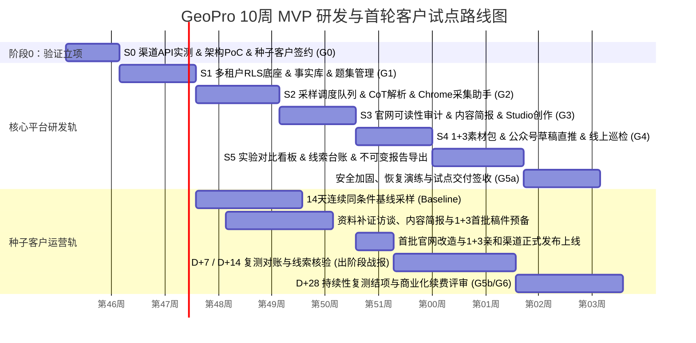

# GeoPro（智脉 GEO）资源投入与里程碑排期计划

> **文档版本**：v2.0（消除排期倒挂修订版）  
> **更新日期**：2026-11-16  
> **核心修正说明**：原文档集在 8 周（2 名开发共 80 人日）内叠加了多租户底座、双通道监测、官网日志系统与 14 平台分发模板（实际超 110 人日），存在严重延期风险。本计划科学裁剪首版边界（聚焦 `1+3` 核心渠道与纵向闭环），确立 **10 周稳健 MVP 研发与种子试点计划**（含 20% 联调与缓冲余量）。  
> **关联文档**：[01-立项总览](./01-项目立项与方案审查总览.md) ｜ [02-PRD](./02-产品需求文档-PRD.md) ｜ [04-开发Spec](./04-技术架构与开发规格说明书-Spec.md)

---

## 一、 10 周里程碑总览与阶段门禁（G0 ~ G6）

> **时间线铁律**：软件功能研发工期（Engineering Timeline）与客户内容生效自然观察窗口（Observation Window: 14 天基线 + D+7/14/28）双线并行但严格遵守先后门禁——**未冻结 14 天基线前，严禁上线实验目标页优化改动**。

### 阶段交付成果与硬性退出门禁（Quality Gates）

| 阶段 | 周期节点 | 核心研发与运营交付物 | 退出门禁（未达标禁止强行闯关） |
| :--- | :---: | :--- | :--- |
| **S0 立项与验证** | **W1** （第 1 周） | 火山方舟/百炼联网 API 真实响应与成本探针；Next.js + Worker + PG 最小贯通 PoC；敲定 1 个垂直行业 3 家种子客户 CSP 意向 | **G0**：至少 1 条官方联网 API 完整拿到回答+原生引用+计费字段；明确 C 端网页 DOM/CoT 结构可提取 |
| **S1 底座与建档** | **W2 ~ W3上** （1.5 周） | Monorepo 工程脚手架、Better Auth 组织与代理商权限、PG RLS 隔离、品牌事实库审批、40+10 题集冻结、单次采样落盘 OSS | **G1**：双租户越权测试 100% 阻断；首个品牌题集冻结并**正式启动 14 天连续基线采样** |
| **S2 双轨监测与质量** | **W3下 ~ W4** （1.5 周） | `pg-boss` + Outbox 可靠调度、预算预留账本、**Chrome 浏览器 C 端采集助手首版**、实体/引用/CoT 思考链解析、200 条黄金标注集校准 | **G2**：连续 72 小时无故障运行；有效覆盖率 $V/P \ge 95\%$；实体精确率 $\ge 95\%$、引用提取率 $\ge 98\%$ |
| **S3 诊断与 Studio** | **W5 ~ W6上** （1.5 周） | 引用网页安全抓取（防 SSRF）、官网 SSR/耗时/SEO 审计器、补证工单、内容简报（Brief）、绑定 `fact_id` 生成与六维 AI 友好 Linter | **G3**：14 天基线完整结束并生成不可变快照；每家种子客户产出至少 3-5 项有明确证据支撑的改造简报 |
| **S4 审批与 1+3 分发** | **W6下 ~ W7** （1.5 周） | 逐版本 Hash 审批锁、官网改造包、`1+3`（公众号/知乎/百家号·头条）适配导出包、微信公众号草稿 API 连接器（可选降级 M）、URL 巡检器 | **G4**：每家试点品牌至少 **3 项内容/页面真实公开上线且通过核验**，记录精确 `effective_at` 时间戳 |
| **S5 复测与交付验收** | **W8 ~ W10** （3 周） | D+7/D+14 同口径前后对比看板、有效线索轻量台账、不可变报告 PDF/HTML 导出、单客户成本毛利对账单、备份恢复演练 | **G5a（第 10 周末交付签收）**：3 家客户签收执行成果与 D+14 阶段报告，安全/恢复演练达标 **G5b（自然日满 D+28）**：完成持续性效果结论复盘 |
| **S6 商业化扩展** | **W11+** | 正式三级 SaaS/Agency 报价单、CMS 连接器（WordPress）、短视频平台 API 连接器、5→20→100 品牌容量压测 | **G6**：种子客户产生真实付费/续费且单品牌直接毛利率 $\ge 60\%$，方可启动规模化扩容研发 |

---

## 二、 研发工作包（Epics）与工时估算明细

按纯有效工程人日估算，并显式计入 **20% 外部接口联调与缺陷修复缓冲**：

| Epic 编号与模块 | 核心开发内容拆解 | 预估前端/全栈 | 预估后端/Worker/AI | 合计人日 | 优先级 |
| :--- | :--- | :---: | :---: | :---: | :---: |
| **E01 工程底座与多租户安全** | pnpm workspace、Next.js 16、Drizzle 迁移、Better Auth、Agency `project_grant`、PG RLS、私有 OSS 代理 | 4 d | 6 d | **10 人日** | P0 |
| **E02 品牌底座、CSP 与事实库** | CSP 目标配置、品牌消歧词典、自有域名/账号登记、事实版本审批与过期联动检查、40+10 题集版本化 | 5 d | 4 d | **9 人日** | P0 |
| **E03 双轨采集与调度计费引擎** | 方舟/百炼 `EngineAdapter`、Outbox + `pg-boss` 调度器、原子预算预留、**Chrome 采集助手插件（MV3）** | 5 d | 9 d | **14 人日** | P0 |
| **E04 CoT 思考链解析与指标引擎** | 实体提及/推荐判定、CoT 淘汰归因抽取、原生引用解析、`metrics-v2` 等权聚合、人工纠错多版本重算 | 4 d | 7 d | **11 人日** | P0 |
| **E05 官网审计与信源抓取器** | 防 SSRF 限速抓取器、HTML vs Playwright 渲染对比（检测 JS 空壳与大陆响应耗时）、SEO 规则引擎 | 3 d | 6 d | **9 人日** | P0 |
| **E06 AI 友好 Studio 与版本审批** | 内容简报（Brief）、`fact_id` 绑定生成、六维 AI 友好度 Linter、版本 Diff 乐观锁审批 | 6 d | 5 d | **11 人日** | P0 |
| **E07 1+3 分发包、公众号草稿与巡检** | 官网修改包、公众号内联样式渲染 + 草稿 API、知乎/百家号/头条导出包、回填 URL 自动可见性核验 | 5 d | 6 d | **11 人日** | P0 |
| **E08 实验复测、线索台账与报告** | 14天基线快照、D+7/14/28 共同题对比、有效线索录入/导入台账、复盘工单转化、不可变报告导出 | 5 d | 5 d | **10 人日** | P0 |
| **E09 测试、可观测性与部署演练** | Vitest 指标/RLS 集成测试、Playwright 核心链路 E2E、Docker 容器化部署、PG+OSS 联合恢复演练 | 3 d | 5 d | **8 人日** | P0 |
| **小计（纯开发工作量）** | — | **40 人日** | **53 人日** | **93 人日** | — |
| **20% 联调与风险缓冲** | 处理大模型接口变更、平台风控样式调整、试点客户定制反馈 | 8 d | 11 d | **19 人日** | 必留 |
| **10 周 MVP 研发总容量需求** | — | **48 人日** | **64 人日** | **112 人日** | — |

> **排期匹配度验证**：配置 **2.5 名研发人员**（1 名资深后端/AI 架构 + 1 名资深 Next.js 全栈 + 0.5 名全栈/插件支持）× 10 周（50 个工作日）= **125 可用研发人日 > 112 需求人日**，排期扎实可控、不透支加班、不烂尾！

---

## 三、 团队资源配置方案（标准版 vs 精简创业版）

团队可根据当前资金预算与人员到位情况，在以下两套编制中选择其一启动：

### 方案 A：标准稳健编制（推荐，共 4.5 FTE，10 周高质量交付 3-5 家试点客户）

| 岗位角色 | 投入比例 | 核心职责分工 | 关键能力画像要求 |
| :--- | :---: | :--- | :--- |
| **产品与交付负责人（PM）** | **1.0 FTE** | 负责产品需求把控、种子客户业务访谈、冻结 CSP、把控 G0-G6 门禁、主持客户周会与结案汇报 | 懂 B2B 获客逻辑、熟悉 SEO/内容营销，具备极强的客户预期管理能力 |
| **技术负责人 / 后端与 AI 工程师** | **1.0 FTE** | 负责架构落地、PG RLS 与数据库迁移、`pg-boss` 调度、大模型联网 Adapter、CoT 解析 Prompt 工程与防 SSRF 抓取 | 精通 TypeScript/Node.js、PostgreSQL 事务与锁、国产大模型 API 实战经验 |
| **资深全栈开发工程师（Next.js）** | **1.0 FTE** | 负责 6 大工作台前端页面、RSC/Server Actions、Studio 编辑器与 Diff 审批、报表图表交互 | 精通 Next.js App Router、Tailwind/shadcn、复杂表单与数据表格状态管理 |
| **全栈 / 浏览器插件工程师** | **0.5 FTE** | 负责 `GeoPro Capture Extension`（Chrome MV3 插件）开发维护、微信公众号草稿连接器与 E2E 自动化测试 | 熟悉 Chrome Extension DOM 解析开发、TypeScript 全栈基础（可由前两人分担则延长 2 周，或兼职投入） |
| **GEO 内容策略与数据分析运营** | **1.0 FTE** | 负责 40 题挖掘、200 条黄金标注集构建、使用插件执行每周 C 端核验、撰写内容简报与 `1+3` 深度标杆稿件 | 具备极强的 B2B 技术/商业深度长文写作能力（拒绝水文写手），懂数据分析 |

### 方案 B：精简冷启动编制（最低可行配置，共 2.5 ~ 3.0 FTE，范围自动收敛）
- **人员构成**：`1 名产品兼内容运营负责人` + `1.5 ~ 2 名全栈开发`。
- **必须同步执行的范围裁剪（Scope Cut）**：
  1. 首期仅服务 **1~2 家种子客户**，自动 API 通道只接 **1 个最稳通道**（如火山方舟或阿里百炼）；
  2. 暂缓微信公众号草稿 API 连接器（全走 M 级一键复制素材包 + URL 回填）；
  3. 暂缓官网脱敏日志导入模块，仅保留公开 URL 技术可读性审计；
  4. 研发周期控制在 **10~12 周**，优先保证证据真实性与核心交付闭环。

---

## 四、 10 周 MVP 阶段直接预算投入汇总（不含团队固定薪资）

以 **首期 10 周（约 2.5 个月）、支撑 5 个种子客户品牌 + 内部测试品牌（共 6 个活跃品牌槽位）** 测算云资源与外部接口直接现金支出：

| 费用大类 | 细项配置说明 | 月度预估成本 | 10 周（2.5 个月）预算 | 备注 |
| :--- | :--- | :---: | :---: | :--- |
| **云主机与容器计算** | 阿里云 ECS 2 台（Web 4C8G + Worker/Playwright 4C16G，中国大陆同可用区）+ 负载均衡/带宽 | ¥950 /月 | **¥2,375** | 试点期足够支撑 20+ 品牌并发调度 |
| **托管数据库与备份** | 阿里云 RDS PostgreSQL 17 基础高可用版（2C4G ~ 4C8G，100GB ESSD，自动备份） | ¥650 /月 | **¥1,625** | 生产级备份恢复保障，满足 RPO/RTO |
| **私有对象存储与网络** | 阿里云私有 OSS（原始 JSON 响应、网页快照、C 端存证截图，约 50GB）+ 邮件推送服务 | ¥120 /月 | **¥300** | 文本 JSON 极轻，截图开启 WebP 压缩 |
| **大模型联网采样与生成费** | 6 个品牌 × 约 ¥750/月（含火山方舟联网 API、阿里百炼联网 API、CoT 解析及草稿生成 Token 消耗 + PoC 测试余量） | ¥4,500 /月 | **¥11,250** | 绑定预算硬顶熔断，绝不超支失控 |
| **域名、备案与合规杂项** | 企业域名、SSL 证书、ICP 备案服务及测试企业认证账号年费 | — | **¥1,000** | 一次性基础投入 |
| **外部直接技术总投入合计** | — | **约 ¥6,220 /月** | **约 ¥16,550** | **仅需签约 2 家付费试点客户（¥9,800/月）即可在首季完全收回全部外部基础设施与 API 现金成本！** |

---

## 五、 核心项目风险与应对预案（Risk Matrix）

| 风险等级 | 风险场景描述 | 触发信号 | 预设应对与降级方案 |
| :---: | :--- | :--- | :--- |
| **高** | **甲方客户资料拖延或官网迟迟无法上线修改** | S1 建档超 5 天拿不到产品参数，或 S4 官网 IT 排期超过 2 周 | 1. 立项筛选必须确认甲方有专职对接人； 2. 官网阻塞时，立即启用 **微信公众号 + 知乎机构号 + 百家号** 外部权威账号先行发布承载事实，不卡死整个实验周期 |
| **高** | **客户期望“7 天内包上 DeepSeek/豆包榜首”** | 销售签约阶段口头过度承诺 | 强制执行 CSP 合同条款：明确 GEO 是基于真实优势的内容工程，区分 `G5a 执行交付验收` 与 `G5b 自然观察窗口`，销售严禁承诺特定排名名次 |
| **中** | **C 端网页改版导致 Chrome 采集助手选择器失效** | 某平台前端 DOM class 更新，插件提取引用为空 | 插件解析器采用多层语义特征回退 + 远程配置热更新 JSON 选择器规则；极端情况下支持插件内“划词选区存证”保底，1 小时内热修复 |
| **中** | **国产大模型调整联网触发阈值或计费单价** | 条件合格覆盖率 $E/P$ 突降或单样本费用翻倍 | `EngineAdapter` 实时监控 `search_state` 与单次 `usage`；异常超阈值自动暂停对应通道并告警，在报告中标记模型环境断点 |
