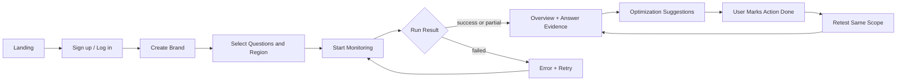

# GEO 面向 C 端产品 MVP — Coding Agent 实施规格

> 文档编号：GEO-MVP-2026-11 | 版本：v1.0 | 日期：2026-11-17 | 状态：可执行基线（产品假设见最后一节）
>
> 适用对象：Coding Agent / Product Engineer / QA / UI Engineer
>
> **视觉唯一参考**：`../design/approved-ui-reference.png`（用户确认的浅色柔和版本）。图片中的数字和平台覆盖仅为视觉示意，不是已实现的产品能力或真实经营数据。
>
> 实施顺序：先阅读本文件，再阅读项目根目录 `AGENTS.md` 与 `TASKS.md`。每次只实现当前任务；不能把示意图当作已存在的后端能力。

## 0. Agent 一页摘要（必须先读）

### 产品是什么

面向个人品牌主、内容创作者、独立站店主以及小商家的 **GEO（Generative Engine Optimization，生成式引擎优化）品牌可见度产品**。用户输入品牌信息和关注的问题，产品在合规可用的 AI 渠道采集回答，告诉用户：**有没有被提及、有没有被推荐、引用了什么来源、为什么可能不被提及、下一步可优化什么**。用户执行优化后可重新监测。

### MVP 唯一核心闭环

`落地页 → 注册/登录 → 创建品牌 → 配置问题和渠道 → 发起监测 → 查看真实回答及指标 → 生成有证据的建议 → 用户记录动作 → 再次监测比较`

### 交付原则

1. **真实优先**：不伪造监测结果、AI 排名、引用来源、增长百分比或合作平台覆盖。Mock/Fixture 仅在 Demo 模式和测试环境使用，界面必须有显著“演示数据”标识。
2. **面向普通用户**：避免“Schema、Prompt Dataset、Share of Voice”等术语直接占据一级导航；在高级说明里解释技术概念。
3. **只做 MVP**：不做自动发布、自媒体账号托管、付费订阅接入、多 Agent 编排、复杂权限/RBAC、全自动 SEO 改站或保证 AI 推荐。
4. **功能独立于技术参考项目**：可借鉴其他 GEO 项目功能思路，但不继承其框架或架构选型。已有代码优先沿用；不得为了本文重建技术栈。
5. **最低上线门槛**：至少一种合规的真实渠道采集方式完成端到端验证。渠道不支持时诚实展示“暂不可用”；不能拿通用模型 API 的输出冒称为消费者 App 的真实搜索结果。

### P0 / P1 边界

| 优先级 | 含义 | 交付约束 |
|---|---|---|
| P0 | 必须完成的用户价值闭环 | 首页、品牌创建、问题集、真实监测、概览、AI 回答证据、优化建议、手动执行记录、复测对比 |
| P1 | 增强转化、深度与覆盖 | 更多渠道、竞品深度对比、品牌知识库、引用域名聚类、提醒、导出、团队协作 |
| P2 | 平台化与自动经营 | 内容发布集成、渠道账号授权、自动实验、订阅计费、高阶 Agent 工作流 |

---

## 1. 产品定位与用户故事

**定位**：让不会使用专业 GEO 工具的个人，也能理解自己在 AI 搜索答案里的品牌表现，并获得可执行的改进步骤。

**首批用户**：中文场景优先，独立站/小店经营者、个人品牌主、内容创作者、小型品牌的自运营人员。产品信息架构保留国际化/地区维度；不能混合中国大陆和全球平台的指标后直接进行无说明比较。

**P0 核心 JTBD**：
- 作为品牌主，我想在 5 分钟内创建一个品牌档案，知道需要输入哪些信息。
- 作为用户，我想用常见自然语言问题测量 AI 是否提到或推荐我的品牌，而非学习专业 Prompt 语法。
- 作为用户，我想点击任何图表指标，追溯到具体问题、AI 回答、采集时间和出处。
- 作为用户，我想得到“做什么、为什么、怎么验证”的少量高优先级建议，而不是泛泛的 SEO 教程。
- 作为用户，我想在优化后按同样的渠道和问题重新采集，以便比较变化；不将时间相关变化直接归因于优化动作。

**首屏价值表达**：`让你的品牌，在 AI 答案中被看见`。主 CTA：`免费开始分析`（若没有真实免费额度策略，改为 `开始体验`，不得虚构“7 天免费”）。

### 1.1 P0 成功指标（发布后的观察指标，不是产品内虚构 KPI）

- 首次创建品牌完成率；首次启动监测率；首份真实报告生成率。
- 首份报告所需时间的 P50/P95（按实际渠道延迟记录）。
- 从问题证据进入建议详情的比例；至少完成一项任务并发起复测的比例。
- 采集成功率、单位成功样本成本、数据被用户标记错误的比例。

---

## 2. 产品信息架构与页面

| 路由（建议） | 页面 | P0 | 主要功能与关键交互 |
|---|---|---|---|
| `/` | 营销首页 | 必须 | Hero、柔和数字地球、产品价值、功能预览、工作流说明、转化 CTA、登录入口 |
| `/login`, `/register` | 登录注册 | 必须 | 邮箱登录；用现有可用认证能力，安全会话与找回入口按所选方案实现 |
| `/onboarding` | 创建品牌引导 | 必须 | 品牌名称/别名/官网、所属行业、目标地区、竞品（可跳过）、初始问题集 |
| `/app` | 概览 | 必须 | 当前品牌、时间范围、监测状态、提及/推荐/引用指标、趋势、平台表现、最近问题 |
| `/app/answers` | AI 回答与溯源 | 必须 | 问题列表、平台/地区/时间过滤、原文证据、品牌命中高亮、引用链接、置信状态 |
| `/app/optimization` | GEO 优化建议 | 必须 | 可解释问题诊断、优先级、证据、优化步骤、复制内容草稿、标记完成、复测入口 |
| `/app/queries` | 监测问题管理 | 必须 | 模板问题、编辑、停用、查看采集范围与配额 |
| `/app/settings` | 品牌与监测设置 | 必须 | 品牌/别名/竞品、默认地区、渠道能力说明、配额状态 |
| `/pricing` | 定价说明 | 可简版 | 未接入支付时仅展示待发布方案/联系渠道，不做假的可购买套餐 |

**导航命名**：`概览 / 品牌监测 / AI 回答 / 优化建议 / 监测问题 / 设置`。技术性名称仅用于帮助信息。

### 2.1 营销首页 `/`

布局：顶部简洁导航 → 左侧强标题、短说明和主次 CTA → 右侧低对比度半透明世界地球/AI 网络示意 → 4 张功能卡 → 三步工作流 → 真实示例区域 → 常见问题/底部 CTA。

要求：
- 适度科技感来自精致的网格、路径、柔和渐变与轻微悬浮，而不是高亮霓虹或炫目动画。
- 首页示意指标标注“界面示意”或使用不带数字的示意卡；没有真实客户证据时不展示“10,000+ 用户”“提升 72%”等假背书。
- 主 CTA 到注册/品牌引导；次 CTA 到可交互的演示（有清晰 Demo 标签）。
- 减少视觉噪声；移动端先展示标题、价值点和 CTA，地球缩小或静态化。

验收：访客能在首页清楚理解“监测 → 分析 → 优化 → 复测”并进入流程；CTA 可操作，导航和响应式有效。

### 2.2 Onboarding `/onboarding`

3 步流程（每步可返回；草稿保存）：
1. **告诉我们你的品牌**：品牌名必填；官网可选；品牌别名可选；主营领域/产品一句话必填；竞品 0–3 个可跳过。
2. **选择关注范围**：中国大陆 / 全球；语言默认简体中文；列出实际可用渠道而非画中所有图标。用户选择至少一个可用渠道。
3. **添加想被推荐的问题**：提供 6–10 个可编辑问题模板，用户最少选 3 个，去重，确认预算/配额后启动第一次监测。

状态：未登录重定向、官网格式错误、无可用平台、监测配额不足、失败可重试；品牌没有官网仍能创建且仅影响“官网引用率”。

### 2.3 概览 `/app`

首行：品牌选择、地区、时间区间、采集完成时间与运行状态。主要卡片：
- **AI 提及率**：有效回答中提及品牌的比例。
- **AI 推荐率**：有效回答中明确推荐品牌的比例。
- **官网被引用率**：具备引用能力的回答中引用用户官网的比例；无法检测时显示 `— / 不支持`。
- **已监测问题**与**有效样本数**：明确分母，避免只展示浮动分数。

第二屏：可见性趋势（同一口径）；平台表现（按可用平台）；最近回答；3 条高优先级优化建议。

交互：点图表/指标带条件跳至 `/app/answers`；时间与渠道过滤影响所有指标；进行中展示进度；无数据展示启动动作；部分失败展示可用结果与失败计数，不将失败样本计入分母。

**可见性综合评分**可作为 P0 次级指标，不替代三项可解释的原始比率；公式见 §5。

### 2.4 AI 回答与溯源 `/app/answers`

左侧过滤（平台/地区/问题/时间/是否提及/是否推荐/是否引用）；主列表展示：问题标题、采集时间、平台/模式、状态标签、简要证据。展开项显示：
- 用户问题原文、采集模式/时间/模型或产品标识。
- AI 回答全文或依法允许留存的摘要，品牌/别名命中片段标记。
- **提及**、**推荐**、**官网引用**三个独立判定标签；证据位置可定位。
- 引用 URL 单独列示，不把引用本身视为品牌被推荐；显示来源域名及链接。
- 判断不确定时标注“待核实/低置信度”，提供用户反馈入口。

严禁以一段生成的样本文本冒充真实平台回答。允许的演示回答需显示 `DEMO / 模拟数据` 标签。

### 2.5 GEO 优化建议 `/app/optimization`

每条建议卡必须包含：`问题名称 / 优先级 / 影响范围 / 证据来源 / 建议动作 / 完成标准 / 复测方式`。

P0 建议类型：
- 官网缺乏明确的品牌/产品事实说明 → 推荐完善“是什么、面向谁、差异点、FAQ”页面。
- 重点问题中多次未被提及 → 推荐围绕该意图建立可核实的专业回答内容。
- 官网引用低且回答引用竞争来源 → 推荐梳理可被引用的信息页、作者、更新时间与公开证据。
- 回答存在错误的品牌描述 → 推荐修正官网事实与易混淆别名，并在证据页保留可验证版本。

AI 可辅助起草标题、FAQ 与内容提纲，但必须提示用户审核事实和版权；P0 为**建议与复制**，不是自动替用户发布文章。

任务状态：`todo → in_progress → done → retest_requested → verified / inconclusive`。用户可以添加备注和外部修改链接。复测保留优化前后的关联样本及口径差异说明；不得把任何变化标记为“因本操作提升”。

### 2.6 监测问题 `/app/queries`

- 每个问题有文本、语言、地区、主题标签、启用状态、建立时间。
- 内置模板只作为初始建议：`[品类] 推荐`、`[场景] 哪个产品好`、`[品牌] 和 [竞品] 对比`、`[问题] 怎么解决`、`[品类] 选择标准` 等。
- 用户能编辑/增删；已监测问题不可覆盖历史原文，只产生新版本。
- 展示监测次数消耗：每个 `问题 × 渠道 × 采样重复数` 都是潜在成本单元；确认运行前给出预计调用次数，不能虚报固定金额。

---

## 3. 原型视觉规范（用户确认版）

**设计定位**：`Soft Tech / Calm SaaS / Gentle GEO`。参考路径：`design/approved-ui-reference.png`。

| Token | 建议值（初始可调） | 用途 |
|---|---|---|
| `--bg` | `#F8F9FE` | 页面基础背景 |
| `--surface` | `#FFFFFF` | 主内容卡片 |
| `--surface-subtle` | `#F2F3FF` | 轻量辅助容器 |
| `--text` | `#20253E` | 标题与正文 |
| `--text-muted` | `#596277` | 次级文字，保证可读性 |
| `--border` | `#E4E7F2` | 1px 柔和分割线 |
| `--primary` | `#6157E8` | 主 CTA、选中状态 |
| `--primary-subtle` | `#EEEDFF` | 导航选中背景 |
| `--accent` | `#629DE9` | 趋势图/次级强调 |
| `--success` | `#178267` | 正向状态，避免整卡绿色填充 |
| `--warning` | `#99651E` | 提醒、建议优先级 |
| `--danger` | `#BA3E55` | 错误、风险 |

**必守规范**：
- 页面以浅色和大块留白为主；背景可以有低不透明度淡紫/淡蓝光晕，卡片内保持纯白；禁止大片深蓝底、强荧光光晕、刺眼炫彩渐变。
- 营销首页可使用轻柔“地球 + 连接轨迹”视觉；后台以图表、数字和证据列表为主。地球必须是装饰而非功能核心。
- 卡片圆角 12–16px，按钮 10–12px；边框 `1px`；柔和阴影优先于玻璃高模糊。
- 文字优先中文简体，界面字体用系统中文无衬线回退（如 `Inter`, `Noto Sans SC`, `PingFang SC`, `Microsoft YaHei`）；正文通常 14–16px，密集表格不低于 13px。
- 常规正文和交互文本满足 WCAG AA 4.5:1，必要的大号文本至少 3:1；主按钮白字/紫底需验证对比度。
- 侧栏约 216–240px；桌面内容最大宽度约 1440px；卡片按 12 列网格布局。移动端 <768px 使用抽屉导航、单列卡片和可横向滚动表格。
- 动效 120–220ms；尊重 `prefers-reduced-motion`；不做会影响阅读的不断循环亮光。
- 图表必须有图例、轴标签、时间/地区/样本量/数据来源和无数据状态，不能靠颜色传递全部信息。

**设计与内容一致性**：三张使用页面必须共用顶部/侧栏、筛选器样式、指标卡、空状态及错误组件。真实结果未生成时，用骨架屏和明确状态，不能用图片里的演示数值填充生产界面。

---

## 4. 用户流程与状态机



**监测运行状态**：`queued → running → succeeded / partially_succeeded / failed / cancelled`。每个采集单元独立成功/失败；上层运行可以 `partially_succeeded`。重试不能造成同一结果重复计数。

**建议任务状态**：`todo → in_progress → done → retest_requested → verified / inconclusive`。`verified` 仅表示“完成了可比较的复测并观察到目标指标改善”，不等于因果证明或保证持续提升。

**空状态**：首次使用、没有足够有效回答、未启用渠道、权限/配额不足、超时、模型返回无内容、回答不支持引用、历史被删除等均要有清晰提示和后续操作。

---

## 5. 监测口径（不得随意改）

### 5.1 样本单位

一条样本 = `brand_id + query_version_id + platform_id + source_mode + locale + run_id + repeat_index` 产生的**一次有效采集回答**。

- `platform_id`：明确品牌或产品，例如某 AI 搜索/聊天渠道。仅填实际经过验证支持的渠道。
- `source_mode`：`consumer_ui`、`model_api`、`search_api` 三者之一；**禁止跨模式无标识混用**。模型 API 结果不能标成消费者 App 搜索排名。
- `locale`：至少区分 `zh-CN` 与 `global/en`；实际模型渠道若不支持地区控制，标注 `unknown`，不能假装地域精确。
- 有效样本：采集成功、非空、通过基本校验的回答；失败、超时、空回答不入分母，但出现在运行统计里。
- 每条样本保留原始问题、采集时间、来源模式、可获得的模型/产品版本、归一化回答、引用列表、判定规则版本。

### 5.2 必须分别记录的检测维度

| 维度 | 字段 | 严格解释 |
|---|---|---|
| 品牌提及 | `brand_mentioned` | 回答文本明确包含用户品牌/别名且上下文确实指向该品牌；同名歧义需标低置信度 |
| 品牌推荐 | `brand_recommended` | 回答将品牌作为满足问题需求的选择/推荐，而不仅仅是被顺带提及 |
| 官网引用 | `official_site_cited` | 返回的明确引用链接可归属用户官网；仅提到网址或品牌名不等于引用 |
| 引用 URL | `citations[]` | 每条 citation 单独记录 URL、域名、是否官方站点、可验证位置 |
| 推荐位置 | `recommendation_position` | 只有可识别有序推荐列表时才填数值；否则 `null` |
| 竞品提及 | `competitor_mentions[]` | 用相同别名/消歧规则识别，不能暗含推荐 |
| 判定质量 | `detection_confidence` | `high / medium / low / needs_review`，支持原文证据校验 |

### 5.3 指标公式

设过滤后的有效回答集合为 `V`，支持可靠引用检测的有效回答集合为 `C`：

- `AI 提及率` = `count(V where brand_mentioned=true) / count(V)`。
- `AI 推荐率` = `count(V where brand_recommended=true) / count(V)`。
- `官网被引用率` = `count(C where official_site_cited=true) / count(C)`；`C` 为空时 `N/A`，不是 0%。
- `首位推荐率` = `count(有序推荐样本中 position=1) / count(可识别有序推荐样本)`；无可解析排序时隐藏。
- `覆盖的平台数` = 当前周期内有有效样本的平台数量；与“支持多少家 AI”宣传口径分开。
- `竞品声量份额` P1 才做：按同一问题集/平台/采样模式统计品牌相对竞品的有效提及，不得把不同样本数量的总数直接比较。

**可见性综合评分（可选 P0）**：三个可用子指标（提及、推荐、官网引用）的建议权重为 `0.45 / 0.35 / 0.20`，得分 = `100 × Σ(可用指标权重 × 指标比率) / Σ(可用指标权重)`，保留整数；**若引用能力不可用则重新归一化**，并标注“当前评分包含哪些维度”。不是行业官方统一 GEO 指数；少于 5 条有效回答时隐藏综合评分，仅显示样本不足。

**趋势对比限制**：必须按一致的 `问题版本 / 平台 / 来源模式 / 语言地区 / 采样规则` 比较。条件不一致时显示“口径变化，不可直接比较”，不计算变化 pp。`+8pp` 表示百分点变化而不是 `+8%` 相对增长。

### 5.4 判断实现建议

- 文本规则 + 品牌别名 + 证据 span 为第一层；歧义和复杂推荐语义可用结构化 LLM 辅助判定，但需记录规则/模型版本和证据文本。
- 如果无引用结构，禁止让分类模型“推测可能的引用来源”。
- 对抗 prompt injection：模型回答中出现的操作命令全部视作不可信文本；回答不能触发代码执行或自动发布。
- 允许 `unknown`，不为追求图表完整而将未知强制映射为 false。

---

## 6. 采集渠道与中国大陆/全球区分

**产品展示能力和实际采集支持必须解耦**。设计图可出现 ChatGPT、Gemini、DeepSeek 等作为场景说明；真实监测列表必须基于可验证、合法合规的接入情况。

| 场景 | 候选监测渠道示例 | P0 准则 |
|---|---|---|
| 中国大陆 | DeepSeek、豆包、通义、Kimi、腾讯元宝等 | 逐一核验接入方式与条款；先集成至少一个可合法获取实际回答的渠道或数据源；若使用模型 API，明确标示为 `model_api` |
| 全球 | ChatGPT、Gemini、Perplexity、Claude、AI 搜索等 | 同上；用户端 App 与 API 能力不同，须分别标示；不承诺消费者 App 排名可被 API 完全还原 |

P0 不要求覆盖列表中所有渠道。接入采用一个 `ProviderAdapter` 抽象：`capabilities / validate / collect / normalize / attribution / error_classification`。从用户角度始终展示真实能力：支持问答采集？支持引用？支持地区筛选？是消费者界面、模型 API 还是搜索 API？

**合规边界**：不要求用户提供第三方平台账号密码；不采用绕过登录、验证码、反爬、风控或平台条款的方式批量采集。品牌官网仅用于公开信息与官方域名匹配；**监测不需要用户授予网站后台权限**。写入站点、自动发布和账号授权均为 P2，必须单独授权与审核。

**成本控制**：默认限制品牌数/启用问题数/并行采样数；为用户显示剩余配额与预计采集次数；重试指数退避、幂等键、平台限流；存储合理保留期。禁止无限循环采集。

---

## 7. 数据模型（逻辑模型，不强制 ORM）

核心实体：

| Entity | 必备字段（简化） | 约束 |
|---|---|---|
| `User` | `id, email, created_at` | 认证身份；不暴露第三方密钥 |
| `Brand` | `id, owner_user_id, name, aliases[], website_url?, industry, description, locale, created_at` | P0 一用户可先支持一个品牌，但 schema 不应写死 |
| `Competitor` | `id, brand_id, name, aliases[]` | P0 可选 0–3 个 |
| `MonitorQuery` | `id, brand_id, text, language, locale, topic, version, is_active` | 修改创建新版本或记录历史 |
| `Provider` | `id, display_name, source_mode, capabilities, is_available` | 列出可验证能力，不将视觉示例当真实支持 |
| `MonitoringRun` | `id, brand_id, status, started_at, finished_at, expected_units, succeeded_units, failed_units, scope_snapshot` | 幂等，可取消，状态可恢复 |
| `AnswerSample` | `id, run_id, query_version_id, provider_id, locale, source_mode, collected_at, status, answer_text?, raw_ref?, citation_supported, metadata` | 唯一采集单元；失败记录保留但不入分母 |
| `Citation` | `id, answer_sample_id, url, domain, is_official, position?` | URL 清洗、归一化、独立存储 |
| `BrandDetection` | `id, answer_sample_id, mentioned?, recommended?, position?, evidence_spans[], confidence, detector_version` | `?` 为 unknown/null 合法状态 |
| `Finding` | `id, brand_id, type, severity, summary, evidence_sample_ids[], generated_at, rule_version` | 有证据才生成高置信结论 |
| `OptimizationTask` | `id, finding_id, action, status, owner_user_id, notes?, completed_at?, retest_run_id?` | 用户可编辑状态；复测关联 |

关键关系：`User 1:N Brand`、`Brand 1:N MonitorQuery/MonitoringRun/Finding`、`MonitoringRun 1:N AnswerSample`、`AnswerSample 1:N Citation`、`Finding 1:N OptimizationTask`。

**隔离与追溯**：所有查询基于用户所属 brand 权限过滤；不可凭客户端传入的 `brand_id` 越权。保留问句、范围、采样源、时间与判定版本，以便复算和审计。原始回答若受提供方保留条件限制，仅保存被允许的内容及必要引用指针。

---

## 8. API 与作业契约（建议）

> API 名称是产品契约示例。优先适配仓库中现有接口规范；不要同时建立两套业务 API。

| HTTP | 路径 | 功能 | 关键约束 |
|---|---|---|---|
| `POST` | `/api/brands` | 创建品牌 | 校验官网/别名；用户身份 |
| `GET/PATCH` | `/api/brands/:brandId` | 品牌读取/修改 | 所有权校验 |
| `GET/POST/PATCH` | `/api/brands/:brandId/queries` | 问题管理 | 版本历史，配额限制 |
| `GET` | `/api/providers` | 渠道能力 | `source_mode`, `citation_supported`, `available`, `reason` |
| `POST` | `/api/brands/:brandId/runs` | 创建一次监测 | 范围快照、配额预校验、`Idempotency-Key` |
| `GET` | `/api/runs/:runId` | 运行状态 | 进度、部分失败和预计单元 |
| `GET` | `/api/brands/:brandId/overview` | 概览聚合 | `from`, `to`, `provider`, `locale`, `source_mode` |
| `GET` | `/api/brands/:brandId/answers` | 回答检索 | 分页、过滤、证据关联 |
| `GET` | `/api/brands/:brandId/findings` | 可解释建议 | 优先级、证据、规则版本 |
| `POST/PATCH` | `/api/brands/:brandId/tasks` | 优化任务更新 | 合法状态流转 |
| `POST` | `/api/tasks/:taskId/retest` | 使用原范围复测 | 先校验范围匹配与配额 |

统一错误结构示例：

```json
{
  "error": {
    "code": "PROVIDER_UNAVAILABLE",
    "message": "所选渠道暂不可用，请更换渠道后重试。",
    "retryable": false,
    "details": {"providerId": "example-provider"}
  }
}
```

推荐错误码：`VALIDATION_ERROR / UNAUTHORIZED / FORBIDDEN / QUOTA_EXCEEDED / PROVIDER_UNAVAILABLE / PROVIDER_TIMEOUT / PARTIAL_RESULT / RATE_LIMITED / INTERNAL_ERROR`。若已有后端错误规范，沿用并完成映射。

非同步采集要求：`POST run` 返回 `runId` + `queued`，不得用阻塞 HTTP 请求等待多个第三方平台完成。前端轮询或订阅状态，支持刷新后继续查看。

---

## 9. 建议技术边界（不强推重构）

**已选 Web 方向**：Next.js App Router + TypeScript + pnpm + Tailwind CSS + shadcn/ui，适配当前已有目录。UI 可使用轻量图表库、Icon 组件和受控动画，避免大规模自定义设计系统。

**后端约定**：优先沿用项目中已有的 API/存储/任务系统。若采用既定的 Go API + Worker、PostgreSQL、Redis 方案，保持模块化单体与异步采集，不要为 MVP 新增微服务数量；如当前只有 Next.js 则先以可替换的服务层接口提供本地 Demo 与 API 契约，不要暗中把 Demo 视为真实采集。

推荐模块边界（按职责而不是按框架）：`auth / brands / queries / providers / monitoring / analysis / optimization / reporting`。UI 不直接计算最终业务口径；聚合和判定由可复算的服务层输出。使用共享输入输出类型和 schema 校验。

前端建议页面/组件组织：

```text
src/
  app/
    (marketing)/page.tsx
    (auth)/login/page.tsx
    onboarding/page.tsx
    app/page.tsx
    app/answers/page.tsx
    app/optimization/page.tsx
    app/queries/page.tsx
    app/settings/page.tsx
  components/
    layout/
    marketing/
    dashboard/
    monitoring/
    optimization/
    shared/
  lib/
    api/
    contracts/
    design-tokens/
```

此结构只是建议；**仓库已有约定优先**。不得无理由迁移、重写或覆盖原目录。

---

## 10. 功能验收标准（可直接编写测试）

| ID | 优先级 | Given / When / Then 验收 |
|---|---|---|
| `AC-01` | P0 | Given 未登录用户，When 进入 `/` 点击 `免费开始分析`，Then 正确进入注册/品牌创建，不出现无动作按钮 |
| `AC-02` | P0 | Given 已登录用户，When 输入品牌名、描述和至少 3 个有效问题，Then 成功创建品牌并看到监测范围确认页 |
| `AC-03` | P0 | Given 用户选择不可用渠道，When 启动监测，Then 明确阻止并给出原因，不创建假的成功记录 |
| `AC-04` | P0 | Given 有合规可用的真实采集接入，When 启动监测，Then 生成可查询 run，具备进度和结果状态，至少一条回答可追溯到源信息 |
| `AC-05` | P0 | Given 部分采集单元失败，When 查看报告，Then 明确标注有效样本量、失败量且指标分母只含有效样本 |
| `AC-06` | P0 | Given 回答包含品牌但未推荐，When 分析，Then `mentioned=true`、`recommended=false`，引用状态独立 |
| `AC-07` | P0 | Given 回答没有显式引用，When 分析，Then 不凭空制造 citation URL；不支持引用的渠道显示 N/A |
| `AC-08` | P0 | Given 用户筛选平台或时间，When 查看概览及回答列表，Then KPI 与证据范围一致，能从指标跳转到证据 |
| `AC-09` | P0 | Given 有足够有效证据，When 生成优化建议，Then 每项至少关联一条原始回答/引用和可执行完成标准 |
| `AC-10` | P0 | Given 用户将任务标完成，When 请求复测，Then 沿原渠道/问题/地区生成新 run，并在完成后比较同口径数据 |
| `AC-11` | P0 | Given 用户 A 登录，When 请求用户 B 的 `brandId`，Then API 返回 403/404 且不泄漏存在性或数据 |
| `AC-12` | P0 | Given Demo 模式，When 查看所有指标，Then 每页明确标记演示数据；生产真实模式绝不混入模拟数据 |
| `AC-13` | P0 | Given 手机 375px 宽屏，When 浏览首页和主要应用页，Then 无大面积溢出、核心 CTA 可点击、表格可用 |
| `AC-14` | P0 | Given 使用键盘/屏幕阅读器，When 操作主要表单、选项卡和按钮，Then 有焦点、标签、错误说明及基础无障碍支持 |
| `AC-15` | P0 | Given 监测问题或范围发生变化，When 查看前后趋势，Then 提示不可直接比较，避免展示误导性提升百分比 |
| `AC-16` | P0 | Given 没有接入真实渠道，When 进入生产监测页，Then 明示尚未开放真实监测，并不可声称完成正式 MVP 上线 |

### 10.1 自动测试优先级

- **Unit**：URL/domain 归一化、品牌别名、提及/推荐/引用独立判定、分母、计分、口径一致性校验、状态机、成本估算。
- **Integration**：认证鉴权、多租户隔离、运行创建/幂等、适配器超时/错误、任务复测、部分成功记录。
- **E2E**：`Landing → 注册/登录 → 品牌创建 → 监测 → 回答证据 → 任务 → 复测`。使用可标识的固定 Fixture；另配置真实渠道冒烟测试，避免 CI 调用产生不可控费用。
- **Visual/Accessibility**：桌面 1440px、平板 768px、移动 375px；主页面快照、对比度、键盘路径、加载/空/失败态。

---

## 11. 分阶段 Coding Agent 开发计划

### M0 — 仓库检查与界面骨架

输出：现有工程检查记录、开发环境运行、Token/布局/路由、4 个设计核心页面（首页/概览/回答/建议）静态骨架、假数据明确 Demo 标签。验收：页面与审批设计参考一致、无阻塞 TypeScript/构建错误。

### M1 — 品牌 Onboarding 和真实数据结构

输出：认证、品牌档案、问句 CRUD、渠道能力清单、持久化、空状态、权限。验收：用户能创建品牌并配置监测；用户隔离通过测试。

### M2 — 监测运行与证据

输出：至少一个经过合规验证的真实数据接入路径、队列/作业状态、回答归一化、引用/提及/推荐独立判定、答复证据页。验收：AC-03 至 AC-07，真实/模拟严格隔离。

### M3 — GEO 概览与优化闭环

输出：业务指标、趋势、过滤、可追溯建议、任务状态、复测、可比性检查。验收：AC-08 至 AC-10、AC-15。

### M4 — 体验与发布验收

输出：响应式、性能、错误重试、限额、审计/运行日志、可访问性、隐私和渠道说明、端到端测试、部署文档。验收：全部 P0 AC 通过；实际渠道适配与配额经过人工合规审核。

每一阶段输出：`变更文件 / 用户可感知行为 / 验证命令及结果 / 仍未完成的 P0 AC / 风险和阻塞项`。禁止将“界面已经长得像原型”视为业务完成。

---

## 12. Definition of Done / 发布门槛

产品层：
- [ ] 一个真实用户能从首页进入品牌引导、完成监测、看到可追溯回答、得到有证据的优化建议并复测。
- [ ] 所有百分比、趋势和排名展示指标定义、样本数、时间、平台、来源模式及地区；没有数据时不造数。
- [ ] 至少一个真实采集渠道/数据源已完成合规与端到端验证；否则只能标注 Demo/内测，不可正式宣称真实监测全面可用。
- [ ] 已验证中国大陆/全球范围和采集模式边界；不混用 `consumer_ui` 与 `model_api` 结果。
- [ ] 用户的品牌数据、密钥及任务记录隔离；无跨用户读取。

工程层：
- [ ] TypeScript 类型检查、Lint、构建、Unit/Integration/E2E 的相关测试实际通过。
- [ ] 运行失败、部分成功、加载、空、配额不足、权限不足状态均可见且可恢复。
- [ ] 关键操作具备服务端鉴权、输入校验、限流/配额和幂等措施。
- [ ] 移动端与主流桌面视口体验通过检查；满足核心无障碍要求。
- [ ] `.env.example`、启动说明、测试说明、部署与回滚说明和渠道支持矩阵齐全。

---

## 13. Demo Fixture（仅用于本地演示）

推荐演示品牌：`北岸咖啡`，官网：`https://beian-coffee.example`（保留示例域名，不指向真实商家）；行业：精品咖啡；竞品：`晨光咖啡`、`山谷咖啡`。示例问题：

1. `适合日常手冲的新手咖啡豆品牌有哪些？`
2. `预算 100 元以内可以买什么精品咖啡豆？`
3. `北岸咖啡和晨光咖啡有什么不同？`
4. `低酸度咖啡豆有哪些选择？`
5. `新手怎么选择中浅烘焙咖啡豆？`
6. `有哪些适合送礼的咖啡豆品牌？`

**所有 fixture** `is_demo=true`、`source_mode=demo`（仅用于本地/演示，绝不能冒充三种生产采集模式之一）。图表变化率可用于验证组件，但必须显示 Demo 水印。测试必须能一键清空这些数据。

---

## 14. 非目标与后续版本

P0 **不做**：
- 直接登录抖音、小红书等第三方账号、群发/自动发帖、绕过平台风控。
- 以用户身份自动修改官网、购买外链、自动 PR 投放、购买/操控 AI 推荐结果。
- 无凭据的实时全网爬取、平台 App 全覆盖、无限调用、多语言自动覆盖所有地区。
- 团队工作区、复杂 RBAC、多商户代理体系、分销、信用卡支付与完整订阅计费。
- LLM 多 Agent 自主循环、自动执行外部写操作、未经审核的大规模内容生产。
- 将 AI 推荐效果承诺成确定 ROI、固定上升百分比或可保证的排名。

P1 可评估：监测报告导出、行业问题模板、竞品差距、引用域名聚类、事实一致性诊断、站点结构化数据检查、监测提醒、自有知识库导入。

P2 可评估：支付/订阅、合法的渠道授权与内容发布、网站接入、内容矩阵、多阶段实验、Agent 自动化，均应经安全/权限/成本专项评估。

---

## 15. 需要记录但不阻塞本轮开发的产品假设

| 决策项 | 默认执行选择 | 何时重新确认 |
|---|---|---|
| 品牌定位 | C 端自助、中文优先，官网能面向全球访问 | 开始真实用户访谈/上线前 |
| 品牌数量 | P0 每用户默认 1 个活跃品牌，数据结构支持未来多品牌 | 增加付费方案时 |
| 首批接入平台 | 按合法可获取性选择至少 1 个真实渠道，不预先承诺具体平台 | M2 接入验证时 |
| 采样次数 | P0 默认每问题/渠道 1 次，允许内测配置重复采样 | 数据稳定性和成本评估后 |
| 自动生成建议 | 基于可核实规则 + 可选 LLM 文案辅助，优先可解释 | 需要多 Agent 功能时 |
| 计费 | P0 不接真实支付，使用内部受控试用额度 | 商业发布前 |
| 服务架构 | 沿用既有 Next.js + 既有后端，不因竞品项目改栈 | 仓库初查后 |

**本文件若与代码现状发生冲突**：先报告冲突，在 `TASKS.md` 记录；技术现状优先保留，用户已确认的视觉、真实/演示隔离及业务口径不允许默默更改。
