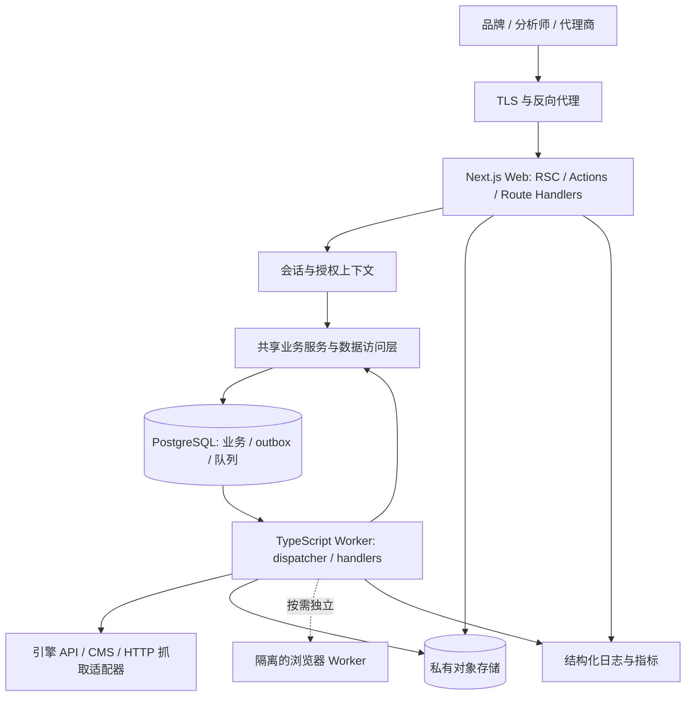
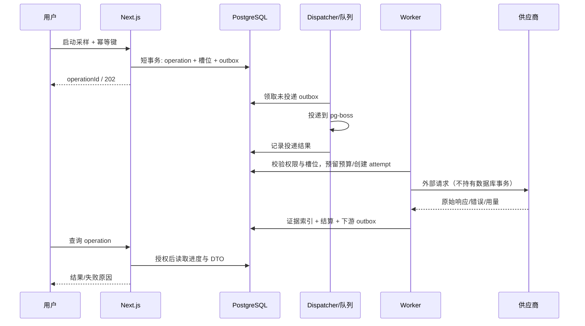

# GEO 平台 Next.js 全栈技术选型与项目架构设计

版本：architecture-v1｜调研日期：2026-11-13｜状态：架构设计，待 PoC 验证。

本次用户已明确选择 Next.js 全栈开发，因此以此为确定约束，替代此前“保留开源底座原框架”的默认建议。本文关联 [产品报告](中国大陆%20GEO%20监测优化经营平台产品设计报告%20初稿.md)、[指标与证据合同](指标与证据合同.md) 和 [实施阶段](README.md)。目前仓库是规划文档，尚无应用代码、依赖锁文件或运行环境；下文的目录、接口、资源配置和验收项均为拟建方案。

## 1. 推荐方案

采用 **Next.js App Router + TypeScript + PostgreSQL + Drizzle + Better Auth + pg-boss + 独立 Node.js Worker**。Next.js 承担页面、会话入口、业务 API 和短事务；Worker 承担监测、抓取、分析、发布与报告任务。两者在同一 pnpm workspace 中共享领域代码和数据合同，部署时是两个进程。

首版选择自托管 Node.js 容器，数据库与对象存储优先使用适合中国大陆业务区域的托管服务。生产候选为 Nginx/负载均衡 + Next.js Web + Worker + 托管 PostgreSQL + 私有 OSS；地域、云账号与采购尚未确定，不在本次创建云资源。

这是按现有业务约束作出的架构判断：GEO 的难点是可恢复的长任务、测量口径、权限和证据。单一语言可以减少类型和业务逻辑重复，进程分离则让 Web 发布与采样执行独立扩缩。Next.js 官方说明部分托管环境会限制长时间 Route Handler；`after()` 也受路由最大运行时长约束，因此不用于承载本项目的可靠任务队列。[BFF 部署边界](https://nextjs.org/docs/app/guides/backend-for-frontend)、[after 文档](https://nextjs.org/docs/app/api-reference/functions/after)。

首版不另建 NestJS/Express/Go API，不引入独立向量库、Elasticsearch、Kafka、Kubernetes 或通用 Agent 编排平台。需要时按后文触发条件引入，而非作为开工前置条件。

## 2. 技术组件清单

P0 表示首轮必须具备该能力；P1 表示出现明确需求后再加入。包名用于依赖归属设计，不代表已安装或已经通过兼容测试。

| 层次 | 首选组件/包 | 用途与项目约束 | 优先级/依据 |
| - | - | - | - |
| Web 全栈 | `next`、`react`、`react-dom`、TypeScript | App Router；RSC 读数据、Server Actions 提交站内表单、Route Handlers 提供 HTTP 接口 | P0；[Next.js 安装](https://nextjs.org/docs/app/getting-started/installation) |
| 运行与仓库 | Node.js LTS、pnpm workspace | Web、Worker 和共享包同仓；统一 lockfile、运行版本、构建规则 | P0；[Node 发布](https://nodejs.org/en/about/previous-releases)、[pnpm workspace](https://pnpm.io/workspaces) |
| UI | Tailwind CSS、shadcn/ui | 工作台、表单、对话框、导航；选择一个组件基础实现，保持设计令牌一致 | P0；[Tailwind Next.js](https://tailwindcss.com/docs/installation/framework-guides/nextjs)、[shadcn Next.js](https://ui.shadcn.com/docs/installation/next) |
| 数据表格 | `@tanstack/react-table` | 问题、样本、引用、任务列表；后端分页筛选，前端负责交互 | P0；[Table v8](https://tanstack.com/table/v8/docs/introduction) |
| 图表 | `recharts` 与 shadcn Chart | 推荐率、覆盖率、成本趋势；空值显示 N/A，点击指标进入证据 | P0；[Chart](https://ui.shadcn.com/docs/components/base/chart) |
| 表单/输入合同 | `zod`、`react-hook-form`、`@hookform/resolvers` | Zod 共享输入校验；复杂编辑表单使用 RHF，简单表单可用原生 Action | P0；[Zod](https://zod.dev/)、[RHF](https://react-hook-form.com/get-started) |
| 客户端服务端状态 | `@tanstack/react-query` | 仅用于任务进度轮询、动态筛选等交互区域；不把所有 RSC 查询再复制一次 | P0 局部使用；[Query](https://tanstack.com/query/latest/docs/framework/react/overview) |
| 会话与组织 | `better-auth`、官方 Drizzle adapter | 登录、会话、组织成员和邀请；品牌授权及代理商跨客户访问由业务服务控制 | P0；[Next 集成](https://better-auth.com/docs/integrations/next)、[组织插件](https://better-auth.com/docs/plugins/organization) |
| 关系数据 | 托管 PostgreSQL | 客户、样本索引、版本、任务、成本和审计；JSONB 保存可查询的供应商元数据 | P0；[PostgreSQL 版本政策](https://www.postgresql.org/support/versioning/) |
| ORM/迁移 | `drizzle-orm`、`drizzle-kit`、`pg` | TS schema、显式 SQL、短事务和可审查迁移；每进程受控连接池 | P0；[Drizzle](https://orm.drizzle.team/docs/overview)、[迁移](https://orm.drizzle.team/docs/migrations)、[pg pool](https://node-postgres.com/features/pooling) |
| 持久任务队列 | `pg-boss` | 重试、延迟、领取和任务执行；业务幂等与计费一致性另做 | P0；[项目与运行要求](https://github.com/timgit/pg-boss)、[官方文档](https://pgboss.io/) |
| 对象存储 | `StoragePort` + OSS `ali-oss` 实现 | 保存原始响应、快照、附件和导出；私有 bucket、受控访问 | P0；[阿里云 OSS SDK](https://github.com/ali-sdk/ali-oss) |
| 目标引擎采集 | 自建 `EngineAdapter` + 官方 HTTP/SDK | 方舟、百炼等逐通道适配，保留原始响应、搜索候选、原生引用和计费字段 | P0；沿用产品报告已列来源，逐端点实测 |
| 内容生成/语义分析 | AI SDK `ai` + 验证通过的 provider adapter | 可用于生成草稿、结构化分析、可选流式 UI；明确直连供应商，不默认走 Gateway | P1 封装；[AI SDK](https://ai-sdk.dev/docs/introduction) |
| 网页抓取/解析 | 受控 HTTP 客户端、`cheerio`；按需 `@mozilla/readability` | HTTP 优先；产品规格按结构提取，长文可用正文提取器 | P0；[Cheerio](https://cheerio.js.org/docs/intro/)、[Readability](https://github.com/mozilla/readability) |
| 浏览器运行时 | `playwright` 独立抓取进程 | 仅允许且必须执行 JS 的网页；与应用端到端测试用途分离 | P1；[Playwright](https://playwright.dev/docs/intro) |
| 应用日志 | `pino` | 结构化日志、关联 ID、脱敏、耗时和错误分类 | P0；[Pino](https://github.com/pinojs/pino) |
| 链路观测 | OpenTelemetry，Next.js instrumentation 与 Worker SDK | 贯通请求、outbox、队列、模型调用；后端可接选定监控服务 | P1 链路、P0 基础指标；[Next.js OTel](https://nextjs.org/docs/app/guides/open-telemetry) |
| 测试 | `vitest`、`@playwright/test`、真实 PostgreSQL 测试实例 | 纯函数、事务/隔离/重试、完整用户链路分别验证 | P0；[Vitest](https://vitest.dev/guide/)、[Next.js 测试](https://nextjs.org/docs/app/guides/testing) |
| 工程检查 | TypeScript strict、ESLint、Prettier、CI | 类型、导入边界、格式、构建、迁移和关键测试；检查命令独立于 Next build | P0；配置进入代码评审 |

邮件邀请与找回密码需要 `MailPort` 和实际可送达的邮件服务，属于 P0 接入依赖。供应商按部署区域、账号和送达验证决定；首轮不依赖海外社交登录。短信登录、企业 SSO、富文本协作编辑和支付订阅为后续需求，不提前搭建。

### 2.1 版本基线与兼容性

本次读取的 [Next.js 支持政策](https://nextjs.org/support-policy) 将 16.x 列为 Active LTS；建议采用 **Next.js 16.x 经核验的安全补丁版**。React/React DOM 按所选 Next.js 的 peer dependency 配对锁定，不单独追逐新版本。安装日重新核验支持政策和安全公告，本文不作为永久版本锁。

[Node.js 发布页](https://nodejs.org/en/about/previous-releases) 当前同时列出 24、26 为 LTS。建议先用 **Node.js 24 LTS** 建兼容基线，26 可在依赖、镜像和浏览器测试通过后升级；不选 EOL 或 Alpha 分支。pg-boss 当前文档要求 Node≥22.12、PostgreSQL≥13，因此 Node 24 满足其公开最低要求，仍需集成实测。[pg-boss 要求](https://github.com/timgit/pg-boss)。

数据库优先选云平台可用的 **PostgreSQL 17 最新维护补丁**；18 可作为同等候选，最终按云版本、备份能力和恢复测试确定。二者都在本次官方版本政策范围内，不使用预发布数据库。[版本政策](https://www.postgresql.org/support/versioning/)。

锁定 `packageManager`、Node 镜像 digest、Next/React、Drizzle ORM/Kit、Better Auth/adapter、pg-boss 和 Playwright/浏览器镜像组合。Better Auth 本次文档使用独立 `@better-auth/drizzle-adapter`，旧示例的导入路径不能直接照抄；以锁定版本文档为准。[Drizzle adapter](https://better-auth.com/docs/adapters/drizzle)。

## 3. 关键候选比较与决定

| 决策 | 首选及理由 | 备选与切换条件 |
| - | - | - |
| 后端形式 | Next.js 内置服务端入口 + 共享业务服务；目前没有已有 API 迁移负担 | 只有出现独立团队、不同发布周期或协议需求时才拆独立 API |
| ORM | Drizzle：本项目大量显式 SQL、聚合、租户约束和任务事务，希望直接控制查询 | Prisma 可满足类型查询与迁移；团队已有成熟经验时可替换，但不可混用两套迁移所有权；参见 [Prisma 7 文档](https://docs.prisma.io/docs/orm/v7)，新大版本另核验 |
| 队列 | pg-boss：与 PostgreSQL 共用基础设施，符合现有产品规划；按业务任务粒度使用 | [BullMQ 当前文档](https://docs.bullmq.io/) 已列 Redis 与 PostgreSQL 后端，不能再以“必需 Redis”排除；如团队更熟悉、工作流或调度实测更适配，可改选一个，不同时使用两套 |
| 身份 | Better Auth：自托管、Next 集成、组织插件与数据库 adapter 有官方文档 | 若客户有必须接入的身份提供方，再做 OIDC/SSO 方案；身份产品不自动解决品牌权限 |
| 部署 | 自托管容器 + 同区域数据库/对象存储，便于长任务、供应商访问和成本控制 | 托管 Next.js 可用于预览；生产若采用函数托管，Worker 仍独立，验证跨区延迟和连接池 |
| 实时状态 | 2—5 秒自适应轮询，完成后停止；不需要常驻 WebSocket | 用户/并发规模要求更低延迟时评估 SSE 与共享事件后端 |
| 内容编辑 | 首版 Markdown/受控文本 + 事实引用 + 版本 diff | 富文本/多人协作有明确需求后再选编辑器，单独审查扩展许可 |

Drizzle、pg-boss 和其他组件的性能优劣并未在本项目测量；上表是可维护性与业务匹配判断。源码许可、插件商业版边界和云服务条款在依赖锁定时分别核对，不能把组件组合视为已获全部商业授权。

## 4. 运行架构与依赖方向



“共享业务服务”是同一包分别加载到 Web 和 Worker 中，不是额外部署的微服务。依赖方向为入口 → 应用用例 → 领域规则/接口 → 基础设施实现；领域层不导入 `next/headers`、React、HTTP 请求对象或具体云 SDK。

Web 不启动常驻消费者和 cron。Worker 内可先运行调度 tick、outbox dispatcher 和任务处理器，但分别管理并发与健康状态；多个 Worker 通过数据库锁和唯一约束协调，不假设只有一个实例。后续仅把高负载处理器拆到新进程，保持合同不变。

## 5. 建议仓库结构

```text
huowang-harness/
├─ geo-prd/                         # 既有产品与架构文档
├─ apps/
│  ├─ web/
│  │  ├─ src/app/
│  │  │  ├─ (public)/               # 公开页面
│  │  │  ├─ (auth)/                 # 登录、邀请、找回密码
│  │  │  ├─ (console)/w/[workspaceId]/
│  │  │  │  ├─ brands/[brandId]/
│  │  │  │  │  ├─ facts/
│  │  │  │  │  ├─ monitoring/
│  │  │  │  │  ├─ observations/
│  │  │  │  │  ├─ sources/
│  │  │  │  │  ├─ site-observations/
│  │  │  │  │  ├─ tasks/
│  │  │  │  │  ├─ studio/
│  │  │  │  │  └─ experiments/
│  │  │  │  ├─ reports/
│  │  │  │  └─ settings/
│  │  │  └─ api/                    # auth、v1 查询/异步命令、回调
│  │  ├─ src/features/              # 按业务聚合组件、hooks、薄 Actions
│  │  ├─ src/components/ui/          # shadcn 源码；首版不单独建 UI 包
│  │  ├─ src/server/                # Next 会话桥接、DTO、server-only 入口
│  │  ├─ src/proxy.ts               # 轻量重定向；不作为权限最终边界
│  │  ├─ src/instrumentation.ts
│  │  └─ next.config.ts
│  └─ worker/
│     ├─ src/main.ts
│     ├─ src/scheduler.ts
│     ├─ src/dispatcher.ts
│     └─ src/handlers/              # sample、analyze、crawl、publish、report
├─ packages/
│  ├─ contracts/                    # Zod、DTO、错误码、job payload；可被前端使用
│  ├─ domain/                       # 纯规则：指标、状态转移、内容审批
│  ├─ application/                  # 用例与 ports；不依赖 Next
│  ├─ db/                           # Drizzle schema、repositories、SQL migrations
│  ├─ auth/                         # Better Auth、组织模型与权限解析
│  ├─ adapters/                     # engines、storage、crawler、publishing、mail
│  ├─ queue/                        # pg-boss 封装、任务版本与重试规则
│  └─ observability/                # logger、trace context、业务指标
├─ tests/                           # fixtures、integration、e2e
├─ infra/                           # 容器、反向代理、部署与恢复说明
├─ pnpm-workspace.yaml
├─ package.json
└─ pnpm-lock.yaml
```

目录是目标蓝图；首个纵向流程可只创建实际需要的包。共享包用 `workspace:*`，避免依赖被解析成注册表同名包。Worker 使用独立 TS 构建产物与 Node 启动，明确 ESM/包 exports 和 NodeNext 解析规则；开发时可用 `tsx`，生产不依赖 Next 编译 Worker。

CI 限制浏览器代码仅引用 contracts 和纯 domain 子路径，禁止引用 auth、db、adapters、queue 或服务端 application。`server-only` 用在 Next 服务端桥接入口；不要将依赖 Next/RSC 条件导出的标记包无差别注入普通 Node Worker 共享库。

## 6. Next.js 服务端职责与接口规范

官方建议新应用集中设置服务端数据访问层，执行授权并返回最小 DTO。本文据此让所有入口调用共享用例，数据库查询不散落到 React 组件中。[Next.js 数据安全](https://nextjs.org/docs/app/guides/data-security)。

| 入口 | 本项目职责 | 禁止承载的逻辑 |
| - | - | - |
| Server Components | 认证后调用查询服务，展示首屏与分页结果 | 返回原始凭证、执行发布、渲染时启动采样 |
| Server Actions | 站内短表单：保存事实、建计划、提交审核；持久化异步任务意图 | 等待批量模型调用、直接抓取整站、以闭包参数代替授权 |
| Route Handlers | 查询轮询、文件访问、webhook、外部 API；长任务返回 202 | 将 HTTP 连接寿命作为任务寿命、无限上传/下载代理 |
| Client Components | 表单、图表、交互表格与任务进度 | 导入数据库客户端、供应商凭证或决定最终权限 |
| proxy.ts | 会话存在性提示、登录跳转、受控 URL 重写 | 作为唯一授权、执行长数据库/模型操作 |

Server Component 直接调用共享查询函数，不通过本机 HTTP 调用自己的 `/api`。Server Action 与 Route Handler 可作为同一用例的不同传输层，但必须共用校验、授权、事务、幂等和返回合同，不能复制两份业务规则。

建议业务接口如下；认证插件路径独立于业务 API。

| 方法/路径 | 用途 | 关键校验与返回 |
| - | - | - |
| `/api/auth/[...all]` | Better Auth handler | 依锁定版本官方集成，可信来源、会话与限流配置 |
| `GET /api/v1/brands/:id/observations` | 样本筛选与分页 | 品牌授权、游标、时间范围和最大页数；返回 DTO |
| `POST /api/v1/brands/:id/monitoring-runs` | 手工启动监测 | 固定计划版本、预算、幂等键；202 + operationId |
| `GET /api/v1/operations/:id` | 进度/失败查询 | 按 operation 的真实租户和品牌鉴权；不直接开放队列表 |
| `POST /api/v1/content/:id/approvals` | 审批版本 | 审批权限、contentHash、factRevision；并发不匹配返回冲突 |
| `POST /api/v1/publications` | 确认发布或记录人工发布 | 对应账号/内容版本、有效审批、幂等；自动提交异步化 |
| `POST /api/v1/exports` | 导出报告/证据 | 冻结范围、数据权限；202，完成后另申请下载 |
| `POST /api/v1/uploads/intents` | 申请上传位置 | 租户、类型、大小、随机对象键和有效期 |
| `POST /api/webhooks/:provider` | 平台回调 | 对原始请求体验签、时间窗、防重放、eventId 去重 |

JSON/URL/表单/队列/供应商响应均视为外部输入，入口使用 Zod。错误统一为 code、message、traceId、可选字段错误；日志保存内部原因，前端不显示 SQL、令牌或完整供应商错误体。状态码按 401、403/必要时 404、409、422、429、503 区分。

业务幂等记录包含租户、动作、幂等键、请求摘要、操作结果；同键不同请求体返回 409。Cookie 身份的自建写接口显式验证来源/CSRF，不能因同源部署就忽略；webhook 使用签名身份，不能复用用户 Cookie 权限。

## 7. 多租户、认证与代理商授权

### 7.1 身份模型

Better Auth 管用户、session、organization、member、invitation；本产品把 organization 映射为 tenant，不再另造一套独立成员真相。品牌、客户服务关系和代理商委托是业务表。首版自助组织创建受控，邀请指定角色，管理员能力也需要业务校验。[组织插件](https://better-auth.com/docs/plugins/organization)。

首版使用数据库会话，敏感写操作实时读取成员/授权状态，不依赖长期缓存的组织角色。Cookie 采用安全属性；邀请、找回密码、登录需要限流、令牌到期和邮件验证。Better Auth 的登录集成由官方 handler 完成，不自写密码存储算法。[Next 集成](https://better-auth.com/docs/integrations/next)。

代理商员工身份属于其组织，访问品牌必须有客户租户授予的 project_grant，并同时验证当前员工的代理商成员身份、委托范围和有效期。请求中的 workspaceId/brandId 只用于定位，不能赋予权限。切换界面工作区不产生新的授权。

用例接收服务端构造的 AuthContext：actorId、actorType、targetTenantId、brandScope、permissions、authorizationRevision。发布和私密事实读取校验细粒度 permission；审核人和执行人按产品角色分配。Worker 通过持久任务找到租户、操作者/服务主体和授权依据，在执行前重新校验授权；长期监测使用可撤销的服务授权，不保存浏览器 session 续命。

### 7.2 数据隔离

所有租户业务表带 tenant_id；品牌下实体使用 `(tenant_id, brand_id)` 复合关系，避免合法 ID 被挂到错误租户。repository 查询必须显式带已验证的租户和品牌范围，浏览器不能直连 PostgreSQL。

P0 对租户业务表启用 PostgreSQL RLS 作为第二道边界。运行账号既不是表 owner，也没有 BYPASSRLS；迁移账号与运行账号分离。RLS 只能限制所设置的租户，不能自动验证代理商的品牌权限。PostgreSQL 官方说明 owner 通常绕过 RLS，超级用户与 BYPASSRLS 角色始终绕过，必须针对实际运行角色验证。[RLS 文档](https://www.postgresql.org/docs/current/ddl-rowsecurity.html)。

以下仅展示策略形状，完整迁移还需覆盖所有表、复合外键、角色授权及读写操作：

```sql
ALTER TABLE geo.brand ENABLE ROW LEVEL SECURITY;
ALTER TABLE geo.brand FORCE ROW LEVEL SECURITY;
CREATE POLICY tenant_scope ON geo.brand
  FOR ALL TO geo_app
  USING (tenant_id = current_setting('app.tenant_id', true))
  WITH CHECK (tenant_id = current_setting('app.tenant_id', true));
```

示例 tenant_id 为 text，匹配实际采用的组织 ID 类型。授权通过后在同一个短事务、同一连接中调用参数化 `set_config('app.tenant_id', tenantId, true)`，并在该事务句柄内完成查询；连接池归还后上下文不能残留。缺少上下文应拒绝读写。设置租户值的能力不开放为公共 API；该策略不能抵御运行账号已被完全控制或任意 SQL 注入。

认证表、队列和调度控制表单独 schema/角色授权：登录前需要访问的 auth 数据不能套用尚不存在的 tenant context；dispatcher 只获得调度元数据所需权限。不要给所有 Worker 一个可遍历客户正文的超级账号。跨租户汇总采用逐个授权范围查询或专用最小权限汇总任务。

## 8. 数据模型、索引和指标计算

| 模块 | 主要表 | 约束与用途 |
| - | - | - |
| 身份与授权 | auth 插件表、project_grant、service_authorization | 组织是租户真相；授权版本、范围、过期与撤销可查 |
| 品牌与事实 | brand、brand_entity、fact、fact_version、fact_evidence | 别名与归属、批准事实、公开范围及版本 |
| 问题与计划 | prompt_set、prompt_version、measurement_plan、plan_version | 冻结题集、通道、模式、时区与预算 |
| 采样执行 | scheduled_sample、run_attempt、observation | 计划槽位唯一；每次尝试和费用独立；原文只追加 |
| 分析与信源 | analysis_version、mention、citation、source_page、page_snapshot | 原生引用与搜索候选分开；归一化规则版本化 |
| 诊断与发布 | opportunity、task、content_version、approval、publication | 内容 hash 与事实版本绑定；发布结果未知独立状态 |
| 官网与归因 | site、page_inventory、log_import、crawler_visit、referral_session、conversion_event | 日志覆盖、身份核验、来源可信度与事件去重 |
| 实验与报告 | experiment、experiment_window、report_snapshot、report_sample | 固定窗口、样本集合、指标/分析版本和排除列表 |
| 运行与预算 | operation、outbox_event、idempotency_record、budget_reservation、usage_event、audit_event | 原子建任务、重复投递保护、费用预留与审计 |

P0 关键唯一约束：计划槽位 `(tenant, plan_version, prompt_version, channel, scheduled_slot, repeat_index)`；分析 `(observation_id, analysis_version)`；费用事件 `(provider, billing_account, event_key)`；业务扣费 `(tenant, operation, charge_type)`；webhook `(provider, provider_account, event_id)`。对象表的关联同样需 tenant_id，不能靠“UUID 难猜”保护。

样本列表索引以 `(tenant_id, brand_id, channel_id, observed_at, id)` 为起点，按真实过滤条件调整；游标至少带稳定时间和 ID。引用按 source_page_id 与 observation_id 查询；计划调度按 due_at/status 查找；outbox 按投递状态与下次尝试时间查找。金额采用明确币种、单位及定点数值；Token/次数保留原始单位，避免 JS 浮点累积账差。

完整响应存对象存储，PG 存指针、hash、条件和必要元数据。不要把所有业务字段只塞 JSONB，也不要提前为每个供应商建立一套独立业务表。日期存 timestamptz/UTC，聚合按产品合同的 Asia/Shanghai。

指标实现放在纯 domain 模块，由 Worker 生成带版本的日/题/通道预聚合；Web 读取聚合并能钻取原样本。纠错产生新 analysis_version，旧报告继续引用旧版本。推荐率按固定非品牌题逐题等权，未满足联网条件的样本不进入主比较；完整合同以 [指标与证据合同](指标与证据合同.md) 为准。

首版可采用索引与聚合表，先记录查询时延、扫描行数和实际数据量；只有这些方法无法满足实测目标时，再考虑按时间分区或专用分析库。

## 9. 可靠任务与事务设计

pg-boss 提供 PostgreSQL 队列、重试、调度等能力；当前文档也提供事务/ORM adapter。本文首版采用 **业务事务 + outbox + dispatcher**，便于把投递状态、补偿和业务审计显式记录，不依赖框架生命周期。后续若证明同事务入队更合适，可以替换投递实现，不能改变业务幂等合同。[pg-boss 文档](https://pgboss.io/)。



outbox 投递成功后进程崩溃、尚未标记 delivered，会造成再次投递，因此消费者必须以业务 ID 去重；不能把“队列提供某种 exactly-once 声明”解释为模型调用、发布和收费都只发生一次。

建议队列：sample.collect、sample.analyze、source.fetch、site.import、content.generate、publication.submit、publication.verify、report.build、usage.reconcile。payload 只放 jobSchemaVersion、operationId、业务对象 ID 与 traceId，不放密钥、客户整份资料或原始大响应。

定时 tick 在短事务内通过锁/唯一约束生成到期槽位，状态可补扫。停机错过的槽位记录 missed；恢复后不能补采并伪装历史时间。租约配合 attempt/fencing 版本，旧 Worker 的迟到结果不能覆盖新终态，但已经发生的供应商费用必须进入对账。

预算预留使用数据库原子检查，依据该通道受控的最大输出/搜索/超时配置计算上限；每次尝试结算真实用量。没有可信费用上限时使用独立保守额度与人工阈值，不宣称绝对不会产生供应商超额。供应商超时未知时保留预留或不确定成本，不能立即释放后无限重试。

原文已保存但分析失败，只重跑分析。对象存储与数据库没有单一事务：先写带 attemptId/hash 的不可变对象，再提交索引和下游事件；失败通过 reconcile 补写或回收孤立对象。供应商已响应、Worker 尚未持久化就崩溃仍可能丢失结果，记录为未知并通过请求 ID/供应商查询能力恢复，不能承诺不存在此窗口。

监测可对超时、限流做有上限的退避重试；授权撤销、配置错误暂停。发布超时进入 unknown，查询远端或人工核对后才能再发。任务进度和客户可见错误由 operation 表提供，业务用户不直接访问 pg-boss 管理界面。

## 10. AI 接入：测量与生产分别建接口

### 10.1 测量适配器

采集通道的工作是忠实保存外部系统行为，不能为了统一 SDK 丢失搜索候选、引用位置、联网是否触发和费用。首版优先用供应商原生 HTTP/SDK 编写 adapter，统一的是业务输出合同，不是假设所有接口都有相同能力。

建议接口形状如下，仅用于设计评审，不是可直接运行的实现：

```ts
type SearchState = 'triggered' | 'not_triggered' | 'unknown';
type CitationVisibility = 'complete' | 'partial' | 'unsupported';

interface MeasurementResult {
  channelConfigVersion: string;
  providerRequestId?: string;
  modelVersion: string | 'unknown';
  observedAt: string;
  answerText: string;
  rawEvidenceRef: string;
  searchState: SearchState;
  citationVisibility: CitationVisibility;
  citations: NativeCitation[];
  searchEvidence: SearchEvidence[];
  usage: ProviderUsage;
}

interface EngineAdapter {
  capabilities(): ChannelCapabilities;
  collect(input: FrozenMeasurementInput, signal: AbortSignal): Promise<MeasurementResult>;
}
```

NativeCitation、SearchEvidence、ProviderUsage 等类型在 contracts 中定义并用 Zod 验证；网络错误返回分类错误而不是空的“成功回答”。能力矩阵至少区分：服务/端点、联网与强制联网、原生引用、候选来源、用量字段、地区控制、限流和版本。

每个 adapter 配一组脱敏真实响应 fixture；覆盖无引用、候选来源未被引用、未联网、流中断、错误及供应商新增字段。先保存原始响应，再解析成业务对象；协议升级产生新的 adapter/analysis 版本，历史回答不重采也能重算。

### 10.2 内容生成与分析

内容生成可使用 AI SDK 统一调用和流式体验；其抽象不能代替对供应商原始证据的保存。本项目只启用明确配置的 provider、endpoint 和数据区域，不使用隐式模型字符串路由到未批准的网关。[AI SDK 介绍](https://ai-sdk.dev/docs/introduction)。

事实库仅进入生成/分析场景，不注入目标引擎的监测问题。输入内容先按公开范围筛选；输出关键主张绑定 fact_id，结构化输出经过 Zod 和业务核验。生成结果合法 JSON 不等于事实正确；争议进入人工审核。

`MeasurementPort`、`GenerationPort`、`AnalysisPort` 分开计费和日志。为防止重试放大，明确由哪一层负责重试，关闭或限制 SDK 内部隐式重试；无论重试发生在哪一层，费用必须可计量。分析模型不持有发布工具或发布凭证。

## 11. 抓取、附件与原始证据

### 11.1 抓取执行

source.fetch 先使用受控 HTTP 获取字节，再交 Cheerio 提取标题、链接、正文块与结构化信息；长文章可尝试 Readability，但产品参数表和政策页不能只依赖文章提取器。正文缺失进入 render_required，而不是直接判页面无内容。[Cheerio](https://cheerio.js.org/docs/intro/)、[Readability](https://github.com/mozilla/readability)。

HTTP 与浏览器抓取共用安全策略：允许的 scheme/端口、规范化 URL、DNS 与实际连接 IP 校验、每次重定向重验、阻断私网/回环/链路本地/云元数据、域名限速、超时、最大字节数和内容类型。仅预查 DNS 再普通 fetch 会留下重绑定窗口；连接层需固定已核验地址或使用受控出口代理。

浏览器进程还需限制页面子资源和出口网络；不得因为入口 URL 合法就允许脚本访问内网。它不持有主数据库管理员密钥和发布账号会话。验证、登录阻断或平台拒绝转人工，不建设绕过机制。

网页快照、模型回答和 Markdown 都作为不可信内容展示。默认渲染转义文本；富格式必须清洗，禁止直接将抓取 HTML 放入 `dangerouslySetInnerHTML`。证据 HTML 如需下载应作为附件或在隔离域使用，不带业务会话。

### 11.2 存储与访问

`StoragePort` 提供 putImmutable、head、getStream、delete、createUploadIntent 等有限能力。生产候选使用私有 OSS 与官方 `ali-oss` SDK；如改用其他对象存储，替换 adapter 并验证签名、校验和、生命周期与权限，不假设所有厂商完全兼容 S3。[OSS SDK](https://github.com/ali-sdk/ali-oss)。

对象键形如 `tenants/{tenantId}/observations/{id}/{hash}.json`，但路径不是权限机制。对象索引包含 tenant_id、brand_id、内容 hash、大小、类型、状态、保留策略与创建主体。普通业务端不能指定任意 bucket/key。

上传流程：申请意图 → 取得限定对象与有效期的上传能力 → 上传到临时区 → finalize 检查大小/类型/hash/归属 → 必要的内容扫描 → 转成可用附件。大文件不经过 Server Action；日志导入由 Worker 分批解析，限制解压比例与记录量。

读取先经业务授权。对于要求撤销立即生效的原始证据与私有报告，走受控下载代理或二次授权流；短效签名 URL 一旦发出在过期前通常仍可使用，不能将“关闭账号”描述为已撤销所有已发链接。公开报告分享作为后续独立能力，需范围、到期和撤销设计。

保留期由客户协议/配置决定：原始样本、快照、日志与导出可以不同。删除任务覆盖对象、索引、派生缓存和可访问报告，审计中只保留允许保留的最小操作信息；备份中的到期删除按既定恢复和生命周期规则处理。

## 12. 前端页面、缓存与交互

页面按已有产品模块组织，首屏由 RSC 查询服务返回 DTO；大表采用服务器分页，URL 保存筛选和时间窗。图表是客户端组件，输入为已计算的数值、分子分母、覆盖率、版本和证据查询条件，不在前端重新定义指标。

任务创建后显示 operationId 与预期工作项，Query 轮询进度、失败原因和费用；退到后台降低频率，终态停止。刷新、关闭页面或退出登录不取消已经持久化的任务。取消必须是显式业务操作，检查执行阶段及外部副作用是否可停止。

| 数据 | 首版缓存方式 | 失效规则 |
| - | - | - |
| 公开介绍页/静态资源 | 可预渲染和 CDN 缓存 | 发布版本变更 |
| 私有工作台 RSC/API | 按请求鉴权；不启用共享页面/数据缓存 | 每次请求使用当前权限与窗口 |
| 任务状态 | 局部客户端 Query 缓存 | 轮询/操作成功失效，终态停止 |
| 指标与报告 | 数据库预聚合/不可变 report_snapshot | 分析版本和窗口构成键；读取仍做当前访问授权 |
| 公共网页抓取结果 | 专用抓取缓存 | URL、内容 hash、抓取策略与刷新时间 |
| 客户资料/带账号页面 | 租户隔离缓存 | 资料版本、授权与删除策略 |

首版不为私有控制台启用 `use cache` 或共享 ISR，也不把数据库直接查询的安全性寄托于 fetch 缓存设置。固定的 Next 版本需通过真实响应头、RSC 导航和两个账号访问验证无共享泄漏；公开与私有路由分别配置，CDN 不缓存认证业务响应。

客户端 Query key 包含 actor/session 范围、targetTenant、brand、筛选、指标版本和权限修订；退出/切换租户清理相关缓存，SSR QueryClient 按请求创建。客户端缓存只改善体验，不能替代服务端授权。审批成功后刷新对应版本页面，发布前仍从数据库重验。

## 13. 内容审批、发布与账号安全

内容草稿、人工批准、发布确认和平台结果是独立实体。批准记录绑定正文 hash、关联事实版本、账号/渠道范围和批准人。发布任务入队前校验一次，真正调用平台前再校验；内容改动、事实撤销、授权过期均能阻止执行。

发布服务在短事务中通过乐观锁检查预期版本，生成 publication 和 outbox，然后立即返回。实际接口调用发生在 Worker。幂等键不能防止供应商忽略幂等参数，远端能力需分别测试；unknown 状态必须查询/人工核验后转移，不自动重发。

平台回调在验签、防重放和去重之后只触发状态校验。乱序回调不能把 withdrawn 改回 public，处理器通过允许的状态转移与远端查询确认终态。每次人工覆盖状态记录操作者与证据。

供应商采样 Key、分析模型 Key 与内容发布 Token 分开存储、分开授予 Worker；Web 只拿必要的身份与业务访问能力。客户 Token 用密钥服务/信封加密保护，DB 保存密钥引用或密文；解密权限只授予对应执行进程。撤销授权增加 authorizationRevision 并取消待执行意图，已经发生的公开发布另走撤回操作。

首轮仍支持人工发布与 URL 回填；Next.js 全栈选择不会改变抖音、小红书等平台真实开放能力。自动发布须通过既有阶段 4 的能力验收，不因为接口代码写完就对客户开放。

## 14. 部署拓扑、配置与数据库连接

### 14.1 环境与拓扑

| 环境 | Web/Worker | 数据与外部服务 | 要求 |
| - | - | - | - |
| 本地开发 | Next dev + 独立 Worker 开发进程 | 本地 PostgreSQL；存储测试 adapter；脱敏 fixture | 无生产密钥，演示数据明确标记 |
| 集成测试 | CI 独立构建的 Web/Worker | 独立 PostgreSQL 与专用测试 bucket；外部 API 默认 stub | 实测只在单独受预算限制的任务中运行 |
| 试点生产 | 反向代理 + Web 容器 + Worker 容器 | 同区域托管 PostgreSQL、私有对象存储、密钥服务 | TLS、最小权限、告警、备份恢复 |
| 扩展生产 | 多 Web/Worker；按需浏览器池 | 受控连接池、共享失效机制、分级存储 | 容量由实测决定；滚动发布与任务兼容 |

自托管参考 Next.js 官方建议设置反向代理，限制恶意/超大请求。`output: 'standalone'` 可用于 Web 镜像；产物默认不会自动包含 public 和 `.next/static`，镜像或 CDN 需明确处理。monorepo 还要验证 tracing root 与共享包文件是否进入产物。[自托管](https://nextjs.org/docs/app/guides/self-hosting)、[standalone 输出](https://nextjs.org/docs/app/api-reference/config/next-config-js/output)。

Web 和 Worker 可来自同一个 commit，但用不同启动命令/镜像目标。Web 运行 Next 的服务端产物；Worker 运行自己的编译入口。首版不用 Next custom server，也不在 Web 容器中顺带启动 cron。Web 和 Worker 独立健康检查，Worker 的“活着”与“仍能领取和完成任务”分别监控。

### 14.2 构建、发布与连接预算

单一构建产物在所有 Web 实例复用；多实例需要协调 Server Actions 密钥、deploymentId、静态资产与缓存失效。`NEXT_SERVER_ACTIONS_ENCRYPTION_KEY` 是构建相关密钥，按所选 Next 版本在构建与部署链路安全注入；不能把它当客户端公开配置。轮换时考虑旧页面发起 Action 的版本兼容。[多实例自托管说明](https://nextjs.org/docs/app/guides/self-hosting)。

业务服务主要使用 Node runtime。数据库连接池按进程设置，不每个请求新建；auth、业务、队列和 dispatcher 的池都必须计入总数。示例预算：1 Web 共 10 条、1 Worker 业务 10 条、队列 5 条、dispatcher 2 条，加迁移/运维预留 10 条，共 37 条连接；这只是初始配置示例，不是数据库容量结论。扩容倍数必须进入公式。[node-postgres 连接池](https://node-postgres.com/features/pooling)。

如果引入 PgBouncer/云代理，核验事务模式、prepared statement、LISTEN/NOTIFY 与 pg-boss 所选功能；需要专用会话的队列连接应直连或使用已验证模式，不能假设所有池可互换。RLS 的 transaction-local context 必须在真实池化模式下测试。

首版 Web + 普通 Worker 可沿用产品报告的 4—8 vCPU、8—16 GB 总量级作为压测起点，数据库单独配置，浏览器任务单独核算。供应商限流、等待时长和每次调用成本可能先于 CPU 成为瓶颈。100 品牌/月 72 万计划样本只是业务负载输入，不是现有容量承诺。

### 14.3 配置与秘密

以 Zod 验证启动配置并按进程拆分：Web 会话/业务 DB/下载能力；Worker 队列/业务 DB/供应商引用/存储；迁移任务单独持有 DDL 权限。`.env.example` 只写名称和说明；`NEXT_PUBLIC_*` 仅放可公开值，不能包含供应商 Key、数据库 URL 或会话密钥。

对外地址、可信来源、代理头与回调 URL 用显式允许列表。用户可配置的模型 endpoint、抓取 URL 和 webhook 目标都经过出口策略验证，避免“自定义模型供应商”绕过 SSRF 防护。官网字体与静态资源优先本地打包，发布前验证中国大陆目标网络下的可访问性。

## 15. 可观测性、费用与备份

P0 使用 Pino 结构化日志，记录 traceId、operationId、sampleId、attemptId、tenantId、channelConfigVersion、耗时和错误码；绝不默认记录整份请求正文、Cookie 或 Token。客户私有原文属于证据库，日志只留引用与脱敏摘要。[Pino](https://github.com/pinojs/pino)。

指标至少覆盖：V/P、E/P、引用可观察覆盖、队列积压年龄、失败/限流率、每合格样本成本、预算预留未结算、outbox 滞留、发布 unknown、对象索引不一致及报告重算失败。tenantId 不宜作为所有时序指标的高基数标签；客户明细在数据库/日志查询中取得。

OpenTelemetry 可逐步串联 Web 与 Worker；trace context 经 outbox/payload 传递，供应商原始请求 ID 存证据索引。关键数据库审计必须与业务事务落库，不能仅靠异步日志或 `after()` 保证。[Next.js instrumentation](https://nextjs.org/docs/app/guides/open-telemetry)。

每品牌成本拆为目标采样、搜索、语义分析、内容生成、抓取、对象请求/存储/下载、人工与支持；SDK 费用和模型费不要混算为同一行。每日对账实际用量与供应商账单，未知费用单列，不自动补零。云价格与模型单价以部署时实际报价和账单确认，本次不作采购报价。

数据库备份与对象保留/版本策略共同设计，试点目标沿用 RPO≤24 小时、RTO≤4 小时，实际通过恢复演练验证。恢复后要核对数据库指针、报告快照和对象是否齐全。恢复的旧队列不能直接重放所有发布/扣费任务，应先暂停外部副作用、对账并确认远端状态。

## 16. 测试与 CI/CD

本文不创建空壳应用或假装完成运行测试。正式实现后优先验证高风险业务不变量，而不是为每个 UI 字段复制一份测试。

| 测试层 | 工具与范围 | 必须覆盖的案例 |
| - | - | - |
| 领域单测 | Vitest；纯指标、状态机、归一化、预算计算 | 指标合同算例、未知值、内容改动使审批失效、同键不同请求冲突 |
| 数据集成 | 真 PostgreSQL + Drizzle migrations | 复合外键、RLS、池化上下文清理、并发额度预留、账本唯一约束 |
| 队列集成 | pg-boss + 可中断 Worker | 入队前后崩溃、重复投递、租约过期、迟到结果、解析失败不重采 |
| 适配器合同 | 脱敏真实响应 fixture + 限量真实探针 | 联网状态、原生引用与候选分开、错误分类、费用字段、SDK 重试 |
| 用户链路 | Playwright E2E | 登录/邀请、两个租户、代理商授权、建计划、证据查询、审核、发布回填、报告 |
| 安全与导出 | 集成/E2E | 对象越权、缓存串租户、webhook 重放、SSRF/重定向/子资源、HTML 注入 |
| 部署与恢复 | 构建镜像和恢复环境 | standalone 静态文件、Worker 启动、滚动版本、备份与对象联合恢复 |

Vitest 主要覆盖普通 TS 与可隔离逻辑，异步 RSC 和完整框架交互优先交给端到端测试；Next.js 官方测试指南区分了单元、集成与 E2E，不能用纯函数测试代替生产链路。[Next.js 测试](https://nextjs.org/docs/app/guides/testing)、[Vitest](https://vitest.dev/guide/)、[Playwright](https://playwright.dev/docs/intro)。

建议 CI 顺序：锁文件安装 → 格式/导入边界/类型 → 领域测试 → 临时数据库迁移与集成 → Web 和 Worker 构建 → 关键 E2E → 镜像扫描与发布。外部付费探针单独设预算与凭证，不在每个 PR 默认执行。

数据库采用生成并评审 SQL migration 的流程；生产禁止用 schema push 代替迁移审查，也不让每个 Web 实例启动时自动迁移。迁移由单独一次性任务执行。Better Auth schema 生成后纳入同一迁移所有权，避免两套工具并发修改相同表。[Drizzle 迁移](https://orm.drizzle.team/docs/migrations)。

发布采用 expand/contract：先加兼容字段与索引，再发布兼容新旧 jobSchemaVersion 的 Worker/Web，完成回填与队列排空后删除旧字段。回滚应用版本不等于回滚已经发生的数据库变更或外部发布；破坏性变更必须另有恢复计划。

## 17. 与原阶段计划对应的落地任务

保持原 S0—S6 业务目标，用下列架构任务补充实施细节；不因此额外承诺固定总工期。先打通一个品牌、一通道、一条任务的闭环，再增加功能。

| 阶段/架构任务 | 工作内容 | 交付物与通过条件 |
| - | - | - |
| S0 / A01 | 锁 Next/React/Node、Drizzle/Auth/pg-boss 组合；评估开源代码可移植范围 | 兼容矩阵、版本锁、源码许可记录；不再选择 TanStack Start 作为应用框架 |
| S0 / A02 | 最小 PoC：登录、组织、受限品牌查询、入队、Worker 保存真实响应、查询结果 | 一个生产构建可跑的纵向链路；重启 Web 不影响 Worker 完成任务 |
| S1 / A03 | 建 pnpm workspace、共享 contracts/domain/application、迁移与环境分层 | 本地/CI 可复建；客户端不能导入服务端包 |
| S1 / A04 | 建角色/代理授权、RLS、对象索引与会话；冻结题集/计划 | 两租户和代理商越权测试通过；基线正常启动 |
| S2 / A05 | 完成 outbox、调度、幂等、预算预留、attempt 与分析版本 | 重启/重复消息/超时不会重复客户计费；连续运行满足 G2 |
| S2 / A06 | 两通道 adapter、原始 fixture、指标聚合、任务轮询 | 原生引用可追溯；不满足条件的样本不进入主比较 |
| S3 / A07 | URL 去重与受控抓取、页面审计、日志导入、优化工单 | 无日志不填零；来源与工单有证据；SSRF 检查通过 |
| S4 / A08 | 草稿/事实校验、版本审批、素材包、发布回填、可选 CMS | 修改审批版本不能继续发布；unknown 不自动重发 |
| S5 / A09 | 实验比较、报告快照/导出、费用对账与恢复 | 报告按版本复现，权限撤销生效，完成联合恢复演练 |
| S6 / A10 | 依据实测扩容，按需求增加持续日志/渠道连接器与只读 API | 有容量与成本依据，新增 adapter 独立通过合同验收 |

### 17.1 开工前必须验证的十项问题

1. 锁定版本的 Better Auth、Drizzle adapter 与 Next.js 会话/Action Cookie 是否实际兼容。
2. 组织身份与代理商 project_grant 是否只有一个权限真相，撤销能否即时阻止敏感写操作。
3. 真实运行角色启用 RLS 后，认证、业务查询、队列和迁移是否各自按最小范围工作。
4. outbox 与 pg-boss 在真实数据库/连接池中的失败与重放行为是否符合设计。
5. 方舟/百炼实际端点是否能提供所需原文、联网证据、原生引用和费用依据。
6. Worker 崩溃、供应商超时和重复消息是否能对账；不能恢复的结果是否明确 unknown。
7. Next standalone 是否正确包含共享包与静态资源，Worker 是否能脱离 Next 独立启动。
8. 生产网络下数据库、模型、对象存储、邮件与回调的连通性、时延和成本是否可接受。
9. 两账号跨租户导航、客户端缓存、下载链接及代理商撤销是否存在越权。
10. 数据库加对象存储联合恢复后，报告可否复现、任务可否安全继续。

## 18. 开源项目如何在 Next.js 方案中复用

OpenGEO/Elmo 继续作为 adapter、数据结构、监测与报告流程参考；它们的页面、路由、服务端函数与认证集成不能默认直接移入 Next.js。先从不依赖框架的解析、计算、类型和测试样例中选择可复用内容，核对许可证与依赖；再按 contracts 和 application 边界适配。

GeoLook/GEO Doctor 主要借鉴诊断到工单方法；GEOInflow 借鉴站点日志与引流证据；GEOFlow 借鉴内容审批与分发。复制代码、文档、图片是不同复用行为，分别审查。项目原有许可核验记录见 [调研依据与决策记录](调研依据与决策记录.md)。

当前仓库没有已运行的 TanStack 应用，因此采用 Next.js 是新建项目的框架决定，不是承诺“自动迁移现有系统”。此前八周工作量假设需要在 A01/A02 后重估；不能同时假定“完整继承底座开发速度”与“重建全部框架”。

## 19. 暂缓项与重新决策条件

| 暂缓项 | 何时重新考虑 |
| - | - |
| Redis 或其他队列基础设施 | pg-boss/数据库实测不足，或有独立共享限流/低延迟事件需求；先定位瓶颈 |
| Turborepo | workspace 构建时间和多包依赖调度形成明确负担；pnpm 本身先满足组织需求 |
| tRPC / GraphQL | 外部调用者和复杂类型调用需求证明能减少维护；不与现有服务层重复造业务 |
| 向量数据库 | 事实库规模、检索任务与评测证明关键词/关系查询不足；不用于污染监测输入 |
| ClickHouse / 搜索集群 | PG 索引、预聚合和分层之后仍达不到明确查询目标 |
| 独立 API / Go 服务 | 有可测量的性能、团队或部署收益，且迁移/回滚成本可承担 |
| 全平台自动发布 | 逐平台真实权限、可见确认、回执与结果未知处理通过验收 |
| 多 Agent 自主运营 | 当前单流程的可追溯性、成本和权限已稳定，并有明确新增收益 |

## 20. 调研证据与使用限制

本文以项目现有文档和各组件官方文档/官方仓库为依据。2026-11-13 已读取 Next.js、Node.js、PostgreSQL、Drizzle、Better Auth、pg-boss、BullMQ、UI/表单/测试组件及 OSS SDK 的上述来源；Prisma 总览初次超时，后通过其官方版本文档补充；OSS 中文入口不可读，改用官方 SDK 仓库。没有运行依赖安装、供应商付费调用、压测或许可证法律审查。

组件公开能力是资料依据，目录、进程划分、默认组件、权限模型、预算与任务方案是本项目设计。正式实施须把锁定版本、实际配置和 PoC 结果写入架构决策记录；外部 API、定价、平台权限和安全补丁按实施日期重新核验。
