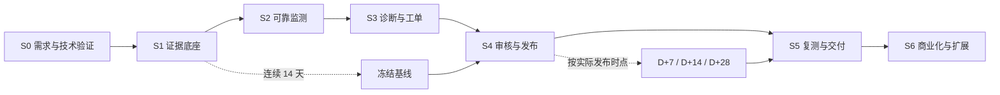

# GEO 产品报告与实施文档

更新：2026-11-13｜方案版本：v1.2（明确 Next.js 全栈方向）｜当前状态：产品规划，尚未开展文档中列出的 PoC、研发或客户试点。

本目录将“产品做什么、为什么做”与“各阶段如何交付”分开维护。基于用户提供的 [GEO 调研会话](https://chatgpt.com/share/e/6af6c0e7-41e4-83e8-9d8c-5ecd270c183f) 修订，沿用原报告文件名。

## 阅读顺序

| 文档 | 用途 | 主要读者 |
| - | - | - |
| [产品设计报告](中国大陆%20GEO%20监测优化经营平台产品设计报告%20初稿.md) | 产品定位、范围、功能、技术与商业方案 | 产品、研发、交付负责人 |
| [Next.js 全栈技术选型与项目架构设计](Next.js全栈技术选型与项目架构设计.md) | 组件选择、Web/Worker 分工、目录、权限、数据、队列、部署与测试 | 技术负责人、全栈开发、运维 |
| [用户端全流程技术方案与 Mermaid 流程图](用户端全流程技术方案与Mermaid流程图.md) | 从登录建档到监测、诊断、审批发布、复测验收和退出的逐节点流程、接口、状态及异常回路 | 产品、设计、研发、测试、交付 |
| [客户网站 SEO 与中国大陆自媒体内容分发实施技术报告](客户网站SEO与中国大陆自媒体内容分发实施技术报告.md) | 官网 SEO 审计与改造、14 个主要平台的分发实现、接口能力边界、数据模型、可靠发布与验收 | 产品、研发、内容运营、客户交付 |
| [调研依据与决策记录](调研依据与决策记录.md) | 原始调研如何转成产品决策，哪些已核验、哪些待实测 | 选型与评审人员 |
| [指标与证据合同](指标与证据合同.md) | 数据对象、分母、版本、状态和验收计算案例 | 研发、分析师、测试、客户经理 |
| [阶段 0：立项与技术验证](stages/00-立项与技术验证.md) | 客户需求、开源 PoC、真实渠道与成本验证 | 产品、技术负责人 |
| [阶段 1：租户品牌与证据底座](stages/01-租户品牌与证据底座.md) | 权限、事实、问题集、原始证据与基线启动 | 研发、数据运营 |
| [阶段 2：监测调度与指标质量](stages/02-监测调度与指标质量.md) | 自动采样、引用解析、人工校准、预算和指标 | 研发、分析师、测试 |
| [阶段 3：诊断与优化任务](stages/03-诊断与优化任务.md) | 信源分析、官网审计、爬虫观测、行动工单 | 分析师、内容运营 |
| [阶段 4：内容审核与发布](stages/04-内容审核与发布.md) | 事实驱动创作、审核、素材包、发布回执与验证 | 内容运营、品牌方、研发 |
| [阶段 5：复测归因与试点验收](stages/05-复测归因与试点验收.md) | 效果观察、访问归因、月报、成本和上线验收 | 交付负责人、分析师、客户 |
| [阶段 6：商业化与规模扩展](stages/06-商业化与规模扩展.md) | 付费交付、渠道扩展、代理商经营与容量演进 | 产品、销售、技术负责人 |

## 阶段依赖与八周排期

以下是相对周次，不是已经确定的开工日期。默认团队：1 名产品兼交付、2 名开发、1 名内容兼数据运营、兼职测试/运维。每周按 5 个工作日估算；开发总容量约 80 人日，建议预留至少 20% 处理接口、返工和故障。各工作包的估算不能简单当成已承诺工期，阶段 0 必须重估。

用户已明确采用 Next.js 全栈。阶段 0 不再比较应用框架，而是验证 Next.js Web + TypeScript Worker 的兼容链路及开源模块复用范围；原八周计划在该 PoC 后重估，不能默认获得完整继承其他框架底座的开发速度。

| 阶段 | 建议时间 | 核心成果 | 退出门禁 |
| - | - | - | - |
| S0 | 第 1 周 | 试点章程、选型决策、能力矩阵、成本样本 | G0：至少一条自动通道有真实证据，第二通道明确可用或降级 |
| S1 | 第 2 周 | 一个品牌、固定题集、权限和证据查询；启动基线 | G1：原始样本可追溯、隔离检查通过、计划冻结 |
| S2 | 第 3 周，基线持续至第 4 周末 | 调度、成本账本、指标和人工校准 | G2：连续 72 小时运行及异常恢复通过，质量达到约定门槛 |
| S3 | 第 4 周 | 诊断、官网观测、可执行工单、基线快照 | G3：至少 3 项可执行改动；14 天基线完成 |
| S4 | 第 5 周 | 审批内容、发布包、上线 URL 与版本 | G4：每个试点品牌至少 3 项可复核改动；没有权限时由客户发布 |
| S5 | 第 6—8 周，D+28 延续至第 9 周或更晚 | 阶段报告、上线验收、试点经济性和完整复测 | G5a：第 8 周交付验收；G5b：到期窗口完成后的效果结论 |
| S6 | G5a 后可准备，扩大投入需 G5b 与经济性证据 | 套餐、经营能力、扩容和新渠道 | G6：付费交付与成本满足阶段 0 约定的经营目标 |

基线从 G1 通过后开始，优化发布前必须完整结束。诊断、草稿可提前准备，不能提前改变实验目标页。不同客户分别计算时间；客户资料、授权、发布或渠道权限延期会顺延其观察窗口。D+28 尚未到期的报告标记“观察中”，不得当作 G5b 已通过。

## 共同执行规则

- 任务编号 S0-01 至 S6-08 是规划编号，不表示已创建外部任务。进入执行时补具体人员、起止时间、状态、阻塞原因和证据链接。
- 每项任务必须有可检查的输出；截图、原始响应、报告版本或账本可作为证据，口头说明不能替代。
- 阶段负责人评审门禁。安全隔离、原始证据和计费一致性不能豁免；外部通道或连接器不足可以缩小范围，并在报告中明示。
- 指标定义冲突时先修订指标合同和版本，再更新实现与报告；不能在报告层临时改分母。
- 所有数量、时长、准确率、预算与成本敏感性都是待验证的规划值，不是已有性能、客户结果或供应商报价。
- 单开发方案：先一品牌、一通道、手工发布和日志导入；保留隔离与证据要求，重估时间，暂缓第二通道、CMS 和实时连接器。

## 下一步启动清单

1. 指定产品/交付、技术、运营及验收负责人。
2. 确认一个行业、3—5 家候选客户和可修改页面；没有这些输入先完成内部演示，不宣称客户试点。
3. 准备可用的供应商账号、试验预算和客户公开资料。
4. 按阶段 0 运行固定版本 PoC，签下 G0 记录，再进入完整研发。
