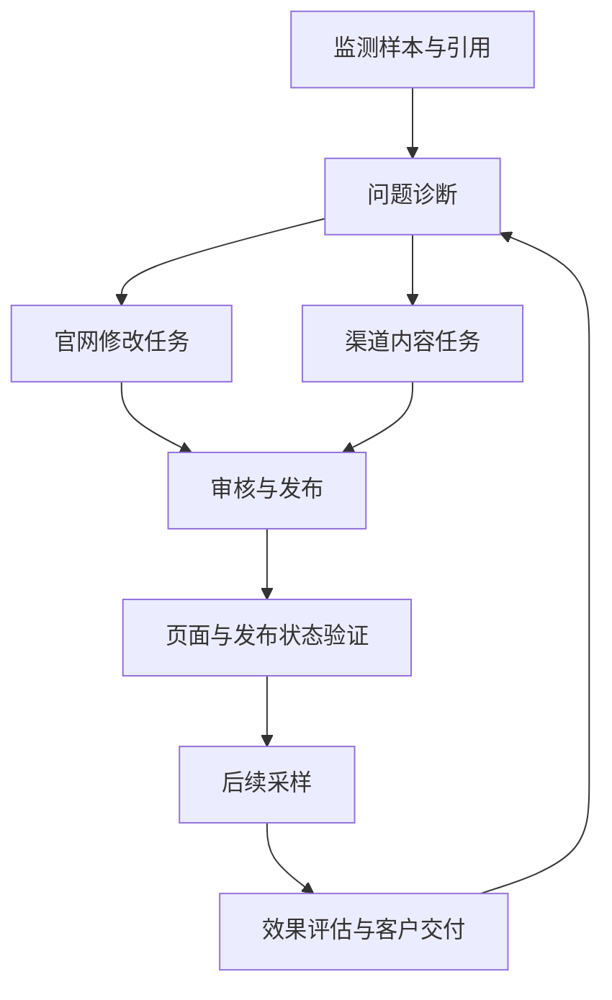
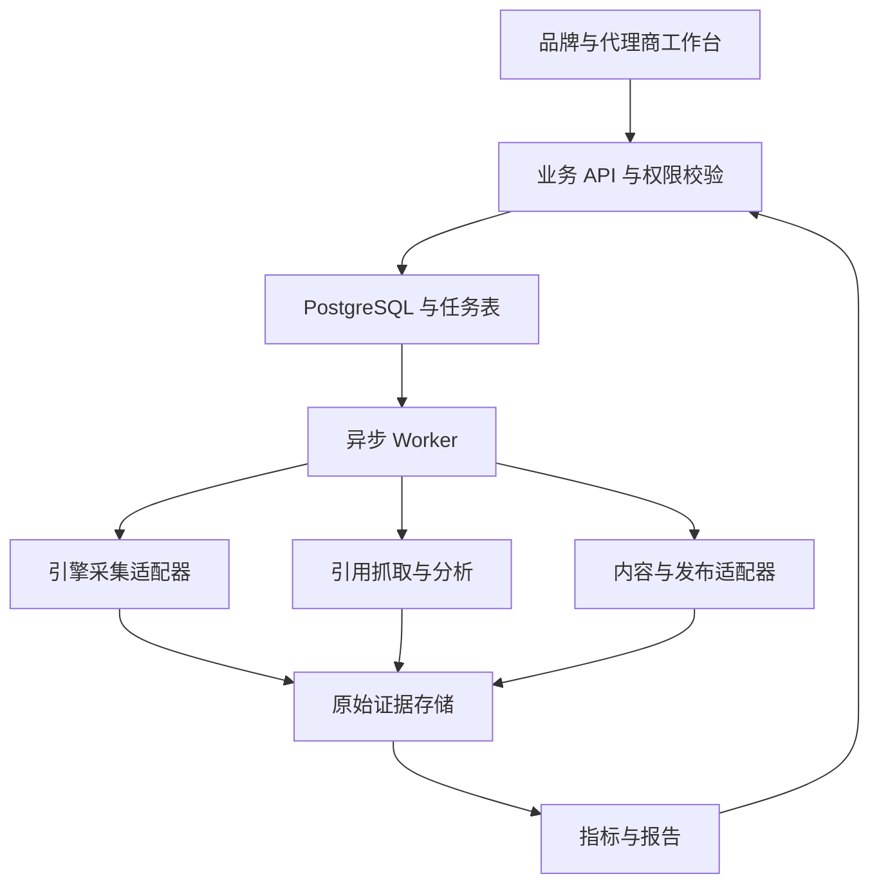

# 中国大陆 GEO 监测优化经营平台产品设计报告

版本：v1.2 Next.js 技术方向确认版｜日期：2026 年 11 月 13 日｜状态：待试点验证的产品方案｜用途：产品立项、试点交付与研发拆解。保留原文件名，便于沿用项目引用。

阅读入口：[文档导航与阶段总览](README.md)；实施从 [阶段 0 工作包](stages/00-立项与技术验证.md) 开始，后续各阶段独立成文；口径以 [指标与证据合同](指标与证据合同.md) 为准；研究依据见 [调研依据与决策记录](调研依据与决策记录.md)。本文描述目标产品，不表示仓库已有对应代码或已完成部署。

建议将产品定位为**面向中国大陆品牌及服务商的 GEO 监测与优化经营平台**：用可追溯的样本判断品牌在 AI 回答中的表现，将问题转成官网和内容任务，再以发布记录、后续采样和业务线索评估结果。首版先形成可交付的闭环，随后扩展渠道与代理商经营能力。

**来源范围：本次已通过浏览器读取用户提供的《GEO板块分析方案》分享页中的 GEO 调研正文，并复核重点仓库及部分官方文档。** [调研会话](https://chatgpt.com/share/e/6af6c0e7-41e4-83e8-9d8c-5ecd270c183f) 是需求与候选方案来源，仓库 README 是作者声明，只有部署和接口实测才能证明本项目可用。未进行付费接口调用、生产部署或客户验证。工期、规模、成本与验收阈值均为设计假设；逐项核验状态见调研依据文件。

本次修订补齐官网爬虫与引荐流量证据、开源复用边界、阶段门禁和跨阶段数据合同。用户已明确采用 Next.js 全栈，技术方向调整为 Next.js Web + 共享 TypeScript 业务层 + 独立 Node.js Worker。详细组件与实现边界见 [Next.js 全栈技术选型与项目架构设计](Next.js全栈技术选型与项目架构设计.md)。

# 一 立项结论

首版交付三个结果：让客户知道“哪些购买问题没有推荐我”，让运营知道“应修改哪一页、补什么事实、在哪个渠道发布”，让客户经理知道“本月完成了什么、证据是什么、还需多久观察”。

| 决策项 | 首版方案 | 原因 |
| - | - | - |
| 服务对象 | 有明确产品资料、官网或稳定内容渠道的中小品牌；同时支持代理商代运营 | 有事实基础，也有人执行修改 |
| 试点范围 | 建议 1 个垂直行业、3—5 家客户、每家 1 个品牌 | 减少跨行业差异，先验证交付成本 |
| 持续监测 | 2 个通过实测验收的国产官方 API 通道 | 先确保来源、引用与成本可解释 |
| 用户端核验 | 豆包、DeepSeek 等按客户需求人工抽样 | 保留真实产品观察，不用 API 数值冒充 App 表现 |
| 优化执行 | 官网诊断、事实库、内容草稿、审核、发布记录、复测 | 形成实际交付，而不止评分 |
| 商业模式 | 订阅配额加可选交付服务 | 将软件收入与人工服务成本分别核算 |
| 第一阶段暂缓 | 全平台无人值守发布、海量站群、完整 CRM、自动保证排名 | 这些能力不能作为首版成立的前提 |

GEO 的可控对象是企业公开内容、事实一致性与交付过程，外部引擎是否收录、引用和推荐需要持续观察。原始 GEO 研究也显示效果随任务领域变化，不能把实验中的提升幅度转化为客户收益承诺。[GEO 研究论文](https://arxiv.org/abs/2311.09735)。

# 二 既有调研如何转成产品决策

此前讨论已覆盖国产 AI 监测、引用分析、官网 SEO、自媒体矩阵、账号授权、开源工具及多域名成本。当前应保留的结论是：**搜索结果、模型回答、消费者产品观察分开记录；提及、推荐和引用分开计算；内容发布必须接入复测。**

| 项目 | 当前公开定位与可参考内容 | 本项目采用方式 |
| - | - | - |
| [Elmo](https://github.com/elmohq/elmo) | MIT；品牌监测、竞品、引用、原始回答与优化机会；不同渠道使用不同采集方式 | 评估监测模块复用，不将其应用框架直接作为 Next.js 底座，也不等同国产 App 覆盖 |
| [OpenGEO Platform](https://github.com/cangqiaoGEO/opengeo-platform) | MIT；基于 Elmo 演进，含国产 API 适配和内容 Studio | 与 Elmo 一起做短期 PoC；核验国产适配、租户隔离、事实审核和上游维护成本 |
| [GeoLook](https://github.com/aigclink/geolook) | MIT；诊断、工单、执行和验证；README 明确为单机工具，缺少团队账号体系 | 参考交付方法和人工采样流程，不直接当多租户 SaaS |
| [OneGlanse](https://github.com/oneglanse/oneglanse) | MIT；通过真实产品网页采集，保存回答及引用 | 参考用户端采样与证据结构；单独评估运行维护和平台许可 |
| [GEOFlow](https://github.com/yaojingang/GEOFlow) | AGPL-3.0；内容工程、多站分发和浏览器辅助发布 | 参考内容运营；闭源商业化前单独核查许可证义务和可用授权 |
| [GEOInflow](https://github.com/yaojingang/GEOInflow) | MIT；官网访问、AI 引荐、爬虫日志、页面覆盖与转化 | 增加独立官网证据模块；先验证日志导入与页面映射，不把爬取视为推荐 |
| [GEO Doctor](https://github.com/Fangx-AI/geo-doctor) | 诊断与优化工作流；代码和 Skill 为 MIT，原创文档、模板和图解为 CC BY 4.0 | 借鉴问题到任务的流程；分别核对代码与内容素材授权 |
| [GEORank](https://github.com/yaojingang/GEORank) | 官网诊断与工具工作台；代码 Apache-2.0，内置内容另有权利边界 | 参考网站检查与诊断入口；不照搬其全部基础设施和内容资产 |
| [Limelit Open](https://github.com/limelit-co/open) | Apache-2.0；Go 单二进制、SQLite、MCP；README 标为预发布 | Go 路线备选，评估适配器与证据展示；不作为成熟多租户底座承诺 |
| [gego](https://github.com/AI2HU/gego) | GPL-3.0；Go 监测、调度与引用分析 | 研究架构；复用前审查授权与部署复杂度 |
| [GoodieAI GEO](https://github.com/lorin-code/ai-geo-monitoring) | 国内监测、会员额度与后台；此次可见根目录未见 LICENSE | 作为产品结构参考；未确认代码授权前不进入复用清单 |

采用“Next.js 主应用 + 独立能力验证”的方式：OpenGEO 与 Elmo 比较可移植的适配器、数据结构和业务模块；GeoLook 验证诊断到工单；GEOInflow 验证官网观测。其余项目只在对应能力出现缺口时深入。Star 和宣传中的效果数字不进入选型评分。阶段 0 对固定版本记录许可证、PoC 结果、原始样本、框架耦合与维护成本，确认复用边界。

OneGlanse 的 Agent 在本地或自托管部署中运行，并非由被监测平台托管；README 分别描述本地运行和服务器 Docker Compose 运行。它的运行方式不能自动解决国产平台接入问题。[运行说明](https://github.com/oneglanse/oneglanse)。

关于广州旗引科技及同模板站点，现有材料只保留为历史竞品线索。本次没有逐站复核，因此不把同模板、宣传页功能或 OEM 宣称当作后台能力、客户数量或 GEO 效果证据。后续竞品验收应要求现场展示：原始回答、真实引用 URL、采样条件、发布回执和复测记录。

# 三 必须修正的能力判断

**“支持某模型”不等于“测到了同名 App”。** OpenGEO README 列出的国产通道主要是 API，其中品牌名称与底层服务的对应关系仍需独立校准。产品页面应该显示真实采集渠道，例如“火山方舟模型加搜索”“豆包助手 API”“豆包网页人工样本”，而不能统一写成“豆包排名”。[OpenGEO 通道说明](https://github.com/cangqiaoGEO/opengeo-platform)。

**不能笼统断言百炼不返回引用。** 当前官方文档提供不同调用协议及搜索来源能力；Responses 的搜索来源和 DashScope 的角标、结构化信息也有区别。实现应按端点、模型和响应字段判断，不能沿用某个开源适配器的限制来描述整个服务。[百炼联网搜索文档](https://help.aliyun.com/zh/model-studio/web-search)。

**豆包助手 API 是独立候选。** 初稿依据火山方舟文档提出这一候选，本次该文档读取超时，因此服务模式与开通条件继续列为待核验项。即使通过实测，它仍然是单独的测量渠道，不能假定与任意账号、地区、时点的豆包 App 输出相同。[豆包助手文档](https://docs.volcengine.com/docs/ark/doubao-assistant?lang=zh)。

**账号登录授权不等于内容发布授权。** 抖音需核实对应应用和权限；小红书账号平台的公开 Scope 文档将笔记读写列为规划中，不能据此承诺通用后台发布。具体合作能力单独确认，不将“文档列出某权限”视为本应用已获批。[抖音创建视频](https://open.douyin.com/platform/resource/docs/openapi/video-management/douyin/create/create-video/)；[小红书 Scope](https://openaccount.xiaohongshu.com/docs/scope)。

# 四 用户角色与经营流程

| 角色 | 核心工作 | 权限范围 |
| - | - | - |
| 品牌管理员 | 确认资料、选定目标、授权渠道、审批发布、查看交付 | 自己的品牌与账号 |
| 内容运营 | 维护事实、写稿、处理修改任务、提交发布 | 被分配品牌；默认无授权凭证管理权 |
| 分析师 | 管理问题集、复核答案、引用分析、设计实验 | 可读原始样本和修正分析结论 |
| 代理商项目经理 | 管理多个客户、排期、配额、工时、月报和续费 | 仅已获授权的客户项目 |
| 平台运维 | 处理采集失败、用量、授权异常和系统故障 | 默认不读取客户私密资料；临时访问留审计 |

客户旅程为：登记品牌及事实 → 冻结首批问题集 → 建立基线 → 确认机会 → 完成内容或官网修改 → 审核发布 → 回填 URL → 验证发布状态 → 复测 → 客户验收与续费评估。

每个机会都必须关联样本，每个任务都必须关联机会，每条已发布内容都必须关联 URL 和版本，每次效果判断都必须关联复测窗口。这样代理商可以证明做过哪些工作，品牌也能追问每项判断的依据。

# 五 产品页面与首版范围

| 页面 | 首版必须提供 | 主要操作 |
| - | - | - |
| 工作台 | 待办、任务状态、监测覆盖、费用、最近变化 | 查看异常、进入任务 |
| 品牌与事实库 | 名称别名、产品、竞品、证据、有效期、审批状态 | 核准事实、撤销过期事实 |
| 问题与监测 | 问题集版本、意图、通道、频率、预算、运行记录 | 新建计划、预览费用、暂停 |
| 回答与引用 | 完整原文、提及片段、引用 URL、采样条件、解析版本 | 人工纠错、查看证据 |
| 优化任务 | 诊断、优先级、负责人、验收条件、目标问题 | 接单、提审、验证 |
| 内容与发布 | 草稿、事实引用、改动对比、渠道包、发布状态 | 审核、确认发布、回填链接 |
| 实验与报告 | 固定样本的前后变化、对照组、失败原因、交付记录 | 比较窗口、生成报告 |
| 官网观测 | 页面清单、日志覆盖、已观察爬取、AI 引荐与目标事件 | 导入脱敏日志、检查缺数、追溯页面 |
| 客户与设置 | 客户项目、成员、配额、授权状态、用量、续费日期 | 分配权限、设置预算 |

总览默认展示“推荐率、提及率、自有页面引用率、有效采样覆盖率、已交付任务”。所有比例旁展示分子、分母、样本时间和采集方式。点击卡片必须能进入构成指标的样本列表。

没有样本、引用字段不可用、抓取受限和确实未提及是四种不同状态。空图表提供具体原因与下一步，不能全部显示为 0。

**范围分级。** P0 是首个交付闭环：租户与品牌、事实审批、固定题集、至少一个通过验收的通道、证据查询、指标、工单、人工发布回填、复测、用量与导出。八周试点目标增加第二通道、官网日志导入和轻量经营台账。CMS 草稿连接器为 P1，权限或工期不足时使用修改包，不阻断首轮交付。自动多渠道发布、实时日志连接器、完整 CRM、Remote MCP 与大规模多站点能力在阶段 6 按证据立项。

# 六 监测体系与大陆渠道接入

建立三类独立证据对象。它们可以关联，不能混算为一个“全网排名”。

| 对象 | 记录什么 | 可回答的问题 |
| - | - | - |
| SearchEvidence | 搜索接口返回的候选网页、标题、摘要、排序 | 哪些资料被检索到 |
| ModelAnswer | 某模型或官方助手 API 的回答及原生引用 | 该 API 通道怎样描述品牌 |
| ConsumerObservation | 真实网页或 App 中观察到的回答、来源及采样条件 | 特定产品环境下用户看到了什么 |

一个 SearchEvidence 出现在候选列表里，不代表它被最终答案引用。人工分析模型新找出的链接也不能补写成目标引擎原生引用。

| 渠道 | 首版处理 | 验收要求 |
| - | - | - |
| 火山方舟模型加联网搜索 | 自动通道候选 | 保存实际搜索调用、模型、原始响应和来源字段 |
| 豆包助手 API | 单独候选，和上一行择一或同时评估 | 开通权限、确认可用模式、实测引用结构与成本 |
| 百炼千问联网搜索 | 自动通道候选 | 按实际协议读取来源；验证强制搜索及搜索未触发状态 |
| 豆包、DeepSeek 用户端 | 每周小样本人工核验 | 记录入口、账号状态、地区、新会话、模式、时间和原文 |
| 元宝、Kimi、百度相关产品 | 后续按客户需求逐项接入 | 先证明采集对应哪个产品，再开放给客户 |
| 自建搜索加任意模型 | 仅作为实验和诊断环境 | 页面明确标记为自建链路，不代表第三方 App |

火山方舟的模型加搜索与豆包助手是不同接入路径，具体模型、工具和开通条件以对应官方文档为准。[联网搜索工具](https://docs.volcengine.com/docs/ark/web-search?lang=zh)；[豆包助手](https://docs.volcengine.com/docs/ark/doubao-assistant?lang=zh)。

每个适配器维护能力清单：是否支持联网、是否能强制搜索、是否返回原生引用、是否提供搜索候选、是否暴露地区配置、是否允许自动采集、当前限流及计费。未通过验收的适配器只进入内部实验区。

# 七 问题集与采样设计

首批每品牌固定 40 个问题：30 个不带品牌的品类和场景问题、5 个明确竞品比较问题、5 个品牌事实问题。前 30 个用于主要推荐表现；比较题和品牌题分开报告，避免把题目主动提到品牌造成的曝光算成发现能力。另设 10 个每周轮换的探索题，不混入固定趋势。

问题来自销售咨询、客服常见问题、产品资料和客户提供的搜索需求。AI 可扩展措辞，但生成题必须人工复核；不能将生成次数称为搜索量。

| 题型 | 示例 | 用途 |
| - | - | - |
| 品类发现 | 适合 50 人团队的设备管理软件有哪些 | 检查进入候选名单 |
| 场景选择 | 多门店设备如何统一远程管理 | 检查需求匹配 |
| 购买约束 | 支持私有部署和分级权限的工具怎么选 | 检查关键能力表达 |
| 品牌比较 | 品牌甲与品牌乙的部署方式有何差别 | 检查比较是否准确 |
| 品牌核验 | 品牌甲的服务地区和售后政策是什么 | 发现错误或过期事实 |

基线建议运行 14 天；每个自动通道每题每天 3 次，分散时间执行，使用新会话。40 题 × 2 通道 × 3 次 × 30 天，为每品牌每月 7,200 个计划样本，不含探索题、人工样本与失败重试。预算较低时减少频率，并同步降低能得出的结论强度。

每次保存问题版本、通道、模型版本或未知状态、语言、目标地区、实际采集地区、模式、账号类型、会话是否全新及采集时间。核心题不在请求中附加品牌知识库或要求“优先推荐客户品牌”。

基线在第 2 周末启动并连续覆盖 14 个完整自然日，时间统一按 Asia/Shanghai 统计，原始时间存 UTC。若当时调度未完成，允许人工触发同一适配器并记录计划槽位；不能事后补采冒充历史。正式优化发布必须晚于基线截止。第 3 周上线调度不能改变题集或静默替换测量条件。

重复结果照常保留，并标记哈希相同；它们可能受平台缓存影响，不能声称是完全独立样本。问题、模型或渠道发生变化时在趋势中标记断点，以固定共同题集比较。

# 八 指标定义与质量要求

下列是本产品建议采用的指标摘要，需要随代码和报告版本一起管理。“合格回答”指有效且满足冻结计划采集条件的回答；提及、推荐和引用先按同题、同通道计算，再对固定题等权汇总。完整定义见 [指标与证据合同](指标与证据合同.md)。

| 指标 | 计算口径 | 防止误读 |
| - | - | - |
| 有效采样覆盖率 | 有效回答数 ÷ 计划样本数 | 超时、登录失败、验证码、解析失败不算有效回答 |
| 条件合格覆盖率 | 合格回答数 ÷ 计划样本数 | 有效但未满足联网条件的回答不计入主比较 |
| 品牌提及率 | 确认提及目标实体的合格回答数 ÷ 可判断提及的合格回答数 | 同名歧义进入待复核；同时显示未知比例 |
| 推荐率 | 明确将品牌列为适合选项的合格回答数 ÷ 可判断推荐的非品牌固定题合格回答数 | 负面举例、仅复述用户问题不算推荐；未知比例单列 |
| 自有页面引用率 | 含已确认自有页面原生引用的合格回答数 ÷ 引用信息完整可观察的合格回答数 | 同时显示引用可观察覆盖率；字段不支持为 N/A |
| 第三方品牌支持率 | 有第三方引用页面且有可验证品牌支持内容的合格回答数 ÷ 可判断支持性的合格回答数 | 与自有域引用分开；全文无法取得则待验证 |
| 竞品份额 SoV | 本品牌被确认提及的合格样本数 ÷ 固定品牌集合中各品牌被确认提及的合格样本数之和 | 每个样本内每品牌最多计一次；它是样本份额，不是市场份额 |
| 明确推荐列表中的位置 | 仅对具有顺序含义的推荐列表计算位置 | 普通散文先出现不等于排名；未上榜单列，不能填 0 |
| 事实错误率 | 经人工确认有错误的品牌回答数 ÷ 已复核的品牌回答数 | 展示复核覆盖率，不能假装抽查等于全部 |
| 到期任务验收完成率 | 到期任务中已满足验收条件的数量 ÷ 到期任务数量 | 发布成功与引擎引用分别验收；延期天数另列 |
| 可观察 AI 引流线索 | 来源可识别的访问或明确自报 AI 来源的线索 | 分类呈现，不能推算不可见的全部 AI 转化 |

每项分析保存原文证据片段、判定理由、分析模型和规则版本。优先用确定性规则定位实体及 URL，再由分析模型处理歧义；分析模型没有证据时返回“无法判断”。

对固定题集优先展示逐题均值及分布，防止某些题采样更多而主导总分。置信区间按问题、日期考虑聚类，不把同一题的重复回答都当独立用户。首版不提供一个混合所有渠道的神秘总分。

聚合默认“逐题计算、固定题目等权”；样本级比率仅作为诊断明细显示，并注明汇总方式。推荐率默认使用 30 个不带品牌的固定题；比较题、品牌题和探索题分别成组。回答有效但未满足计划联网条件时保留为有效回答，排除出该计划的主要可比指标，并计入条件不符数。分母、未知值和版本规则统一见 [指标与证据合同](指标与证据合同.md)。

准备至少 200 条人工标注样本，覆盖别名、同名、否定、竞品比较、虚构链接和无序列表。建议上线门槛为：实体识别精确率不低于 95%、召回率不低于 90%；原生引用解析准确率不低于 98%。这是待试点验证的产品目标。

# 九 网页引用分析与成本控制

引用分析按三层递进：先读取回答中的 URL 和域名；再为去重后的 URL 获取必要页面信息；最后只对高价值页面做正文与品牌证据分析。无需为每个客户或每条引用启动独立浏览器。

流程为：保留原始 URL → 解析重定向 → 生成归一化标识 → 识别站点与内容类型 → 按缓存策略抓取 → 提取正文及事实证据 → 绑定具体回答中的引用位置。

| 数据 | 处理策略 |
| - | - |
| 原始 URL | 在约定证据保留期内随样本保留，删除按客户数据策略执行 |
| 去重 URL | 去掉明确的跟踪参数；不随意删除会改变内容的参数 |
| canonical | 作为候选线索，校验后使用；不盲信跨域声明 |
| 页面正文 | HTTP 抓取优先；确有需要且允许时再渲染 |
| 更新 | 结合 ETag、Last-Modified 和内容哈希；常规页面初设 7 天缓存，热点可缩短 |
| 受限页面 | 保存 URL、标题和可用摘要，标记未取得全文 |
| 自有或竞品归属 | 域名之外还可按账号、作者、页面判断；共享平台不能整域归为自有 |
| 去重转载 | 同时统计页面数与内容簇数，避免一稿多发制造虚假信源广度 |

抓取器需要域名限速、超时、响应体上限，并防止 SSRF：校验初始地址、重定向和最终解析 IP，阻断内网、回环、链路本地及云元数据地址。网页内容只作为数据，不得触发任务工具或修改平台指令。

公开页面缓存可以按政策共享；客户私有资料、个性化页面和账号内容必须隔离。某页面被引用只能证明观察到一次引用，不能直接证明该站点与引擎存在固定合作关系。

# 十 优化工作台与官网 SEO

每个机会形成可执行任务，而不是输出“增加优质内容”这类泛泛建议。任务包含目标问题、相关回答、引用缺口、具体改动、负责人、工作量、截止时间、验收方式和复测窗口。

| 问题表现 | 具体交付 | 验收 |
| - | - | - |
| 品牌基本信息混乱 | 统一名称、产品型号、服务地区、联系方式和政策 | 官网及已授权渠道字段核对通过 |
| AI 回答错误参数 | 更新对应产品页，标注规格、条件、来源和日期 | 改动已发布；后续样本单独检查错误是否减少 |
| 竞争对手占据特定问题 | 新增有独特证据的场景页或比较说明 | 内容满足真实需求，并纳入后续采样 |
| 引用第三方却没有品牌 | 联系适合的行业媒体或合作方，提供可核验资料 | 记录真实发布结果；不保证外部编辑采纳 |
| 官网页面不可读取 | 修正状态码、渲染、链接、robots 或错误 canonical | 抓取复验成功，保留前后差异 |
| 大量重复内容 | 合并重复页、区分产品和地域的实际信息 | 页面目的明确，重复与冲突减少 |

官网支持三种执行方式：无写入权限时输出修改清单；有 CMS 权限时生成草稿并提交审批；客户使用 Git 管理站点时生成补丁或 PR。首版必须支持修改包；一种 CMS 草稿连接器为 P1，取得权限且不影响主链路时实施。

技术检查覆盖 HTTP 状态、主体内容可见性、站内链接、robots、sitemap、canonical、标题描述、与页面一致的结构化数据，以及产品和政策事实。结构化数据是机器可读的表达方式，不作为必然提升推荐率的保证；llms.txt 仅列为可选实验项。

内容页建议采用“直接回答—适用条件—具体证据—限制或例外—更新日期”的结构。需要的是客户真实参数、案例和数据，不通过伪造测评、客户证言、百科条目或相互抄写来建立证据。

# 十一 品牌事实库与内容生产

事实库是内容生成的输入，不作为监测目标引擎时的附加上下文。这样既能控制输出质量，也能避免污染测量。

每条事实至少包含：实体、属性、值、来源 URL 或客户资料、版本、有效期、可公开范围、审批人、审批时间。事实状态分为待核验、已批准、过期、撤销和冲突。过期或冲突的关键事实会阻止相关稿件进入发布。

内容工作流为：选取目标问题 → 关联已批准事实 → 生成提纲 → 生成草稿 → 校验事实与来源 → 人工编辑 → 渠道适配 → 审批。

生成结果必须把关键主张关联到 fact_id。系统检查 fact_id 是否存在、是否仍有效、文中数值与条件是否一致；不能只检查“有没有引用标记”。未知信息使用待补充项，不由模型补造。

素材包按渠道组织文案、封面、配图、视频脚本、来源、AI 生成声明和发布说明。不同渠道可以调整表达，但价格、承诺、参数、服务地区等关键事实必须一致。客户私密材料默认不得进入公开草稿或发送到未批准的外部模型。

# 十二 授权与发布设计

监测公开回答、分析公开网页和提供建议通常不需要客户授予官网管理员权限；自动修改官网、发布内容和读取私有经营数据则分别需要对应授权。品牌核验、网站控制权证明和渠道账号授权是不同对象。

| 操作 | 所需权限 | 无权限时的可交付结果 |
| - | - | - |
| 公开品牌监测 | 创建项目即可；遵守来源访问要求 | 正常监测与报告 |
| 公开官网审计 | 公开访问，控制抓取范围 | 提供诊断和修改包 |
| CMS 草稿 | 限定站点和内容范围的写入权限 | 导出草稿和素材包 |
| 官网正式发布 | 指定发布权限与明确审批 | 客户自行上线后回填 URL |
| 抖音内容发布 | 对应应用资质、发布 Scope、用户授权和用户可感知的发布操作 | 导出素材包，人工发布 |
| 小红书内容发布 | 核验适用于该业务的实际开放能力 | 首版采用人工或平台允许的辅助发布并回填 |
| 公众号等渠道 | 分别确认账号类型、应用资质及接口权限 | 首版人工发布记录；不假定通用接口可用 |
| 经营数据回传 | 账号数据权限或客户导入 | 上传聚合结果或人工录入线索 |

本产品要求代用户发布时展示具体内容并取得对应版本的确认，平台审核作为独立阶段。初稿引用的抖音接口页本次读取超时，接入前须重新核验其要求。小红书所核验的账号授权文档不能证明本应用具备笔记发布能力。[抖音文档](https://open.douyin.com/platform/resource/docs/openapi/video-management/douyin/create/create-video/)；[小红书文档](https://openaccount.xiaohongshu.com/docs/scope)。

系统为每个账号记录 capability、scope、授权到期时间、应用审核状态、配额和确认方式。发布按钮仅在能力满足时出现。确认界面展示账号、具体内容版本、发布时间及渠道，不把一次 OAuth 同意视为对未来全部内容的发布同意。

发布任务区分：待审核、已批准、待用户确认、已提交、平台审核中、公开可见、被拒、已撤回、结果未知。接口超时后先查询结果，避免重复发布。用户撤销授权时立即阻止未执行任务，并解除刷新权限；已公开内容的撤回单独处理。

不收集客户账号密码或依赖共享 Cookie 池。出现验证、权限不足或平台拒绝时转人工任务，不设计规避风控的发布链路。

# 十三 复测与业务归因

将三种结果分开：**交付完成**是客户同意的改动已上线；**观测改善**是固定条件下的样本变化；**业务贡献**是可观察的访问、咨询或成交关联。完成发布不能直接判定 GEO 生效。

每项实验记录假设、目标题集、目标通道、改动页面、发布版本、开始时间、对照题集、主指标、观察窗口和终止条件。初始建议采用 14 天基线及发布后第 7、14、28 天观察点；这些只是排期假设，不能承诺平台在指定日期收录。

优先按主题或页面分组分期上线，保留相近未修改组。品牌整体活动可能影响多组，报告必须记录同期营销、引擎更新和采集方式变化。比较时使用相同题集、相同渠道与相同口径；小样本或覆盖变化明显时只报告观察，不标为因果提升。

一个实验关闭时可以是观察到改善、无明显变化、证据不足、不可比较或已回滚。观察到改善不自动等于因果提升，无明显变化的结果同样沉淀为后续决策。

业务归因分别保存可识别 AI 来源访问、带明确活动参数的访问、客户自报来源及 CRM 关联，不把它们混成一个归因强度相同的数字。来源丢失记为未知；不能给所有被引用 URL 强行添加跟踪参数，或将品牌搜索增加全部归因于 GEO。

## 13.1 官网爬虫、页面覆盖与访问证据

参考 [GEOInflow](https://github.com/yaojingang/GEOInflow) 的官网数据思路，增加独立 SiteObservation 模块，并与回答采样共用站点与页面标识。首批支持客户导出的脱敏日志和聚合访问数据；持续连接器留到有稳定输入后实施。

| 证据 | 最小记录 | 可以说明什么 | 不能推出什么 |
| - | - | - | - |
| CrawlerVisit | 站点、路径、时间、状态码、声明 UA、核验状态、日志批次 | 覆盖日志内观察到某类访问 | 页面已被模型收录或推荐 |
| PageInventory | 页面 URL、业务优先级、快照版本、可用性 | 固定页面集合的访问覆盖 | 未见访问的页面一定没被其他节点抓取 |
| ReferralSession | 脱敏会话标识、落地页、来源类别、时间、来源可信度 | 可识别 AI 引荐访问 | 全部 AI 带来的访问量 |
| ConversionEvent | 事件去重键、会话关联、目标、时间、关联依据 | 在约定窗口内观察到的业务关联 | GEO 导致的增量收益 |

UA 字符串只能形成“声明为某爬虫”的线索；核验方法、版本和结果另存。只有具备可验证身份依据的访问才进入已核验集合；没有依据时保持未核验。机器人、站内测试与真实访客流量分开，不能将爬虫请求计成客户访问。

页面覆盖率 = 固定清单中观察到合格爬虫访问的页面数 ÷ 同一日志覆盖窗口内纳入清单的页面数。日志不完整时标记为“已覆盖数据内的观测比例”，缺少日志时为 N/A。展示日志节点、起止时间、缺口及清单版本，避免把缺数解释为未抓取。

时间链只作关联：页面发布 → 观察到爬取 → 观察到引用 → 观察到引荐 → 记录咨询。任何节点都允许缺失；没有共享标识和可验证来源时不能把这些事件拼成同一个用户旅程。原始 IP、查询参数和个人信息按最小化规则处理，不把完整访问日志送入内容生成模型。

# 十四 客户经营与商业化

“经营”包含品牌的持续内容经营，也包含平台或代理商自身的客户交付、成本和续费管理。首版做轻量经营台账，不重建完整 CRM。

每个客户项目保存负责人、服务目标、合同周期、套餐配额、上线任务、已交付内容、待客户确认事项、费用消耗和续费日期。月报固定包括：样本方法、表现变化、完成任务、证据链接、未解决问题、下月行动和预算。

| 方案 | 包含内容 | 建议收费维度 |
| - | - | - |
| 监测版 | 问题集、API 监测、引用分析、基础报告 | 品牌数加有效采样额度 |
| 增长版 | 监测加事实库、内容任务、实验和交付看板 | 软件订阅加内容与人工服务量 |
| 代理商版 | 多客户工作区、角色、客户报告、配额与成本 | 工作区基础费加客户或品牌额度 |
| 企业版 | 专属环境、特殊接入、审计与支持 | 单独评估范围与资源 |

不以文章数量作为唯一价值指标，也不提供“全平台不限量监测”。用户购买前能看到题目、渠道、重复次数、频率和预估成本；达到预算时按照约定暂停或降频，不能静默制造超额消费。

对客户计费与供应商成本分别记账。供应商可能对失败请求收费，而平台可以选择不向客户计费；内部必须保留这一成本。计费事件使用唯一标识，避免重试重复扣减。

建议试点门槛：至少 3 家客户跑完一个完整交付周期；每家有 3 项可复核改动；能获得付费或续费意愿；持续人工工作量可控。效果不明显时仍交付真实结论，不通过更换题目美化成绩。

# 十五 技术架构与运行位置

首版采用 Next.js App Router 全栈应用加独立 TypeScript/Node.js Worker；共享业务服务，PostgreSQL 存业务与样本索引，对象存储保存大体积原始响应和页面快照。组件首选 Drizzle、Better Auth、pg-boss，具体兼容性待 PoC。开源项目按模块复用，不沿用与 Next.js 不同的页面/路由框架，也不另建 Go API。详见 [独立架构文档](Next.js全栈技术选型与项目架构设计.md)。

服务端运行任务调度、API 调用、正文分析、报告生成和已获准的渠道接口。人工采样发生在用户可见的浏览器或 App 中，再导入平台。需要浏览器运行时的受支持任务使用独立 Worker 池，不与数据库混布；账号会话隔离。

| 模块 | 职责 |
| - | - |
| Identity 与 Tenancy | 账号、租户、品牌授权及代理商访问 |
| Brand 与 Facts | 实体、域名、事实、证据和版本 |
| Monitoring | 问题集、计划、适配器、样本和质量状态 |
| Evidence | 引用、页面、快照、事实片段和归属 |
| SiteObservation | 页面清单、日志覆盖、爬虫核验、引荐会话和目标事件 |
| Optimization | 诊断规则、机会、任务及验收 |
| Studio 与 Publishing | 草稿、审批、账号能力、发布和回执 |
| Experiments 与 Reporting | 固定比较窗口、效果评估及客户报告 |
| Metering | 供应商成本、客户配额、工时及预算 |

初期使用 PostgreSQL 任务队列即可；出现明确瓶颈再引入 Redis 或专用消息系统。先通过索引、分区、预聚合及冷热分层解决查询问题，再评估 ClickHouse。MVP 不以 Kubernetes、向量数据库或多智能体编排为必要条件。

所有外部模型与网页输出均为不可信数据；只有经过业务权限校验的服务可以执行发布和修改。分析模型不持有客户发布凭证。

# 十六 数据模型与接口合同

| 实体 | 关键字段或关系 |
| - | - |
| tenant 与 membership | 租户、用户、角色、授权品牌 |
| brand 与 brand_entity | 名称、别名、产品、竞品集合、域名与账号归属 |
| fact 与 fact_evidence | 值、来源、有效期、公开范围、审批与版本 |
| prompt_set 与 prompt_version | 题型、意图、语言、目标地区、版本 |
| engine_config | 实际服务、模型、模式、能力、限流、凭证引用 |
| measurement_plan | 题集、采样日历、预算、通道和版本 |
| scheduled_sample 与 run_attempt | 计划样本、尝试次数、终态、供应商请求标识 |
| observation | 原文、采集条件、对象存储指针、完整性和时间 |
| analysis 与 mention | 判定、证据片段、规则和分析模型版本 |
| citation 与 source_page | 原始 URL、引用位置、页面归一化标识、抓取状态 |
| opportunity 与 task | 问题证据、改动目标、负责人、验收条件 |
| content_version 与 approval | 草稿、事实关系、审批人、审批对应内容哈希 |
| publication | 渠道、账号、版本、远端 ID、URL、状态和回执 |
| experiment 与 experiment_window | 假设、题集、目标页面、对照、观察窗 |
| site 与 page_inventory | 站点归属、数据授权、页面版本及优先级 |
| log_import 与 crawler_visit | 导入哈希、覆盖范围、访问证据及身份核验版本 |
| referral_session 与 conversion_event | 脱敏关联、来源类别、去重键、归因窗口及依据 |
| usage_event 与 audit_event | 配额、供应商成本、操作与对象版本 |

所有客户数据带 tenant_id；跨租户关系需在数据库约束和服务校验中同时防护。代理商只通过显式项目授权访问客户。原始样本只追加；分析纠错生成新版本，使历史报告可以按当时口径重现。

建议接口包括：品牌和事实管理、问题集版本管理、监测计划创建、样本与引用查询、任务验收、内容审批、发布确认、实验比较、用量查询。发布接口必须携带内容版本、审批记录和幂等键；内容变化会使旧审批失效。

对外 Remote MCP 放在后续版本，优先开放只读的品牌表现、引用证据和任务查询；不把模型可以调用工具当作它拥有客户业务授权。

# 十七 调度可靠性与运行验收

任务唯一键由 tenant、plan_version、prompt_version、channel、scheduled_slot、repeat_index 组成。调度器通过唯一约束防止多实例重复创建，Worker 通过租约和心跳领取任务。采用至少一次执行加幂等落库，不假定外部调用能做到严格一次。

重试仅针对可恢复故障，使用退避、次数上限与抖动；权限失效、账号验证、业务拒绝直接进入可解释的暂停状态。原始响应成功但分析失败时仅重做分析，不重复调用目标引擎。发布结果未知时禁止盲目重发。

| 验收项 | 建议门槛 |
| - | - |
| 原始证据追溯 | 每条展示指标都能追溯样本、题集和分析版本 |
| 租户隔离 | 越权访问用例全部阻断，导出和对象链接同样受控 |
| 采样完成 | 试点正常权限与可用配额下，日计划有效覆盖率至少 95%；外部故障单列 |
| 定时任务恢复 | 重启后可继续任务，无重复计划样本与重复客户计费 |
| 发布一致性 | 版本变更需重新审批；同一幂等键不产生重复业务发布 |
| 授权撤销 | 未执行任务及时停止，令牌不得出现在日志中 |
| 备份恢复 | 完成一次数据库与对象索引恢复演练；目标 RPO 24 小时、RTO 4 小时 |
| 指标可比性 | 通道、题集或解析版本变化可识别并说明 |

监控至少覆盖有效采样率、限流和权限失败、P95 时延、队列积压、单样本成本、引用可观察覆盖率、分析待复核率、抓取命中率和发布结果未知数。告警可进入平台待办；向外部通信渠道发送通知需要客户配置。

# 十八 容量与成本模型

**域名数量本身通常不是主要算力指标。** 只统计回答中的引用域名，与抓取全部页面、保存截图、执行浏览器和持续生成内容是不同负载。多域名不需要一域名一服务器；多客户主要靠租户隔离和配额管理。

下面全部是预算敏感性示例，不是厂商报价，也不是实测容量。假设每品牌每月 7,200 个计划样本，端到端单样本可变成本包含模型、搜索、分析及平均重试开销。

| 品牌数 | 月计划样本 | 若每样本 0.02 元 | 若每样本 0.10 元 | 若每样本 0.30 元 |
| - | -: | -: | -: | -: |
| 5 | 36,000 | 720 元 | 3,600 元 | 10,800 元 |
| 20 | 144,000 | 2,880 元 | 14,400 元 | 43,200 元 |
| 100 | 720,000 | 14,400 元 | 72,000 元 | 216,000 元 |

这些数字不含云基础设施、人工采样、编辑、客户服务、渠道制作、税费和销售成本。真实单价应由供应商账单和试点用量反算；一个样本可能触发多次搜索，不能把“单次 API 价格”直接当作端到端成本。

每品牌月贡献 = 收入 − 监测可变成本 − 抓取与存储分摊 − 内容与采样人工 − 客户支持及渠道成本。报价前至少记录两周的真实成本分布，不能只看均值。

以 100 品牌示例，72 万回答 × 平均 5 条引用产生 360 万条引用关系；若独立 URL 比例假设为 10%，是约 36 万个 URL。初次缓存抓取量与后续 TTL 刷新量分开算，不能把引用次数直接当网页抓取次数。

若每回答原始文本及元数据平均 20 KB，72 万条约 14.4 GB，尚未计索引和副本。若每条再留 300 KB 截图，另增约 216 GB。因此 API 样本默认不制作截图，用户端样本按证据需要保留，正文和页面快照按策略分层保存。

试点可从应用及普通 Worker 合计约 4—8 vCPU、8—16 GB 内存的量级开始评估，数据库单独测算；浏览器 Worker 独立扩容。这只是压测起点，不是承诺。正式容量由并发、延迟、页面大小、保留期和恢复目标决定。

# 十九 中国大陆上线约束

首版优先选择适合中国大陆业务的数据处理区域和模型服务，将客户资料的公开范围、外发目标、保存期限与删除流程写入产品配置。若使用境外分析服务，需要单独核实数据与合同条件，不能默认把全部客户资料转发过去。

生成内容流程应保存 AI 生成属性、来源和审核记录，导出及发布时支持适用的声明和标识；不得恶意移除已有标识。《人工智能生成合成内容标识办法》已于 2025 年 9 月 1 日施行，其中区分生成服务、传播服务与用户义务，具体适用流程需要结合产品形态评估。[网信办原文](https://www.cac.gov.cn/2025-03/14/c_1743654684782215.htm)。

上线清单包括：部署与域名所需手续、用户协议和隐私说明、数据处理与删除机制、所接渠道的应用许可、内容审核与投诉流程，以及适用的生成服务要求。备案、许可和安全评估的具体适用性由最终业务形态决定，不在尚未确定形态时一概承诺。

试点内容优先采用客户已能证明的产品事实。医疗、金融等高要求领域不作为默认第一批行业，避免在数据和审核流程尚未成熟时承担额外内容判断。

# 二十 八周交付计划

八周是首批试点的产品交付目标，不是所有客户完成 D+28 效果验证的期限。各阶段详见 [阶段总览](README.md)；G0—G6 为证据门禁，时间到达不自动通过。阶段 6 是八周之后的扩展阶段，按试点结论另行排期。

按 1 名产品或交付负责人、2 名开发、1 名内容与数据运营、兼职测试或运维估算。若只有 1 名开发，应缩小到单工作区、单自动通道和手工发布记录，再按实际速度调整工期。

| 周次 | 交付物 | 完成门槛 |
| - | - | - |
| 第 1 周 | 试点客户、指标合同、40 题模板、开源 PoC、渠道能力清单 | 两候选通道能保存真实回答和可验证来源；不足时明确降级范围 |
| 第 2 周 | 品牌、角色、事实库、问题集、样本存储 | G1 通过后最迟周末开始首批 14 天基线；可先人工触发同一适配器 |
| 第 3 周 | 调度、限流、失败分类、配额、费用预估 | 计划可连续运行，失败不污染业务指标 |
| 第 4 周 | 引用分析、官网审计、日志导入、优化工单 | 形成有证据的诊断；完成 14 天基线并冻结结果，之后才能发布优化 |
| 第 5 周 | 草稿、事实校验、审核、素材包、发布回填 | 至少完成 3 项经客户确认的修改并记录版本 |
| 第 6 周 | 复测窗口、任务验证、月报和轻量客户台账 | 区分交付完成与效果变化，包含无效和失败结果 |
| 第 7 周 | 按实际发布时间执行第 7、14 天观察；租户安全、恢复与成本优化 | 可重现指标、完成恢复演练、拿到真实单位成本 |
| 第 8 周 | 首批客户验收、商业报价、下阶段清单 | 完成阶段交付验收；尚未到期的 D+28 观察继续到第 9 周或更晚 |

若第 5 周发布，第 28 天观察将延续至第 9 周左右，不能为了在第 8 周结项缩短窗口并宣称长期收益。渠道权限申请时间独立于研发工期，未获批时继续用人工发布包交付。

# 二十一 首批开发任务与验收案例

建议以以下 10 个 Epic 建立研发任务：租户品牌、事实库、监测适配器、调度与配额、回答引用、官网观测、优化工单、内容发布、实验报告、客户经营。每个 Epic 都包含原始数据、操作审计和异常状态，避免最后再补可追溯性。阶段文件使用 S0—S6 任务编号，可直接转入项目管理工具；目前均为计划项。

| 典型场景 | 预期结果 |
| - | - |
| 品牌名称和普通词同名 | 不自动计入；结合上下文与实体规则，歧义进入复核 |
| 某次请求未联网但回答正常 | 记录为有效回答，同时标记未联网，按计划口径分别统计 |
| 提供商只返回候选来源 | 记录 SearchEvidence，不计为原生引用 |
| 回答没有引用，但适配器能完整观察引用 | 引用数量为 0；与字段不可观察的 N/A 区分 |
| 页面正文无法访问 | 保留原生引用事实，正文支持性判断待验证 |
| 客户删除或改动已审批草稿 | 原审批失效，发布前需再次审核当前版本 |
| 发布请求超时 | 进入结果未知，查询或人工核对后才能决定重试 |
| 客户撤销授权 | 新调用停止，未执行任务转待处理 |
| 同一发布 URL 在复测中被引用 | 形成 URL 关联证据，但不直接认定因果增量 |
| 引擎更新导致全行业变化 | 报告标记版本或环境变化，并检查对照题组 |
| 重启 Worker | 恢复未完成任务，配额和结果不重复计入 |
| 代理商访问未获授权客户 | 拒绝查询、导出与对象下载 |

实施顺序首先打通“一个品牌、一个固定题集、一个自动通道、一条优化任务、一篇已发布内容、一次后续复测”的纵向链路，再横向增加通道和客户。

# 二十二 试点中的决策与待验证事项

| 待验证事项 | 取得证据的方式 | 影响的决策 |
| - | - | - |
| 客户愿为何种结果付费 | 3—5 家客户试点访谈及实际购买 | 套餐与首选行业 |
| API 与用户端差异有多大 | 同题、近时点、相同目标地区的配对样本 | 人工采样占比与报告命名 |
| 哪些信源值得投入 | 本行业引用语料与发布后观察 | 官网、公众号、媒体和社交渠道预算 |
| 开源底座能否满足经营需求 | PoC 审查租户、权限、数据导出、恢复与维护 | 扩展 OpenGEO、Elmo 或自研的边界 |
| 发布权限何时可用 | 对应应用审核和实际接口验收 | 自动发布排期 |
| 每品牌真实交付成本 | 记录模型、搜索、重试、编辑和客户支持用量 | 配额、定价与毛利 |
| 优化是否产生持续效果 | 固定题组与多个观察窗口 | 后续扩大或停止实验 |

建议先批准试点范围和指标合同，再投入完整平台研发。产品成立的证据是：客户能看懂变化，运营能执行具体任务，交付可以复核，单位成本能够覆盖，且后续观察支持继续投入。

# 参考资料

以下为初稿与本次修订使用的来源索引；本次读取成功、失败及仅继承初稿的范围见 [调研依据与决策记录](调研依据与决策记录.md)。能力描述以对应服务和仓库为范围；开源 README 的功能声明不等于已经完成生产验收。

1. [火山方舟 联网搜索工具](https://docs.volcengine.com/docs/ark/web-search?lang=zh)

2. [火山方舟 豆包助手](https://docs.volcengine.com/docs/ark/doubao-assistant?lang=zh)

3. [阿里云百炼 联网搜索](https://help.aliyun.com/zh/model-studio/web-search)

4. [抖音开放平台 创建视频](https://open.douyin.com/platform/resource/docs/openapi/video-management/douyin/create/create-video/)

5. [小红书开放平台 授权范围](https://openaccount.xiaohongshu.com/docs/scope)

6. [Elmo 仓库](https://github.com/elmohq/elmo)

7. [OpenGEO Platform 仓库](https://github.com/cangqiaoGEO/opengeo-platform)

8. [GeoLook 仓库](https://github.com/aigclink/geolook)

9. [OneGlanse 仓库](https://github.com/oneglanse/oneglanse)

10. [GEOFlow 仓库](https://github.com/yaojingang/GEOFlow)

11. [GEO 原始研究论文](https://arxiv.org/abs/2311.09735)

12. [人工智能生成合成内容标识办法](https://www.cac.gov.cn/2025-03/14/c_1743654684782215.htm)

13. [用户指定的调研分享会话：GEO板块分析方案](https://chatgpt.com/share/e/6af6c0e7-41e4-83e8-9d8c-5ecd270c183f)（本次已读取 GEO 调研正文）

14. [GEOInflow](https://github.com/yaojingang/GEOInflow)

15. [GEO Doctor](https://github.com/Fangx-AI/geo-doctor)

16. [GEORank](https://github.com/yaojingang/GEORank)

17. [Limelit Open](https://github.com/limelit-co/open)

18. [gego](https://github.com/AI2HU/gego)

19. [GoodieAI GEO](https://github.com/lorin-code/ai-geo-monitoring)
