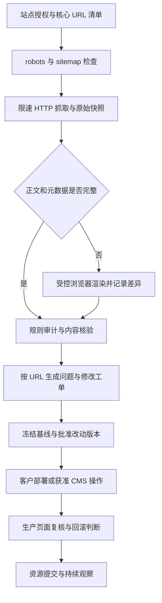
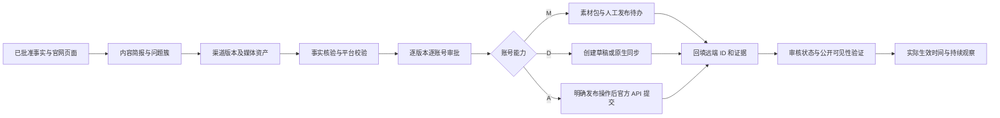
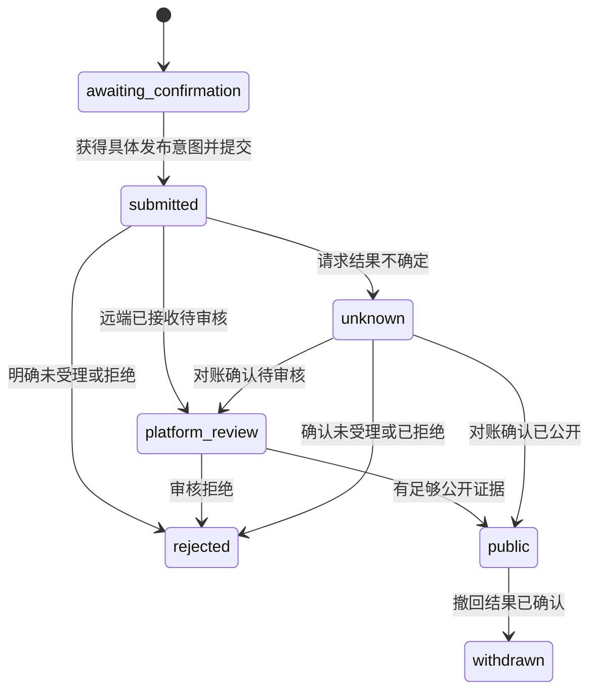

# 客户网站 SEO 与中国大陆自媒体内容分发实施技术报告

日期：2026-11-13｜版本：v1.0｜状态：实施设计，未完成真实账号接入或发布 PoC。

本报告面向产品、研发、内容运营及客户交付团队，细化客户官网 SEO 和内容分发两个模块。采用项目已确定的 Next.js Web + TypeScript Worker 架构：官网形成可维护的事实与内容源，各平台生成适合自身体裁的版本，经审核后发布，再分别核验上线、抓取、搜索表现、AI 引用和业务访问。首版以官网改造包、渠道素材包和人工回填完成闭环；官方接口连接器按应用资质、账号权限和实测结果逐个启用。

当前仓库只有规划文档，本文中的模块、数据表、接口、目录与工期均为待实现方案。本文承接 [Next.js 全栈架构](Next.js全栈技术选型与项目架构设计.md)、[用户端全流程](用户端全流程技术方案与Mermaid流程图.md)、[阶段 3](stages/03-诊断与优化任务.md) 和 [阶段 4](stages/04-内容审核与发布.md)；指标继续遵循 [指标与证据合同](指标与证据合同.md)。平台能力核验日期为 2026-11-13，具体证据范围见第 12 节。

## 1 交付范围与技术结论

### 1.1 三种优化目标分开交付

| 目标 | 可以实施的工作 | 验证方式 | 不应据此推断的结果 |
| - | - | - | - |
| 客户官网 SEO | 可抓取性、页面结构、内容质量、内部链接、URL 管理、搜索资源提交 | 页面快照、服务器日志、搜索平台数据、固定搜索观察 | 发布或提交成功不等于收录、排名提升 |
| 平台内搜索与内容传播 | 平台适配的标题、正文、封面、字幕、分类和真实账号运营 | 平台公开页、账号后台数据、固定条件的站内搜索观察 | 平台阅读量不等于官网访问量；推荐流曝光不等于搜索曝光 |
| GEO | 完整事实、明确出处、可引用段落、跨渠道信息一致性 | 固定题集中的原生引用与推荐、消费者端独立观察 | 不能从百家号发布推断文心必然引用，也不能从大鱼号发布推断夸克必然采纳 |

官网是可控制的事实与版本源，但不是所有平台都能设置指向官网的 canonical 或外链。系统应提供准确的来源表达和站内承接方式；只有平台允许且实际保留的链接才进入引流验证。平台选择依据客户已有账号、目标受众、行业样本中的引用与运营能力，不设全行业通用的“最高权重平台”名单。

### 1.2 平台范围与实现级别

本期覆盖 14 个主要渠道：微信公众号、微信视频号、百家号、今日头条、小红书、知乎、抖音、快手、哔哩哔哩、微博、搜狐号、网易号、企鹅号、大鱼号。CSDN、掘金、简书作为行业扩展。百科编辑、问答灌水、评论投放、广告投放和直播带货不进入本模块。

定义四个实现级别，按“账号 + 内容类型 + 操作”保存，不能只给平台一个布尔值：

| 级别 | 系统实际行为 | 启用条件 |
| - | - | - |
| M 人工发布 | 生成素材包和发布待办，客户在官方后台提交，系统回填并验证 | 账号归属、操作人、内容审批明确 |
| D 草稿协作 | 官方接口创建草稿或使用平台原生同步，保留正式发布待办 | 草稿权限和实际结果已验证；同步功能另记执行方 |
| A 官方接口发布 | 在逐次发布授权范围内提交、查询、对账和验证 | 应用及用户权限、真实发布、异常恢复均通过 PoC |
| X 暂停 | 不继续执行该账号的相关操作 | 授权失效、能力不确定、平台故障或规则变化 |

首版 14 个渠道均可从 M 起步；不能因某平台存在开放文档就直接把客户账号设为 A。浏览器私有接口、服务端共享 Cookie、验证码绕过和反爬对抗不作为 SaaS 发布底座。可讨论用户本地辅助填稿，但它需要独立产品与平台规则评估，不能混称为官方 API。

## 2 客户网站 SEO 模块

### 2.1 接入与站点盘点

客户依次提供域名、重点业务页面、CMS 或技术栈、可修改范围、搜索资源平台管理人、日志可用范围和回滚联系人。通过 DNS TXT、受控校验文件或客户授权材料确认站点管理权；公开网页审计与后台写权限分别登记。控制台采用 Next.js 不要求客户官网迁移到 Next.js。

建立版本化 `page_inventory`：首页、产品与服务页、解决方案页、案例页、知识文章、联系页、历史重定向和废弃页。保留原始 URL、规范化 URL、目标关键词/问题簇、页面类型、业务优先级、内容版本和页面责任人。URL 归一化只清除已确认的跟踪参数；不得无差别删除查询参数、转换路径大小写或合并不同内容。

站点规模较大时按模板和业务重要性抽样，记录总量、抽样规则与覆盖；未抓取的页面标为未检查。首批核心页面清单在实施前冻结，避免通过缩小分母提高完成率。

### 2.2 审计流水线



Worker 先用 HTTP 获取页面，只有正文或元数据缺失时才进入隔离的浏览器池。每次抓取记录请求条件、响应头、状态码、重定向链、原始 HTML hash、正文 hash、耗时和解析版本。渲染成功不能掩盖初始 HTML 为空的问题，两份快照同时保留。

抓取器限制单域并发、最大页面数、深度、响应体、解压后大小和超时；遵守可适用的站点抓取策略。URL、DNS 解析、每次重定向、实际连接目标及浏览器子资源都检查内网/回环/链路本地/元数据地址，阻断 SSRF 和 DNS 重绑定。官网和第三方内容均是待分析数据，不具备驱动工具的权限。

### 2.3 规则与验收映射

以下严重度是项目规则，不能直接当作搜索引擎排名权重。规则结果使用 `pass / fail / unknown / not_applicable`，保存 `rule_version` 与证据定位。

| 检查项 | 实现与修复动作 | 验收证据 |
| - | - | - |
| 状态与重定向 | 识别 4xx/5xx、循环跳转、软 404；改版建立逐 URL 映射；删除页按业务返回合适状态 | 最终状态、跳转链与删除页样本；不把全部旧页跳首页 |
| 正文可读性 | 比较初始 HTML 与渲染正文；重要描述、参数和内链在服务器输出中可读 | 禁用 JS 仍可读的核心内容，浏览器结果与抓取结果一致 |
| robots 与 noindex | 分别解析 robots.txt、meta robots、X-Robots-Tag；检测生产站误带测试环境规则 | 按具体 URL 和 UA 的规则判断；robots 放行不能抵消 noindex |
| canonical | 检查唯一性、目标可用性和语义一致性；清除跟踪参数的重复版本 | 目标 200 且正文对应；不同产品或分页不全部 canonical 到首页 |
| sitemap | 仅列计划索引的规范 URL；检查格式、目标状态、分片和真实修改时间 | 发布页已加入，撤下页已移除；不以每日改 lastmod 伪装更新 |
| 标题与摘要 | 按页面主题形成唯一、准确的 title 和 description；检测批量重复 | 与正文一致；长度只作为编辑提示，不设通用排名阈值 |
| 标题层级与内链 | 清晰主标题、章节层级、真实可访问的 a 链接；补产品到案例/问答的关联 | 无孤立重点页、无关键死链；避免仅靠点击事件导航 |
| 内容与事实 | 校验名称、型号、参数、日期、价格条件、作者和出处；标记空洞与重复模板页 | 关键主张关联有效 fact_version；实例、测评与客户证言有真实依据 |
| 结构化数据 | 按实际页面采用 Organization、Article、BreadcrumbList、Product 等语义；与可见内容一致 | JSON 可解析、实体字段有效；不虚构评分和评价 |
| 移动端与性能 | 检查布局、图片尺寸、阻塞资源、加载稳定性和真实访问性能 | 保存设备、地区、网络、工具版本；实验室分数与真实用户数据分开 |
| 大陆可用性 | 检查 DNS、TLS、字体、图片、视频、第三方脚本及 CDN 缓存 | 由大陆目标网络探针或客户测试提供证据；境外探针不能冒充大陆测试 |
| 站点一致性 | HTTPS、主域、语言/地区版本和路径约定；检查公共页是否误需登录 | 已确认域名映射、页面版本和访问条件 |

robots.txt 用于抓取协作，不是隐私访问控制。禁止抓取与 noindex 的组合可能使爬虫无法读取 noindex，撤下页面应单独制定索引处理方案。结构化数据只表达页面含义，不能承诺百度或其他引擎给出富结果。`llms.txt` 可作实验性补充，不纳入必达项，也不能替代 HTML、robots 或 sitemap。

### 2.4 内容信息架构

每个问题簇指定一个主要官网页面，避免为了同义词批量生成近似落地页。页面建议包含直接回答、适用对象、条件与限制、可核验事实、步骤或比较维度、来源和更新时间；案例页交代背景、实施过程和测量条件。关键词自然进入标题与相关段落，不设关键词密度目标。

网站内容对象增加 `intent_cluster_id`、`primary_url`、`fact_refs`、`author/reviewer`、`effective_at` 和 `next_review_at`。跨平台稿件引用同一事实集合，但可以选择不同论述结构。事实过期时，按依赖关系定位官网和所有渠道版本，创建修订或撤回任务。

### 2.5 按客户技术栈实施

| 客户站点 | 具体交付 | 上线控制 |
| - | - | - |
| Next.js 或可修改代码站点 | 路由/模板补丁、metadata、sitemap/robots、结构化数据、重定向与内链修改 | PR 或补丁关联批准版本；预览验收后由获准人员部署 |
| WordPress | REST API 创建文章/页面草稿、上传获准素材；读取远端草稿校验 | 默认 `status=draft`；正式发布为独立操作；SEO 插件字段需额外适配 |
| 其他 CMS | 在官方 API 或客户提供接口上实现最小草稿连接器 | 权限、字段、并发修改、撤回逐项验收 |
| 无 API 或仅客户能维护 | 输出逐页修改表、正文、metadata、图片、跳转清单和验收说明 | 客户执行后回填 URL、时间、版本及部署证据 |
| 无修改权 | 交付审计与工单，记录客户阻塞 | 不把建议或导出包标为已完成官网改造 |

WordPress 官方 Posts API 支持创建、更新和状态字段；本项目只将获准写范围映射到连接器。应用密码或其他认证方式需按客户环境核验，不能假定安装了某个 JWT/SEO 插件。[WordPress Posts API](https://developer.wordpress.org/rest-api/reference/posts/)

对 Next.js 客户站点，采用以下实现约束：

1. `generateMetadata` 与页面正文从同一公开内容版本读取；canonical 使用已核验站点 origin，不直接相信请求 Host。草稿和客户后台数据不进入公共查询。
2. 适合的营销与知识页面使用预渲染或服务器渲染。发布后同时刷新正文、metadata、列表和 sitemap 的相关缓存，避免多节点或 CDN 仍展示旧事实。
3. `app/sitemap.ts` 只读取公开页面，`lastModified` 来自实际内容更新时间；`app/robots.ts` 区分生产和预览环境。生成规范参考 [Next.js sitemap](https://nextjs.org/docs/app/api-reference/file-conventions/metadata/sitemap)。
4. 动态 metadata 可能采用流式输出，应实测目标爬虫条件下的原始响应。必要时按锁定版本配置 `htmlLimitedBots`，并确保内容语义一致；UA 模拟测试不代表真实爬虫已访问。[Next.js metadata](https://nextjs.org/docs/app/getting-started/metadata-and-og-images)
5. JSON-LD 从批准字段生成，嵌入前做安全序列化，避免将不可信文本直接拼入 script。格式验证与搜索展示资格分别处理。[Next.js JSON-LD](https://nextjs.org/docs/app/guides/json-ld)

### 2.6 搜索资源提交与数据接入

| 搜索渠道 | 实施方案 | 当前边界 |
| - | - | - |
| 百度 | 客户验证站点；维护 sitemap 和更新 URL 清单；有实际权限时接普通收录提交；导入索引、流量关键词和抓取诊断数据 | 官方说明普通收录帮助发现/抓取，不能解决是否收录；实际 token、额度和接口地址从账号后台核验 |
| 必应及 IndexNow 参与引擎 | 在获准域名部署 key 文件；变更事件触发新增、修改、删除 URL 通知；后台数据独立接入 | IndexNow 是通知协议；不把通知成功标为收录，也不假定所有大陆引擎支持 |
| 搜狗 | 由客户在资源平台完成网站验证、Sitemap/死链等操作；首版导出清单、人工留存回执 | 官方帮助列出这些工具，但自动接口与客户权限仍需核验 |
| 360 搜索 | 在客户可用的站长工具中验证提交方式，生成 sitemap/变更清单并导入结果 | 本次入口无可读正文；不把旧版自动收录脚本写入默认方案 |
| 其他搜索入口 | 根据行业流量单独登记能力和观测方案 | 头条号发布不等同于官网搜索资源提交；神马也不由大鱼号发布自动替代 |

依据：[百度普通收录](https://ziyuan.baidu.com/linksubmit/index)、[IndexNow 协议](https://www.indexnow.org/documentation?hl=en)、[IndexNow FAQ](https://www.indexnow.org/faq)、[搜狗资源平台帮助](https://zhanzhang.sogou.com/index.php/help/member)。[360 站长平台](https://zhanzhang.so.com/) 为待登录复核入口。

`index_submission` 保存引擎、站点、URL、内容版本、操作类型、提交时间、响应与批次。站点改动事件经 outbox 入队，按账号额度合批；只提交已确认变更。百度提交的具体协议不以网上旧示例替代当前后台说明。IndexNow 删除通知可包含已删除 URL；普通 sitemap 则移除这些 URL。

收录观察另存 `index_observation`，注明 URL 级结果、站点总量或人工搜索证据。`site:` 查询结果数量不是精确收录总数；搜索结果的地域、时间、账号和查询词必须保留。无官方数据/API 时允许客户上传报表，不能默认为零。

## 3 内容分发的公共流程

### 3.1 从事实源到平台版本



官网先发布可作为默认编排：官网验收通过后才开放含该来源链接的渠道任务。但独家内容、客户发布节奏或活动约束可以改变顺序，必须在 `distribution_plan` 中明确，不能用“官网先发”声称一定获得原创认定或 canonical 优先权。

每个平台输出独立 `content_variant`。标题、正文、封面、图片顺序、视频、字幕、标签、外链、声明和目标账号均属于审批范围。正文摘要与脚本可由模型辅助生成；每条重要主张仍绑定事实版本，不能把虚构体验写成用户测评。

### 3.2 素材包规范

统一导出 `manifest.json`、可复制正文、预览 HTML、封面/配图、视频/字幕、事实来源说明和发布步骤。包内记录内容版本、各文件 hash、目标账号、平台规则版本、权利范围、AI 声明、链接策略、预期时间与回填表单地址。运营内部的事实审查信息和客户隐私不混入公开正文。

富文本采用受限的内容结构树，再分别渲染 HTML、Markdown 或纯文本。平台去掉表格、代码块、脚注或外链时，应在发布前预览中明确提示；涉及事实含义的删改产生新版本。图片上传后只允许预定义的 URL 替换，并保存 `asset_hash → remote_asset_id/url` 映射，不能借“格式转换”静默改稿。

视频资产先登记母版、字幕、声音/音乐与肖像授权，再输出渠道版本。用媒体探测工具读取编码、大小、时长、比例和音轨；必要时在隔离 Worker 转码。限制来自带日期的 `platform_policy_version`，不把某篇旧文档中的大小、字数或视频时长永久写死。短视频可默认准备竖版、长演示准备横版，但这是制作选择，实际以账号发布要求为准。

### 3.3 审批与标识

批准记录绑定 `variant_hash + asset_manifest_hash + account_id + fact_revision + policy_version + operation`。定时发布执行前重验事实、权限、审批和素材；改稿、换账号或事实失效时停止。公开发布与“创建草稿”是两个权限，撤回是第三个权限。

AI 使用情况与原创/转载权利分别记录。系统保留生成合成来源信息，按适用规则生成标识和发布声明；素材转换不得恶意删除已有标识。用户发布生成合成内容应主动声明并使用平台标识功能，依据已于 2025-09-01 施行的 [人工智能生成合成内容标识办法](https://www.cac.gov.cn/2025-03/14/c_1743654684782215.htm)。具体服务提供者义务需结合本产品角色评估，不能用一个“AI 辅助”勾选框替代全部要求。

独家/首发限制写入分发计划，产生与其他平台冲突时阻断任务；“自有作品”也不自动等于符合某个平台的原创权益条件。商业合作、图片/音乐权利、行业资质要求进入客户内容审核，不自动生成不存在的授权或证书。

## 4 逐平台能力与排期总表

证据等级：D 表示已读取官方正文；I 表示官方页面的搜索索引可见，但正文读取受限；U 表示仅入口可见、读取失败或未取得足够接口说明。等级反映本文的资料核验程度，不是平台可靠性评分；所有账号实测状态均为“未进行”。M/D/A 是实现级别，与证据等级分别保存。

| 平台 | 本模块优先内容 | 首版 | 后续连接器方向 | 当前关键边界 |
| - | - | - | - | - |
| 微信公众号 | 深度图文、案例与知识说明 | M | D 优先，A 需核验 | 发布接口正文 U；账号类型、草稿与发布权限分别核验 |
| 微信视频号 | 演示、服务过程、知识短视频 | M | 有明确官方授权再评估 | U；公众号、小程序或视频号小店接口不能代替普通作品发布权限 |
| 百家号 | 场景说明、问答式长文、案例 | M | 合作接口实证后接入 | 企业平台介绍为 I；普通内容发布 API 为 U |
| 今日头条 | 解释型图文、行业观察 | M | 图文与视频分别验证 | 图文接口 U；官方权限页列有头条视频能力，不等于通用图文权限 |
| 小红书 | 原创场景图文、真实体验与教程 | M | 原生分享/特定合作能力单独评估 | D；所见账号平台仅 basic_info 开放，笔记写入仍标规划中 |
| 知乎 | 问题回答、方法论、专业文章 | M | 获明确内容写权限再接入 | 创作手册 D；通用写 API 为 U |
| 抖音 | 场景短视频、讲解与演示 | M | A 候选 | D；video.create 需申请及用户授权，逐次操作须用户感知 |
| 快手 | 演示、实操与服务过程视频 | M | A 候选 | D；上传和发布分阶段，发布异步完成 |
| 哔哩哔哩 | 长演示、系统教程、专栏 | M | 视频和专栏分开接入 | I；官方索引显示相关能力，完整协议和账号权限待核验 |
| 微博 | 观点摘要、更新说明、链接分享 | M | 链接分享作为独立候选 | U；不能把历史 statuses/share 或写接口视为通用发文能力 |
| 搜狐号 | 行业解释、案例文章 | M | 平台原生同步可选 | D；原生同步不等于向本系统开放通用发布 API |
| 网易号 | 行业观察、解释型文章 | M | 合作能力实证后接入 | U；需客户后台核实发布、修改、数据导出范围 |
| 企鹅号 | 图文与视频知识内容 | M | 合作能力实证后接入 | U；企鹅号与公众号是不同账号和权限体系 |
| 大鱼号 | 教程、知识图文与视频 | M | 原生分发记录，API 另验 | D；平台内分发机会不能承诺实际到达指定产品 |

首轮业务可选官网 + 公众号 + 百家号/知乎中的一个；消费类客户可换为小红书，有视频资产的客户再选抖音或快手。选择是实施建议，不代表已验证的转化优劣。一个品牌先跑通少量渠道，再扩到矩阵。

## 5 图文与知识平台实现说明

### 5.1 微信公众号

**内容适配。** 输出标题、作者、摘要、正文 HTML、封面、正文图片、来源链接和声明。建立微信专用样式白名单，重点检查图片可见、段落间距、表格替代和手机预览。正文不能直接使用只对本系统登录用户有效的图片地址。

**首版流程。** 运营从批准素材包进入 [微信公众平台](https://mp.weixin.qq.com/)，确认公众号身份，创建草稿并预览；需要改字或替换图片时回到系统形成新版本；完成相应发布操作后回填文章 URL、远端标识、实际时间和后台证据。草稿预览链接不计公开上线。

**连接器设计。** 计划按“获取凭证与账号能力 → 上传正文图片/封面 → 创建草稿 → 读取草稿核对 → 单独发布 → 查询结果”实现。候选接口族为 `/cgi-bin/draft/*` 与 `/cgi-bin/freepublish/*`，分别保留草稿 `media_id`、发布任务 `publish_id` 和文章标识，不能混用。正式编码前必须补齐当前官方方法、参数、权限及状态定义；本次 [新建草稿文档](https://developers.weixin.qq.com/doc/offiaccount/Draft_Box/Add_draft.html)、[发布文档](https://developers.weixin.qq.com/doc/offiaccount/Publish/Publish.html) 均读取失败，以上是待核验设计，不作为当前可调用保证。

多客户 SaaS 优先评估微信第三方平台授权；单客户自有凭证方案限定在客户许可范围内，令牌和出口 IP 要求按实际账号校验。不要用客户主账号密码代替授权。草稿、普通发布、面向粉丝的群发应作为不同操作分别核验，产品不能把普通发布按钮命名为“群发推送”。

**验收与异常。** 分别验证仅草稿权限、发布被拒、素材失效、用户在微信后台改稿和提交超时。只有草稿权限时完成 D 后交人工；发布结果未知先查账。阅读等后台指标按实际取得的数据字段导入，不能仅凭文章访问页推算粉丝触达。

### 5.2 百家号

**内容适配。** 以场景问题、使用条件、行业解释和真实案例为主，导出标题、摘要、正文、图片/封面、分类建议、来源说明和原创/AI 声明。企业号可有线索等经营功能，但必须针对实际账号可用组件建立配置，不能默认给每篇内容插入电话或外链。[百度企业百家号](https://qiyehao.baidu.com/)

**发布流程。** 客户在 [百家号后台](https://baijiahao.baidu.com/) 选择图文类型，导入素材，核对分类、封面、来源和声明，提交后回填作品 ID 与审核状态；待对外可见，再验证作者、标题、关键事实和页面链接。后台当前字段、额度、可修改期限由客户试点记录，本次未登录核验。

**技术落点。** 实现 `baijiahao.article` 素材渲染器与人工任务模板，不创建猜测的 `/content/publish` 客户端。若客户拿到官方合作文档，按应用鉴权、作品创建、状态查询、编辑/撤回、数据权限五项验收后增加 API 适配器。

**SEO 与验证。** 百家号内容与官网通过事实和来源关联；两者分别记录页面归属、搜索观察和引荐。官网站长提交权限不覆盖百家号共享域名。百家号发布不会自动满足官网收录或文心引用的验收。

### 5.3 今日头条

**内容适配。** 解释型文章需要完整上下文和可核实信息，不能只把公众号引言截断后分发。文章与短内容使用不同模板，封面和摘要独立检查，避免标题承诺超出正文证据。

**发布流程。** 首版由运营进入 [头条号后台](https://mp.toutiao.com/)，选择账号实际可用的文章类型，提交批准正文和图片，核对声明与发布设置；保存远端作品标识、审核反馈和公开 URL。阅读、展现和粉丝数据来自授权后台报表，单独保留指标原名与统计周期。

**技术落点。** 将 `toutiao.article`、短内容和视频作为不同 capability。抖音官方 [权限说明](https://open.douyin.com/platform/resource/docs/accession-guide/type-and-permission/) 列有今日头条视频相关能力，但它不能证明头条图文写入已获准；即使同属一个生态，也不能复用抖音的账号标识、发布路径或审核状态映射而不验证。

**验收与异常。** 拒绝、仅自己可见、审核中和公开分别记录。改稿后重新校验事实，不对被拒内容循环改写重发；账号有原生同步时记录同步来源，防止人工与同步各发一份。

### 5.4 小红书

**内容适配。** 图文按“明确场景 → 实际过程或可复核说明 → 结果与限制”组织，系统输出有序图片、封面、标题、正文、话题建议和来源/声明。不能把品牌介绍伪装成用户亲历测评。图内文字中的参数、价格和前后对比也进入事实审核，不能只审正文。

**发布流程。** 使用 [小红书创作服务平台](https://creator.xiaohongshu.com/) 或客户 App 发布。逐张核对图片顺序、封面裁切、正文与标签；导流方式按实际平台规则和账号能力处理，不能统一加微信号、二维码或伪装链接。发布后回填笔记 ID、分享链接、账号和时间。

**技术落点。** 所见账号开放平台的 [Scope 文档](https://openaccount.xiaohongshu.com/docs/scope) 仅将 `basic_info` 标为已开放，`read_notes`、`write_notes` 标为规划中。因此该 OAuth 登录不能解锁本系统的自动发笔记按钮。其他商业合作或客户端分享能力若取得官方文档，应新增独立 capability，不推断全部小红书业务都没有发布能力。

**验收与异常。** 原始分享 URL 与清理后的展示 URL 分别保存；可能影响可访问性的参数不得盲删。公开验证遇登录、签名过期或风控时记 `access_limited`，由运营在明确访问条件下复核。不可访问不等于删除，收藏/互动也不等于站外 SEO 权重。

### 5.5 知乎

**内容适配。** 区分回答与文章：回答绑定真实 `question_id/question_url`，先解决问题再介绍适用方案；文章承载完整方法、比较维度与依据。正文引用来源，明确品牌/机构身份，不生成伪装成无利益关系用户的推荐。知乎官方提供问答、文章等不同创作形式，参考 [创作者手册](https://www.zhihu.com/knowledge-plan/manual)。

**发布流程。** 运营核对问题上下文、现有回答和重复情况，从官方创作入口粘贴批准内容，确认图片、链接和声明；回填回答/文章的独立 ID、URL、所属问题及发布时间。问题 URL 不能替代回答 URL。

**技术落点。** 实现 `zhihu.answer` 与 `zhihu.article` 两种渲染和验收模板。通用内容写 API 未取得足够官方说明，首版采用 M；不把登录接口或页面内部请求当成公开发布契约。正文在平台编辑器调整后须保留最终版本映射。

**验收与异常。** 问题被合并、回答折叠、内容删除与登录受限分别记录。一个回答被 AI 引用，只能归属于该次样本；不因此认定整个知乎域名属于客户或长期优先信源。阅读、赞同、收藏等仅按后台实际字段导入。

### 5.6 微博

**内容适配。** 主要输出短摘要、配图、更新说明和可用来源链接；长文章、短微博、视频采用不同变体。避免把长文机械截断造成条件丢失，数值与结论须保留必要上下文。

**发布流程。** 首版在微博官方客户端/网页人工发布，回填微博 ID、永久链接、账号、公开范围及时间，检查实际短链跳转和图片。长文章另记其文章 ID 和微博承载帖，不能将二者混成同一远端对象。

**连接器边界。** [微博 statuses/share 官方入口](https://open.weibo.com/wiki/2/statuses/share) 本次无可读正文。若后续评估链接分享，必须核验应用审核、安全域名、文本/图片限制、用户触发、调用额度及数据存储要求；在此之前不启用自动提交。历史 `statuses/update` 示例也不能证明通用发微博权限仍对该应用开放。

**验收与异常。** 测试账号可见、公开可见和限流分开。`weibo.link_share` 若将来启用，仅覆盖明确验证的分享场景，不默认支持纯文本、长文、任意客户域名或定时批量发文。外链被短链化后，原始 URL、远端 URL 和最终落地 URL 都要可追溯。

### 5.7 搜狐号

**内容适配。** 输出行业文章、案例、来源与封面，去除公众号专用样式，检查正文中的网址、图片版权和信息来源。搜狐号官方公告要求发布时声明是否包含 AI 创作内容，需在任务表中记录声明执行结果。[搜狐号标注公告](https://www.sohu.com/a/929885575_119436)

**发布流程。** 从 [搜狐号后台](https://mp.sohu.com/mpfe/v4/) 人工发布并回填。客户账号若具有平台原生内容同步能力，可登记同步源、目标账号、启用时间和作品来源；系统只记录同步结果，不宣称自己调用了发布 API。相关机制见 [搜狐号内容同步规则](https://www.sohu.com/a/741336891_120635073)。

**技术落点。** `sohu.article` 适配器输出正文与声明清单；`native_sync` 单独作为执行模式。使用来源 URL、内容簇和远端 ID 对账，发现同步稿后阻止重复人工提交。只凭标题相同不能自动合并作品。

**验收与异常。** 来源稿已上线不代表搜狐已同步；同步失败或延迟保留待办。公开文章核对署名、正文、声明和访问条件；官网及其他转载页按内容簇去重，不把每个转载当作独立第三方背书。

### 5.8 网易号

**内容适配。** 首轮以可独立阅读的行业解释、案例和知识文章为主，输出标题、正文、封面、图片说明、来源和发布声明。账号实际内容类型、分类和编辑权限须在客户后台确认。

**发布流程。** 客户在 [网易号后台](https://mp.163.com/) 使用获准账号发布；运营保存作品标识、审核状态、最终 URL 与时间。新闻客户端分享页、网页页及后台作品记录可以对应同一作品，保存别名关系而不重复计数。

**技术落点。** 建立 `netease.article` 渲染、人工发布任务和报表导入映射。本次官方入口读取失败，未取得足够通用发布 API 证据；如有客户合作接口，先获取正式协议、鉴权与查询样例，再独立实现。不能根据第三方批量发布产品的宣传推断官方授权。

**验收与异常。** 按客户实际后台确认修改、撤回和重新审核流程。无法修改的错误内容生成撤回或更正任务，不假定新稿沿用原 URL/数据。入口不可访问时保留“访问受限”证据，不能直接判定已下架。

### 5.9 企鹅号

**内容适配。** 图文和视频分开输出，适用于知识讲解与行业案例；发布前确认版权、独家/首发约束、分类与声明。不得把同一份内容同时标成多平台独家。

**发布流程。** 客户进入 [腾讯内容开放平台](https://om.qq.com/)，以实际开通的企鹅号内容能力提交，回填作品 ID、审核反馈和真实可访问的落地页。多端展示若发生，记录为同一源作品的不同展示端。

**技术落点。** 实现 `penguin.article`、`penguin.video` 素材模板和独立账号模型。本次可定位登录入口，未核验后台协议。微信公众平台的 appid、令牌、发布回执不能用于企鹅号；腾讯生态中的广告、视频播放或数据接口也不能替代发文授权。

**验收与异常。** 不将“平台提交成功”展开成腾讯所有产品已分发。后台总阅读与某一落地端阅读分别保留统计范围，不能相加制造曝光。若账号获得合作接口，须增加逐端状态和远端对象映射的验证。

### 5.10 大鱼号

**内容适配。** 输出独立教程、行业知识或视频讲解，并核查商业表达和导流要求。大鱼号公开 [服务手册](https://mp.dayu.com/service-manual) 包含内容审核和导流规则；旧页面的字数、功能和活动门槛不作为本系统永久硬编码，试点以账号当前规则复核。

**发布流程。** 运营在 [大鱼号](https://mp.dayu.com/) 发布、等待审核，回填源作品 ID、时间和结果。有实际展示端证据时再登记目标端 URL。官方 [平台介绍](https://mp.dayu.com/about.html) 表述为内容有机会同步，不能据此承诺进入某个产品或 AI 回答。

**技术落点。** `dayu.article/video` 负责素材和回填；`distribution_surface` 记录平台源作品与各端展示关系。没有明确第三方发布协议时采用 M；“一点生产、多端分发”是平台内部机制，不等于本 SaaS 获得全生态写权限。

**验收与异常。** 已审核、已展示、被推荐和有引荐访问分别观察。渠道间统计口径可能重叠，保存原始报表及定义，不将所有终端数字直接汇总为独立用户。

## 6 视频平台实现说明

### 6.1 抖音

**内容适配。** 输出视频成片、封面、字幕、说明文案、话题、适用的挂载信息和声明。标题、口播、画面文字、字幕中的品牌事实统一核验；视频不能只审脚本而不审最终成片。

**接口条件。** 官方创建视频文档要求申请 `video.create` 并取得用户授权，明确创建后有审核过程，且代用户创建的每次操作都应让用户明确感知。本系统据此设置逐作品发布确认及可查看的执行记录；OAuth 授权本身不能替代具体发布意图。[抖音创建视频](https://open.douyin.com/platform/resource/docs/openapi/video-management/douyin/create/create-video/)

**实现顺序。** 应用审核和账号 OAuth → 校验 scope/账号 → 上传视频取得上传标识 → 校验成片与批准版本 → 用户确认具体作品 → `POST /video/create/` → 保存远端内容标识 → 按已获准查询能力对账 → 公开状态核验。`video_id` 上传标识与作品标识分开保存。查询、删除和数据能力分别申请，参考 [权限说明](https://open.douyin.com/platform/resource/docs/accession-guide/type-and-permission/)。

**失败与降级。** 无 API 权限时在 [抖音创作者中心](https://creator.douyin.com/) 人工发布。上传成功但创建失败，只能按远端语义决定是否复用上传资产；创建响应超时进入 unknown。不能把 SDK 分享事件自动当作服务端 API 审核通过通知，事件适用场景需按 [官方事件列表](https://open.douyin.com/platform/resource/docs/develop/webhooks/event-list/) 核对。

**验收。** 覆盖授权撤销、逐次确认缺失、视频审核中、仅自己可见、发布拒绝、查询权限不足和撤回。平台内搜索表现通过独立固定条件观察；官网引流只统计真实保留的合规链接或经营组件所产生的数据。

### 6.2 快手

**内容适配。** 输出成片、封面、字幕和描述，优先用实操过程解释业务价值；最终素材经编码与事实检查后才进入发布。

**实现顺序。** 官方文档将创建视频拆为发起上传、上传视频、发布视频。取得相应应用/用户权限后保存 upload session，完成普通或分片上传，再调用 `POST https://open.kuaishou.com/openapi/photo/publish`；记录返回的 `photo_id`，通过已获准查询接口确认结果。[快手创建视频](https://open.kuaishou.com/platformDocs/openAbility/contentManagement/createAVideo)

**技术边界。** 发布是异步的，接口返回不能直接标为公开。分片序号、大小、上传令牌和合并完成状态分别保存；断点恢复只重传明确失败的分片。文档中的 scope/能力标识与实际控制台授权值需在 PoC 对齐，不能把大小写或权限名称猜成可用参数。

**失败与降级。** 上传完成但发布报告视频未上传，可能与文件/转码异常有关，应检查上传记录和媒体完整性，不直接重复发布。无权限时采用 [快手官方说明中的创作者平台](https://www.kuaishou.com/help/feedback/4000?categoryId=hot) 人工上传，运营回填审核与公开结果。

**验收。** 测试分片中断、合并失败、发布超时、账号额度和查询不到内容；只有足够远端证据才能从 unknown 迁出。视频数据按时间截面保存，缺少后台权限时不估算完播率。

### 6.3 哔哩哔哩

**内容适配。** 面向长演示和系统教程，视频稿件输出标题、简介、标签、分区建议、封面、分集顺序、字幕及版权声明；专栏输出文章、图片和引用。代码或演示步骤需可复核，不能用视频长度代替内容完整性。

**接口证据。** 官方 [开放平台文档入口](https://openhome.bilibili.com/doc) 的搜索索引显示视频与专栏的发布、查询、删除能力；[文章提交文档](https://open.bilibili.com/doc/4/b14b77b6-8889-8c8b-2e83-17c5a4c550fb) 的索引显示 `ATC_BASE`、用户授权及提交后审核。正文读取受限，因此文档等级为 I，不能据此认定客户应用已开通。

**连接器设计。** 视频路径为 OAuth/权限确认 → 上传初始化 → 文件/分片上传 → 合并 → 封面 → 稿件提交 → 查询审核与公开结果；专栏路径为授权 → 平台图片上传 → 提交文章 → 查询。正式实现前核验 [视频稿件提交](https://open.bilibili.com/doc/4/f7fc57dd-55a1-5cb1-cba4-61fb2994bf0f)、签名版本及完整上传协议，不用浏览器 Cookie 投稿端点替代开放接口。

**数据映射。** `upload_session_id`、平台稿件内部标识、公开 `bvid/aid` 或文章标识分字段保存，以实际响应为准。分 P/多稿件不是同一个层级；整稿审批需覆盖全部分集及顺序。图片/视频上传地址只接受官方流程返回并通过出口校验的目标。

**验收与降级。** 未开放能力时在官方创作中心人工提交。测试上传成功但稿件拒绝、分集缺失、分类失效和重复提交；公开视频可播放与全文可抓取分别记录。视频播放和专栏阅读不直接横向求和比较质量。

### 6.4 微信视频号

**内容适配。** 输出视频、封面、描述、字幕和声明，优先承载可实际拍摄的产品演示、服务过程与知识解答。商品、位置或其他挂载能力仅在客户账号真实可用时加入审批内容。

**发布流程。** 使用 [视频号助手](https://channels.weixin.qq.com/) 或微信 App，由客户核对视频号身份、成片、封面和公开范围，提交后记录作品标识、审核/展示证据及时间。本次入口读取失败，具体账号字段和发布限制由试点复核。

**技术落点。** 实现 `wechat_channels.video` 素材包与人工回执，不复用公众号草稿发布适配器。视频号小店、电商商品、直播或小程序的接口不等于普通视频作品的通用发布权限；取得特定官方合作能力后，新增独立认证与状态映射。

**验收与异常。** 可能只有 App 内可访问的作品：保存远端 ID、访问入口、账号条件与复核人，标明公开 URL 验证受限。不能为了满足字段要求伪造永久网页地址。站内观看、转发和商业组件线索按实际授权数据分别导入。

## 7 垂直渠道扩展

垂直渠道只有在客户行业适用且具备原创内容时才加入分发计划。以下首版均为 M，自动写接口未完成官方能力核验。

| 渠道 | 适配与人工流程 | 数据和验收重点 |
| - | - | - |
| CSDN | 技术教程、工程案例；输出 Markdown/富文本及代码块、依赖版本、复现步骤；由运营在 [创作中心](https://mp.csdn.net/) 发布 | 原创/转载声明、代码许可证、图片、目录和最终文章 URL；不把产品软文伪装成独立评测 |
| 掘金 | 面向开发实践；保留代码、环境、技术结论与适用范围，运营在官方编辑器选择实际分类/标签并发布 | 检查代码渲染、外链、图片与最终 URL；[编辑入口](https://juejin.cn/editor/drafts/new?v=2) 本次读取受限，字段需登录核验 |
| 简书 | 可独立阅读的知识与经验文章，输出简洁 Markdown 和配图，由作者在 [写作入口](https://www.jianshu.com/writer) 提交 | 账号状态、正文可见性、来源和版权；本次入口 403，不能承诺当下具体账号可发布 |

这些平台的自发转载不计作已授权运营成果；要把“客户主动分发”“第三方转载”“监测中发现”三种来源关系分开。

## 8 Next.js 与 Worker 的工程落地

### 8.1 模块职责

沿用 Next.js App Router、TypeScript、PostgreSQL/Drizzle、pg-boss + outbox、对象存储的既有选型，不另建第二套账号/审批体系。建议目录为目标蓝图：

```text
apps/web/app/(workspace)/brands/[brandId]/sites/
apps/web/app/(workspace)/brands/[brandId]/distribution/
apps/web/app/api/v1/sites/
apps/web/app/api/v1/distribution-plans/
apps/worker/src/jobs/site-audit.ts
apps/worker/src/jobs/render-variant.ts
apps/worker/src/jobs/publish-submit.ts
apps/worker/src/jobs/publish-reconcile.ts
apps/worker/src/jobs/verify-publication.ts
packages/domain/src/seo/
packages/domain/src/publishing/
packages/application/src/sites/
packages/application/src/distribution/
packages/adapters/src/crawler/
packages/adapters/src/publishing/
packages/contracts/src/publishing/
```

Web 处理身份、页面、短事务、审批和 202 异步请求；Worker 负责抓取、素材渲染、上传、提交、轮询、验证和指标导入。UI 展示账号实际能力及阻塞原因；未验证权限不显示可执行的自动发布按钮。官方客户端打开与素材下载可以作为人工任务的一部分。

### 8.2 数据模型

扩展现有 `site/page_inventory/content_version/approval/publication`，避免再造同名业务真相。以下所有租户数据都带 `tenant_id`，品牌关联使用复合外键并受既有授权与 RLS 保护。

| 对象 | 核心字段 | 不变量 |
| - | - | - |
| site_access_grant | site_id、允许域名/路径、读写范围、授权证据、到期时间 | 抓取权与 CMS/部署写权分别校验 |
| seo_audit_run / seo_finding | inventory_version、rules_version、URL、severity、evidence、状态 | 同一规则可重放；未知不按通过处理 |
| page_change | 原快照、目标版本、批准记录、部署版本、上线/回滚时间 | 不覆盖原证据；并发修改先比较版本 |
| channel_account | platform、外部账号 ID、主体、credential_ref、授权版本 | 不将不同平台同名账号视为同一账号 |
| channel_capability | 账号、内容类型、操作、模式、scope、证据、checked_at、expires_at | 文档支持与账号实测分开；执行前重新检查 |
| content_variant | parent_content_version、platform、body_ast、fact_refs、policy_version、hash | 每个平台改稿生成新版本 |
| media_asset / remote_asset | 文件 hash、权利/AI 信息、格式、远端账号/标识、到期时间 | 同一素材跨账号不能默认复用平台资产 ID |
| distribution_plan / target | 内容簇、目标账号/变体、依赖、计划时间、独家约束 | 每个目标有独立审批、状态与回执 |
| publication / attempt | approval_id、操作、intent_key、request_hash、远端 ID、各阶段时间 | 逻辑操作唯一，每次网络尝试独立留痕 |
| publication_observation | 远端状态、URL、可见性、正文比对、证据与 observed_at | 观察只追加；抓取失败不覆盖已有公开事实 |
| distribution_surface | 源作品、终端、终端 URL、发现时间、证据 | 平台内部多端展示不重复算源发布次数 |
| metric_import / metric_snapshot | 平台字段、对象、时间窗、累计/区间口径、原始文件 hash | 未取得指标为 N/A；累计值不能跨日相加 |

时间存 UTC，报告口径继续采用项目合同的 Asia/Shanghai。定时发布表单明确显示时区；本文日期使用本次任务的客户端日期，不能将工作机默认时区隐式带入排期。

### 8.3 适配器合同

以下 TypeScript 是接口形状，未承诺任何平台原生支持幂等或撤回：

```ts
type PublishMode = 'manual' | 'draft_api' | 'official_api' | 'native_sync';
type SubmitResult =
  | { kind: 'accepted'; remoteId?: string; requestId?: string }
  | { kind: 'rejected'; code: string; retryable: false }
  | { kind: 'unknown'; requestId?: string };

interface PublishingAdapter {
  describeCapabilities(accountId: string): Promise<CapabilitySnapshot>;
  validate(input: ApprovedVariant): Promise<ValidationResult>;
  prepareAssets(input: ApprovedVariant): Promise<RemoteAssetManifest>;
  createDraft?(input: AuthorizedOperation): Promise<DraftReceipt>;
  submit?(input: AuthorizedOperation): Promise<SubmitResult>;
  reconcile(input: ReconcileInput): Promise<RemoteObservation>;
  withdraw?(input: AuthorizedOperation): Promise<SubmitResult>;
  exportManualPackage(input: ApprovedVariant): Promise<PackageReceipt>;
}
```

这些 DTO 在 `contracts` 定义，鉴权、审批、状态机和事务属于共享 application/domain。适配器只转换协议，不决定租户身份，不接受前端传来的任意凭证或 API URL。`reconcile` 无官方查询能力时返回需要人工核对，不能伪造一个成功状态。纯素材准备也可能上传远端资产，必须有相应权限，且不能隐式提交作品。

### 8.4 内部 API

| 方法与路径 | 行为 | 关键返回或校验 |
| - | - | - |
| `POST /api/v1/sites/:id/audits` | 创建站点审计 | 202 + operationId；限制范围、预算和并发 |
| `GET /api/v1/sites/:id/findings` | 查询 URL 级问题 | 规则版本、证据与未知原因 |
| `POST /api/v1/distribution-plans` | 建计划及目标列表 | 账号归属、内容权限、依赖与独家冲突 |
| `POST /api/v1/content/:id/approvals` | 沿用已有审批用例 | 必须定位最终渠道变体及 hash，避免另建平行审批链 |
| `POST /api/v1/publications` | 沿用发布用例，创建具体目标的操作 | 有效审批、明确执行模式与用户意图；202 或人工待办 |
| `POST /api/v1/publications/:id/receipts` | 回填人工或原生同步结果 | 远端 ID、账号、URL、时间与证据；不能自证公开 |
| `POST /api/v1/publications/:id/verify` | 触发只读验证 | 限频、目标出口校验；202 |
| `POST /api/v1/publications/:id/withdrawals` | 建撤回操作 | 独立权限、原因、远端状态；原发布记录保留 |
| `POST /api/v1/accounts/:id/metric-imports` | 上传后台数据 | 字段映射、时间窗、文件 hash 与租户隔离 |

前端能力检查只改善体验，服务端与 Worker 都要重新鉴权。OAuth 使用 state 绑定操作者、租户和应用，校验回调并按平台要求处理 PKCE/签名；令牌加密保存、最小 scope、单账号刷新锁、日志脱敏。客户退出后停止任务及令牌刷新，已发布作品是否撤回另立操作。

## 9 状态机与可靠发布

### 9.1 将审核 发布和验证分开

沿用阶段 4 的业务词汇，但在实现中分为内容审批状态、远端发布状态和验证状态三个字段，避免一个状态同时表示“稿件批准”和“作品公开”。



`publication_observation` 另存 `pending / verified / mismatch / access_limited / unknown`。远端报告成功但只允许作者查看时，不计公开验收。已知公开作品后续探测失败，保留最后已知状态和失效时间，等待进一步证据，不自动转成 withdrawn。

取消未执行任务是调度状态 `cancelled`，不是公开内容的 withdrawn。创建远端草稿记录 `remote_draft_id`，不触发公开发布时间或效果窗口。

### 9.2 事务与幂等

1. Web 在短事务内检查操作者、账号、有效审批、事实版本和业务幂等键，创建 publication/attempt 意图、审计与 outbox。
2. dispatcher 将事件交给 pg-boss；Worker 取得租约后，重新校验授权与当前业务状态，防止撤权后仍执行旧任务。
3. 请求前持久化尝试和最终请求摘要；网络调用不放进长数据库事务。返回后保存脱敏响应、请求 ID、远端对象和状态变化。
4. 本地唯一键采用 `tenant + account + content_variant_version + operation`；同键不同请求体返回 409。每次尝试有独立 attempt_id，重复投递不能新建第二个逻辑发布。
5. 远端无原生幂等时，本地锁不能保证外部 exactly-once。请求已经可能送达、Worker 崩溃或回包丢失，都进入 unknown/对账流程；未证明远端未受理前禁止自动重发。
6. 若人工核实未发布，保存核实证据与操作者，再在同一逻辑操作下产生获准的新尝试。确需重新发布为新作品时建立独立操作，并记录与旧作品关系。

### 9.3 故障动作表

| 故障 | 系统行为 | 运营动作 |
| - | - | - |
| scope 不足或令牌撤销 | 暂停相关 capability 与待执行任务 | 重新授权或选择人工流程 |
| 校验拒绝、内容违规或审核拒绝 | 保存明确原因，停止自动重试 | 审稿、修订后重新审批 |
| 429 或可确认未受理的限流 | 按远端规则和 Retry-After 退避，限制尝试次数 | 持续限流时调整排期 |
| 网络超时、断连或不明确 5xx | 判断是否可能已受理；可能已受理则 unknown | 先对账，不能一概自动重试 POST |
| 上传部分失败 | 按上传协议恢复，复用经核实的分片或资产 | 无恢复能力时重新准备资产 |
| 回调重复、延迟或乱序 | 验签、持久化去重，按事件/查询结果合并 | 冲突状态进入对账待办 |
| 审核长期未完成 | 限频查询，到期提示人工跟进 | 不因超过系统等待时间而判拒绝 |
| 人工改稿或素材不一致 | 标 mismatch，暂停执行验收 | 对线上内容重新审核，必要时更正或撤回 |
| 多平台部分成功 | 目标独立结算；计划显示完成、失败、阻塞和未知数量 | 对剩余渠道决定修订或取消，不自动删除成功作品 |

回调防重放遵循每个平台真实签名协议，不能强制假定都有同一种时间戳或 event_id。无 event_id 时用官方稳定字段组合与原始事件 hash 去重；回调仅补充证据，仍需覆盖丢回调的查询路径。发布/撤回任务从备份恢复后先暂停外部操作并对账。

### 9.4 调度与限流

本系统定时只表示到期执行提交，不保证平台到时公开。分别保存 `scheduled_at`、`submitted_at`、`platform_published_at`、`first_verified_public_at`；若真实生效时间未知，以首次验证时间作为明确标注的近似基准，不虚构平台发布时间。

初始调度策略按账号串行发布、按应用与平台设置共享限流器，值来自当前权限和实测。状态轮询使用退避、截止时间和人工接管，避免把长时间等待放在一个 Worker 任务或 Next.js HTTP 请求里。故障平台可熔断，但已受理作品仍保留对账任务。

## 10 效果观察与归因

### 10.1 发布验收

每个目标至少保留：批准版本、实际发布版本、账号、远端 ID、公开 URL 或访问限制、提交/生效/验证时间、声明执行记录、可见性证据和事实比对结论。页面模板的广告、导航或平台组件变化不应让整页 hash 差异误判为正文被改；使用版本化正文提取与关键字段比较，必要时人工复核。

匿名访问、登录后访问和 App 内访问分别标记。HTTP 200 可能是登录页或风控页，不能直接算可见。无公开 URL 的平台保留可复核替代证据并说明验收范围，不将其计入“公网 URL 验证完成”。

### 10.2 SEO 分发与 GEO 指标

| 指标 | 计算或观察口径 | 数据限制 |
| - | - | - |
| 官网审计覆盖率 | 完成约定检查的核心页 / 冻结核心页面数 | 展示抓取失败与部分检查，不能全部按完成处理 |
| SEO 工单验收率 | 到期且生产验证通过的工单 / 到期工单 | 提交 PR 或客户收到修改包不算上线 |
| 分发验收完成率 | 到期目标中公开且版本验收通过的数量 / 到期目标数 | 拒绝、阻塞、未知仍留在到期分母；合法计划变更另存版本 |
| 发布到公开耗时 | 已确认公开目标的公开时间减提交时间 | 同时展示未完成和未知数量，避免幸存者偏差 |
| 搜索展现 点击和 CTR | 以各引擎/平台后台同口径数据计算 | CTR 为点击/展现；缺任一项为 N/A，不跨平台直接平均 |
| 索引与抓取观察 | URL/站点各自的资源平台记录与日志 | 日志身份须核验；抓取、索引、排名是独立结果 |
| 平台互动 | 阅读/播放/赞/藏/转等原始字段与窗口 | 保存累计/区间口径，跨端去重能力不足时不报独立总人数 |
| 引荐访问与线索 | 可识别来源会话及其关联事件 | 外链被移除、App 不传 referrer 或来源不明时记未知 |
| AI 提及 推荐与引用 | 沿用 metrics-v1，固定题与固定通道分别算 | API、消费者观察及自建管道不混合 |

### 10.3 归因链路

允许外链的渠道使用客户域名中的落地 URL 和规范 UTM，例如 `utm_source=zhihu&utm_medium=organic_social&utm_campaign=<campaign_id>&utm_content=<variant_id>`；ID 不包含个人信息。canonical 指向去跟踪参数的内容 URL，但 URL 规范化不能破坏业务参数。先验证平台是否保留链接及参数，再登记 `link_survival`。

官网事件包含 landing、engaged_visit、lead_submit 等经客户定义的事件；由服务器或授权分析数据做去重，记录同意/隐私处理范围。App 内私信、电话、搜索品牌后回访等可能无法串联到原内容，不补猜为已归因转化。可用渠道专属表单/经营组件建立可核实关联时，也要区分观察关联与因果增量。

客户自有平台账号属于自有运营信源，不能伪装成第三方独立推荐；只有明确账号或页面归属才标自有，不能整域归属客户。同一事实稿多处发布形成内容簇，报告同时展示源作品数、转载/展示页数和独立证据数。

### 10.4 观察窗口

保留项目既定发布前 14 天基线及 D+7、D+14、D+28 观察。SEO 修复与各平台分批发布分别记录干预时间；若同一实验同时修改官网并多平台发布，结果只能归属于组合干预，不能逐平台宣称因果贡献。需要平台间归因时预先安排对照或分批计划，避免事后挑选窗口。

内容错误应优先更正，随后标记实验条件变化。报告到期但窗口未满时标“观察中”，不能把暂未收录或暂未出现 AI 引用直接判为实施失败。

## 11 工作包与验收计划

### 11.1 分批落地

以下为已有多租户、认证、对象存储、队列及基础审批可复用后的增量估算；不是完整平台工期，也不含平台审批等待、客户网站复杂改版或视频制作。若从当前纯文档仓库开始，必须先实施基础架构，再重估。

| 批次 | 工作包 | 研发估算 | 交付与退出条件 |
| - | - | - | - |
| P0a | 站点盘点、HTTP 审计、证据快照、规则、工单和修改包 | 6—9 人日 | 一站点形成可重复问题证据，至少一项真实改动完成生产验证 |
| P0b | 渠道版本、14 平台素材模板、审批绑定、人工回填和验证 | 9—13 人日 | 选定首批渠道完成端到端；其他模板完成人工预览，不冒充全平台账号验收 |
| P0c | 发布账本、数据导入、归因、观察窗口、隔离与故障用例 | 5—8 人日 | unknown 不误重发；指标可追溯，客户缺数据有明确状态 |
| P1a | 一个 CMS 草稿连接器及官网变更通知 | 3—5 人日 | 草稿写入、并发改稿、撤权、发布后复核通过 |
| P1b | 一个真实有权限的官方渠道连接器 | 4—8 人日 | 授权、素材、提交、审核、查询、重复执行和超时对账均通过 |
| P2 | 新增视频/图文连接器、原生同步对账、自动数据采集 | 按每平台重新估算 | 有明确业务需求与完整权限，不默认批量复制已有连接器 |

P0 合计约 20—30 研发人日，已经超出原阶段 3 与阶段 4 的简版范围，不应直接塞回原八周排期。2 名开发需要至少约 10—15 个纯开发工作日，另加联调、运营核验和客户等待；评审后更新总计划。平台内容规则复核、账号准备和逐平台素材验收由内容运营与客户负责人承担，不隐含在开发人数中。

### 11.2 必测场景

| 范围 | 场景 | 通过条件 |
| - | - | - |
| 官网 | 客户站非 Next.js、JS 空壳、robots 阻断、noindex、canonical 错页、重定向循环 | 每个问题有具体 URL 和证据；能按客户栈交付改动，不要求迁站 |
| 抓取 | URL 跳内网、DNS 变化、恶意子资源、超大 HTML、解压炸弹 | 出口与资源限制生效，不触达禁止地址 |
| 生成与审核 | 数值改写、图片中文字错误、过期事实、审批后改稿、换账号 | 阻断发布或要求重新审批，保留差异 |
| 授权隔离 | 租户串号、代理商授权过期、任务排队后撤权 | Web 与 Worker 均拒绝，凭证不进入日志或素材包 |
| 人工路径 | 回填草稿预览链接、错账号、错误时间、平台改稿、只有 App 证据 | 不误判公开验收；可修正并保留审计 |
| API 路径 | 重复点击、队列重投、请求超时、Worker 崩溃、重复回调、审核拒绝 | 无未经确认的重复发布；unknown 有对账和接管路径 |
| 多平台 | 部分成功、原生同步重复、独家冲突、素材跨账号复用 | 逐目标状态准确，冲突被阻断，成功内容不被连带撤回 |
| 数据 | 重复导入、累计阅读跨日、来源缺失、分母为零、App 引荐丢失 | 不重复计数；未知和 N/A 可解释 |
| 恢复 | 数据库/对象恢复后存在旧发布队列 | 先暂停外部操作并对账，旧任务不盲目重放 |

自动化测试覆盖领域状态机、租户约束、抓取出口和外部响应合同；平台真实写入使用明确获准的测试账号与内容。模板等低风险展示项以人工预览验收为主。完成“连接器代码”不能代替真实账号发布验证。

### 11.3 单平台上线门禁

每个 A 级连接器保存一份能力验收单：官方文档/版本、应用身份、客户账号、scope、内容类型、素材上限、写入/查询/撤回权限、实际请求与脱敏回执、审核结果、公开证据、限流规则和责任人。缺查询能力时需证明人工对账流程可行，否则只开放 M/D。

交付验收沿用 G4：每个试点品牌至少 3 项真实上线且可复核的改动，不能用“三个平台模板已生成”替代。首版不承诺 14 平台全部自动发布，也不承诺确定排名、确定收录或 AI 推荐增长。

## 12 官方资料与待验证事项

### 12.1 本次资料核验台账

核验日期统一为 2026-11-13。“未取得公开证据”只限制本报告的实现承诺，不表示该平台没有定向合作能力。官方入口和官方文章分别标明用途；其他网站上的 SDK 示例、逆向接口和营销宣传未作为能力成立依据。

| 资料 | 核验结果 | 支撑范围 |
| - | - | - |
| [百度普通收录](https://ziyuan.baidu.com/linksubmit/index) | D，读取官方使用说明 | 资源提交帮助发现/抓取，不保证收录；登录后接口及额度待验 |
| [IndexNow 协议](https://www.indexnow.org/documentation?hl=en) 与 [FAQ](https://www.indexnow.org/faq) | D | key、变更通知、提交不保证索引 |
| [搜狗帮助](https://zhanzhang.sogou.com/index.php/help/member) / [360 站长平台](https://zhanzhang.so.com/) | 搜狗 D；360 U | 搜狗站点管理与工具目录；360 当前操作待验 |
| [Next.js metadata](https://nextjs.org/docs/app/getting-started/metadata-and-og-images)、[sitemap](https://nextjs.org/docs/app/api-reference/file-conventions/metadata/sitemap)、[JSON-LD](https://nextjs.org/docs/app/guides/json-ld) | D | 客户采用 Next.js 时的官方实现机制 |
| [WordPress Posts](https://developer.wordpress.org/rest-api/reference/posts/) | D | 草稿与文章 API 设计；不覆盖客户插件字段 |
| [公众号草稿](https://developers.weixin.qq.com/doc/offiaccount/Draft_Box/Add_draft.html) / [发布](https://developers.weixin.qq.com/doc/offiaccount/Publish/Publish.html) | U，正文访问失败 | 仅保留待核验接口入口，不据此判断具体账号资质 |
| [抖音创建视频](https://open.douyin.com/platform/resource/docs/openapi/video-management/douyin/create/create-video/)、[权限](https://open.douyin.com/platform/resource/docs/accession-guide/type-and-permission/)、[事件](https://open.douyin.com/platform/resource/docs/develop/webhooks/event-list/) | D | scope、用户感知、审核、能力分离和事件范围 |
| [快手创建视频](https://open.kuaishou.com/platformDocs/openAbility/contentManagement/createAVideo) | D | 三阶段上传发布、异步结果与查询确认 |
| [小红书 Scope](https://openaccount.xiaohongshu.com/docs/scope) | D，页内更新日 2026-03-29 | 仅此账号平台公开范围；不外推其他合作业务 |
| [B站能力目录](https://openhome.bilibili.com/doc) / [文章提交](https://open.bilibili.com/doc/4/b14b77b6-8889-8c8b-2e83-17c5a4c550fb) | I，官方搜索索引可读，正文受限 | 有相关能力线索；签名、完整协议及账号权限仍待验 |
| [微博分享文档](https://open.weibo.com/wiki/2/statuses/share) | U，无可读正文 | 仅作为待核验入口，不纳入首版自动发布 |
| [知乎创作者手册](https://www.zhihu.com/knowledge-plan/manual) | D | 回答与文章等内容形式，不证明通用 API 权限 |
| [搜狐同步规则](https://www.sohu.com/a/741336891_120635073) / [AI 标注公告](https://www.sohu.com/a/929885575_119436) | D，官方运营资料 | 原生同步、权利和标识流程，不证明通用 API |
| [大鱼号介绍](https://mp.dayu.com/about.html) / [服务手册](https://mp.dayu.com/service-manual) | D | 原生分发与内容审核；历史生态清单不当成现行完整清单 |
| [企业百家号](https://qiyehao.baidu.com/) | I，官方搜索索引可读，正文受限 | 企业内容经营能力线索；不证明普通文章发布接口 |
| [头条号](https://mp.toutiao.com/)、[企鹅号](https://om.qq.com/)、[网易号](https://mp.163.com/)、[视频号助手](https://channels.weixin.qq.com/) | U，登录壳或访问受限 | 实施入口；当前字段、账号权限和自动接口待验 |
| [人工智能生成合成内容标识办法](https://www.cac.gov.cn/2025-03/14/c_1743654684782215.htm) | D | 生成合成内容声明与标识要求，按具体业务角色落实 |

### 12.2 开工前需要补齐的证据

| 待验证项 | 负责人角色 | 完成动作与不满足时的处理 |
| - | - | - |
| 首个客户官网的修改范围 | 客户技术负责人、交付 | 确认域名、页面、CMS/仓库和回滚；无写权则交修改包并等待客户执行 |
| 首批两个渠道的账号与内容 | 客户运营、内容负责人 | 确认真实归属、发布人、样稿及声明；未准备时先验素材模板，不宣称已上线 |
| 公众号当前接口与账号能力 | 集成开发、客户管理员 | 重读可访问官方文档并在后台核验；未通过仅 M，草稿通过可 D |
| 抖音或快手的真实权限 | 集成开发 | 验证发布及查询、撤权与 unknown；未通过不阻塞人工交付 |
| B站与其他定向合作能力 | 集成开发、客户对接人 | 取得完整官方协议和正式授权，不使用推测端点 |
| 搜索后台、日志和业务数据 | 客户站长、分析师 | 确认数据范围、时区、导出和脱敏；缺失指标标 N/A |
| 平台规则与素材模板 | 内容运营、测试 | 每平台完成当前编辑器预览及声明核验，更新 policy_version |
| 基线与组合干预计划 | 分析师、交付 | 冻结 14 天基线和分批发布规则；未完成则不启动实验目标页改动 |

先交付可核验的官网改动与少量渠道分发，再以真实账号证据增加自动化。每增加一个平台，必须同时补齐内容适配、授权、提交、对账、撤回边界和数据口径，才能进入可对客户承诺的交付范围。
