# GEO 用户端全流程技术方案与 Mermaid 流程图

版本：user-flow-v1｜日期：2026-11-13｜状态：待评审技术方案｜适用对象：产品、设计、前后端研发、测试与交付团队。

本方案将用户在 GEO 平台内的完整旅程落实为页面、操作、校验、后台处理、数据记录和异常回路：接入工作区 → 品牌与事实建档 → 配置监测并建立基线 → 查看回答与引用 → 确认诊断和工单 → 制作与审核内容 → 发布及验证 → 复测与业务关联 → 报告验收 → 续费、调整或退出。每张子流程图中的节点编号与紧随其后的说明表对应，可用于拆分页面交互、服务用例和验收案例。

## 1 依据与实施范围

| 依据文档 | 本方案采用的约束 |
| --- | --- |
| [产品设计报告](中国大陆%20GEO%20监测优化经营平台产品设计报告%20初稿.md) | 用户角色、九类页面、监测到交付的闭环、首版与后续能力边界 |
| [Next.js 全栈技术选型与项目架构设计](Next.js全栈技术选型与项目架构设计.md) | Next.js Web、共享 TypeScript 服务、独立 Worker、PostgreSQL、私有对象存储、事务 outbox、权限与幂等 |
| [指标与证据合同](指标与证据合同.md) | P/V/E/Jm/Jr/C、固定题等权、证据来源、版本、比较门槛及报告快照 |
| [阶段 1](stages/01-租户品牌与证据底座.md)至[阶段 3](stages/03-诊断与优化任务.md) | 建档、基线、采样、证据复核、官网诊断与任务 |
| [阶段 4](stages/04-内容审核与发布.md)至[阶段 6](stages/06-商业化与规模扩展.md) | 审批发布、实际生效时间、复测、交付验收和持续经营 |

本文细化的页面路径、用例名称、错误码、操作级状态和退出交互是拟建实现合同，不表示当前仓库已有这些功能。指标含义以指标合同为准，运行边界以架构文档为准；后续变更须同步版本。

| 范围 | 本方案如何呈现 |
| --- | --- |
| P0 首个完整闭环 | 一个品牌、至少一个验收通道、固定题集、事实与内容审批、监测和证据、任务、人工发布回填、复测、用量与报告导出 |
| 八周试点增量 | 第二通道、官网日志导入、最小业务归因及轻量客户台账；不可用时明确缩小范围 |
| P1 | 单个 CMS 草稿连接器；有授权且通过验收后开放，不阻塞人工发布 |
| 阶段 6 扩展 | 更多自动发布渠道、持续日志连接器、代理商经营深化、只读 API/MCP；不作为 P0 必经步骤 |
| 另行定义 | 支付网关、自动续费、退款和完整 CRM；首版只记录合同、配额、付款及续费状态 |

“用户端”指品牌方、运营、分析师和代理商使用的 GEO 工作台；其中“消费者端人工样本”专指人员在第三方 AI 网页/App 中采集的观察。两者不能混淆。自动通道与消费者端样本按不同 channel_id 展示和计算，不合成一个全网排名。

## 2 角色与页面入口

| 角色 | 主要入口与动作 | 权限边界 |
| --- | --- | --- |
| 品牌管理员 | 品牌设置、事实确认、成员管理、预算、内容批准、发布确认、交付验收 | 仅自身获授权品牌；事实批准不等于内容批准，内容批准不等于自动发布同意 |
| 内容运营 | 事实录入、工单执行、草稿编辑、提审、素材导出、发布回填 | 按分配品牌工作，默认不能管理凭证或替代审批 |
| 分析师 | 题集、监测、样本复核、诊断、实验和报告 | 可新增分析版本，不能覆盖原始响应或伪造平台引用 |
| 代理商项目经理 | 客户切换、排期、配额、工时、报告与续费台账 | 同时检查代理商成员身份和客户 project_grant，跨客户操作逐个鉴权 |
| 平台运维 | 系统异常处理 | 不属于客户日常主流程；默认不读取私密资料，临时访问有独立授权和审计 |

建议业务根路径为 `/w/:tenantId/b/:brandId`。路由参数仅定位对象，服务端从对象真实归属构造授权上下文。

| 页面 | 建议相对路径 | 默认内容与下一步 |
| --- | --- | --- |
| 工作台 | `/overview` | 当前品牌、待办、监测覆盖、费用、近期变化；点击指标钻取样本 |
| 品牌与事实库 | `/brand`、`/facts` | 品牌实体、域名/账号归属、事实证据及审批；完成建档后配置题集 |
| 问题与监测 | `/prompts`、`/monitoring` | 题集版本、通道、日历、预算和运行状态；启动、暂停、恢复 |
| 回答与引用 | `/observations`、`/sources` | 原始回答、采集条件、分析版本、引用及支持性；纠错或创建机会 |
| 优化任务 | `/tasks` | 任务负责人、目标页、改动、验收、截止时间；接单、执行、提审 |
| 内容与发布 | `/content`、`/publications` | 草稿、版本差异、审核、渠道包、回执；确认发布或回填 |
| 官网观测 | `/site` | 页面清单、审计、日志覆盖、爬虫、引荐和事件；授权导入或查看缺数 |
| 实验与报告 | `/experiments`、`/reports` | 基线、处理/对照组、观察窗口、结论和报告；复核、签收、导出 |
| 客户与设置 | 工作区级 `/customers`、`/settings` | 项目、成员、委托、账号授权、用量、续费和退出；范围敏感操作单独确认 |

## 3 全流程总览

总览中的 F01 至 F11 对应后续章节的子流程，F12 是跨流程异常处理。用户可从工作台回到任一已获授权的任务，不要求每次登录都重走建档。

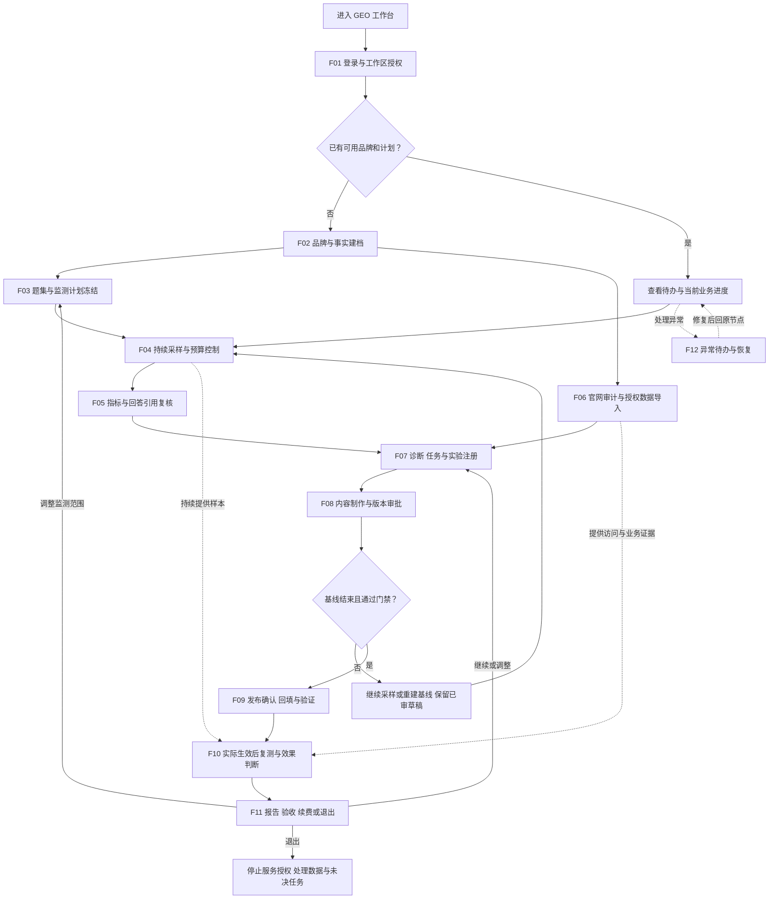

基线采样与公开页面审计可并行，诊断、草稿也可提前准备；正式优化发布必须等待完整基线结束并通过比较门槛。持续采样贯穿发布前后，不能只在观察点临时执行几次请求。

## 4 F01 登录与工作区授权

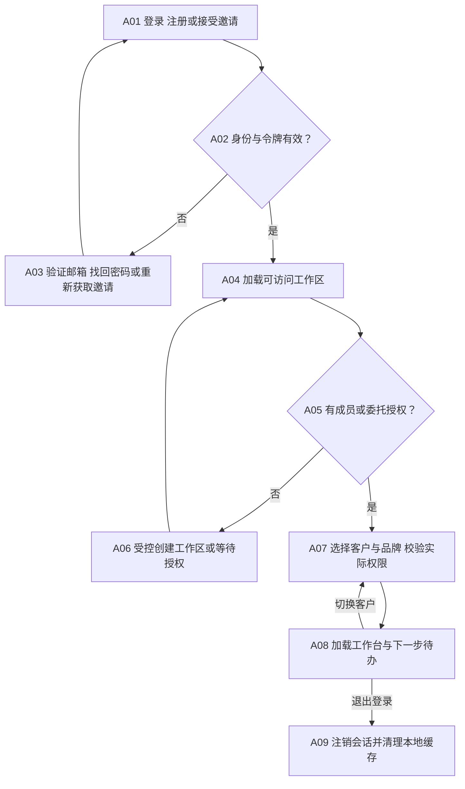

| 节点 | 用户操作和输入 | 系统处理与记录 | 输出与分支 |
| --- | --- | --- | --- |
| A01 | 输入登录资料；邀请入口携带一次性令牌 | Better Auth 处理身份，不自建密码算法；注册方式依受控接入配置 | 已有账号登录；新用户完成邮箱验证后加入指定组织 |
| A02 | 提交验证或邀请接受 | 校验会话、邮箱、令牌到期、邀请目标及是否已使用；登录/邀请限流 | 失败不泄露账号存在信息；成功进入组织选择 |
| A03 | 找回密码或请求新邀请 | 令牌一次性使用；邮件结果可重试，失败显示可操作原因 | 不能将过期邀请转换成默认管理员角色 |
| A04 | 查看组织列表 | organization 映射 tenant；返回获授权客户/品牌的最小 DTO | 无授权显示引导，不能展示其他客户名称或统计 |
| A05 | 选择本组织或代理客户 | 验证 membership；代理商还需有效 project_grant、品牌范围和有效期 | 授权不足保持阻断；界面切换不产生授权 |
| A06 | 创建允许的新工作区，或等待管理员邀请 | 创建组织/成员和审计；是否允许自助创建由接入配置决定 | 没有创建资格时提供邀请指引，不能自行加入他人组织 |
| A07 | 切换客户、品牌 | 构造 AuthContext；清理旧租户 Query 缓存；敏感请求实时读取权限修订 | 品牌不存在或越权返回无访问权，不沿用上一品牌数据 |
| A08 | 打开工作台或待办 | 按当前权限加载指标、operation、任务、费用与异常 | 无品牌去 B01；无计划去 C01；运行中去 D01；有结果去 E01 |
| A09 | 点击退出登录 | 注销会话、清理客户端缓存；已持久化后台任务不因退出取消 | 需要停止计划时另走显式暂停；再次登录可继续查看进度 |

## 5 F02 品牌与事实建档

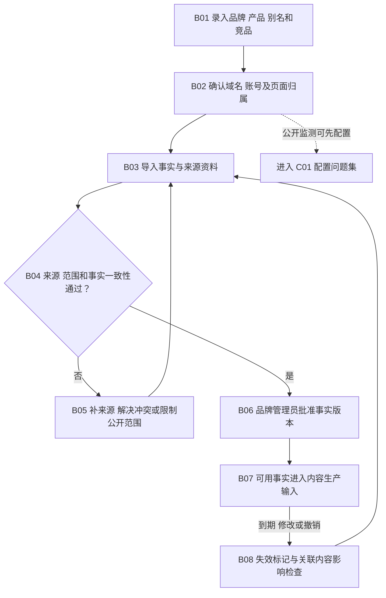

| 节点 | 用户操作和输入 | 系统处理与记录 | 输出与分支 |
| --- | --- | --- | --- |
| B01 | 填名称、别名、产品、行业、地区、竞品集合 | 保存 brand、brand_entity 和集合版本；名称与普通词重合时记录消歧规则 | 形成品牌对象；竞品变化影响 SoV 可比性，不能拼接旧趋势 |
| B02 | 登记官网、平台账号、具体页面及归属证据 | 保存可核查归属；共享平台按账号/页面识别，不能整域划为自有 | 品牌核验、网站控制权和发布授权独立；公开监测无需 CMS 管理权限 |
| B03 | 输入实体、属性、值、来源、有效期、公开范围，上传证明 | 创建 fact_version、fact_evidence；附件经过上传意图、校验和受控存储 | 事实初始为待核验；私密资料不默认外发 |
| B04 | 查看冲突和缺项 | 检查来源可追溯、值/单位/条件、到期与公开范围；争议进入人工判定 | 待核验、冲突、过期分别展示；关键事实不合格阻断相关生成或提审 |
| B05 | 补证据或修正资料 | 新建事实版本并保留旧版；记录处理意见 | 修订后重新核验，不能直接覆盖已批准证据 |
| B06 | 指定授权人批准或拒绝 | approval 绑定事实版本、批准人、时间和用途范围 | 拒绝返回 B05；批准仅允许指定范围使用，不授予内容发布权 |
| B07 | 选择事实用于工单与内容 | GenerationPort 仅收到已批准、有效且允许发送给该模型的资料 | 监测请求不注入事实库；公开监测不被私密资料缺失卡住 |
| B08 | 撤销、更新，或系统识别到期 | 保存失效原因并查关联草稿/审批/待发布任务；待执行任务重验并阻断 | 已公开内容创建纠错/撤回待办；不因事实撤销自动删除外部内容 |

## 6 F03 问题集与监测计划冻结

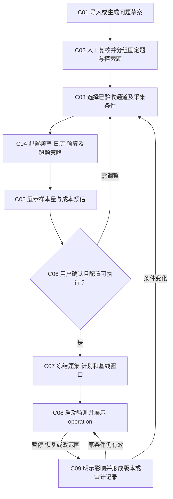

| 节点 | 用户操作和输入 | 系统处理与记录 | 输出与分支 |
| --- | --- | --- | --- |
| C01 | 从咨询、客服、资料导入问题；可让 AI 扩写 | 保存草案来源，检查空题、重复、语言与品牌倾向 | AI 生成次数不表示搜索量；生成题必须人工复核 |
| C02 | 确认 30 道非品牌题、5 道比较题、5 道品牌题；10 道探索题另组 | 保存 prompt_set、prompt_version、意图、题型、语言、目标地区 | 主推荐指标只用固定非品牌题；探索题不混入核心趋势 |
| C03 | 选真实服务/端点、模型、联网模式、地区及采集方式 | 读取能力矩阵版本，校验账号/配置；模型版本未知明确记 unknown | 未验收通道不可选；仅单通道可用时明示范围，不拿自建链路冒充 App |
| C04 | 设置每天次数、日内槽位、起止日、预算和到顶动作 | 绑定新会话要求；原始时间存 UTC、产品日聚合按 Asia/Shanghai | 预算到顶默认暂停；预先同意的降频也需显式计划版本 |
| C05 | 查看量与价后决定是否继续 | 展示 Q×C×R×D，探索题、重试、搜索/分析/抓取另列；未知价不填零 | 例：40×2×3×30＝7,200 个基础计划样本，不是全部调用量或最终账单 |
| C06 | 确认范围、费用预估和服务授权 | 检查权限、至少一个通道、题目完整性、预算、时区和采样日历 | 422 返回字段错误；权限/预算不足指向设置页；确认只覆盖本计划 |
| C07 | 确认基线起止时间和目标页变更约定 | 冻结 plan_version、题集 hash、竞品集合、条件和 14 个完整自然日 | 基线内紧急改页登记混杂，必要时重建；不得事后补采历史槽位 |
| C08 | 点击启动，查看进度或离开页面 | 短事务写 operation、计划/槽位、审计和 outbox；返回操作标识 | 后台执行不依赖浏览器；首个真实样本可立即钻取，完整基线继续累积 |
| C09 | 暂停、恢复、改变次数或渠道 | 展示影响的未来槽位；保留历史失败与缺采；恢复前校验授权和预算 | 变化条件新建版本并标趋势断点；暂停不取消已发生的外部调用和成本 |

本方案沿用文档中的 40 题、14 天及采样次数作为试点默认设计值，最终在阶段 0 冻结；不得看到结果后改题、删失败槽位或放宽比较门槛。

## 7 F04 持续采样与预算控制

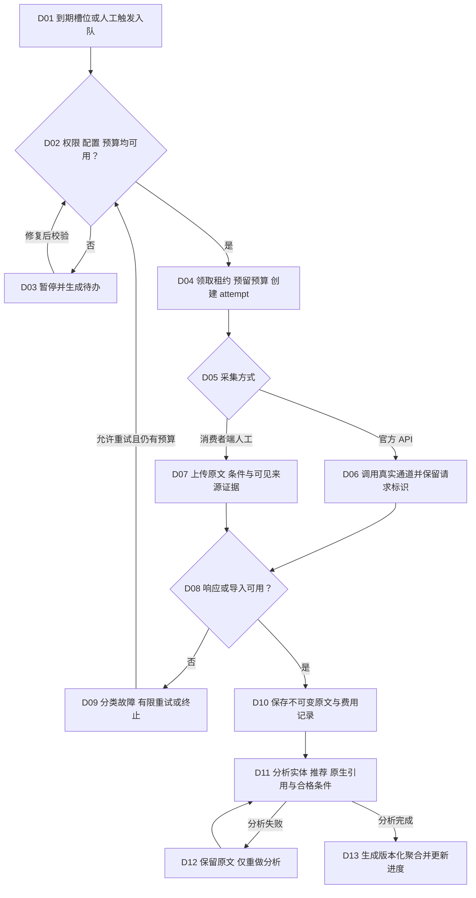

| 节点 | 触发与处理细节 | 持久化与用户可见结果 |
| --- | --- | --- |
| D01 | 调度器按冻结日历建槽位；人工“运行一次”也明确对应槽位/独立计划；outbox 投递 pg-boss | scheduled_sample 组合唯一；重复点击不增加计划分母；停机错过槽位记 missed |
| D02 | Worker 重新读取可撤销服务授权、通道配置、预算和取消状态；不使用过期浏览器会话续命 | 撤销/配置失效进入暂停；预算不够不可继续调用；运行计划与异常原因可查 |
| D03 | 生成账号修复、预算调整或配置更新待办；恢复需新一次校验 | 确定生效时间及未来范围，不用删除旧槽位掩盖未执行 |
| D04 | 自动调用用租约/心跳与 fencing 版本控制领取，数据库原子预留本次尝试预算；人工方式创建待采集任务，导入与后续分析各自控制额度 | 每次真实调用独立 run_attempt；未知费用保留不确定记录；人工采样不伪造供应商调用或 API 费用，可另记工时 |
| D05 | 按 channel_id 分流；人工样本使用独立题集/计划或显式补充观察集合 | ConsumerObservation 不能补进 API 计划的 V/E，实际采集时间必须真实 |
| D06 | EngineAdapter 用冻结问题和采集条件请求目标服务，限制输出、搜索与超时 | 保存 provider_request_id、实际模型/unknown、地区、工具状态、用量及错误；不夹带品牌事实提示 |
| D07 | 人员在可见网页/App 采样，输入入口、模式、账号条件、地区、新会话、时间、原文和来源 | 截图/附件作为证据；验证码和登录问题转人工处理；不承诺无人值守采集 |
| D08 | 校验原文完整性、响应协议与导入必填条件 | 截断/缺原文不能作为有效回答；回答有效但未联网由 D11 判为不合格，不当作执行超时 |
| D09 | 超时/限流等可恢复故障有限退避；权限/配置错误直接暂停；上限耗尽保留失败 | 原槽位下新增 attempt，不新增样本；供应商可能已计费，待对账项单列 |
| D10 | 先写 attemptId/hash 对应的不可变对象，人工导入则使用导入记录 ID/hash；再提交 observation 索引、实际发生的用量结算和分析 outbox | 对象与 DB 不同事务，reconcile 补索引或清孤立对象；无法恢复的响应明确 unknown；未发生的模型调用不生成费用 |
| D11 | 确定性规则与语义分析结合；分别判断有效、符合条件、提及、推荐、引用可观察性 | 保存 analysis_version、原文片段、理由、规则/模型版本；搜索候选不成为原生引用 |
| D12 | 分析队列有限重试，耗尽后进入人工处理 | 原文已保存就不重采引擎；修复生成新分析版本，保留旧版和原始成本 |
| D13 | Worker 按日/题/通道/版本聚合；更新 operation 与可用样本数 | 前端可展示部分结果；终态停止轮询；迟到旧 Worker 结果不覆盖新终态，真实费用仍入账 |

## 8 F05 指标与回答引用复核

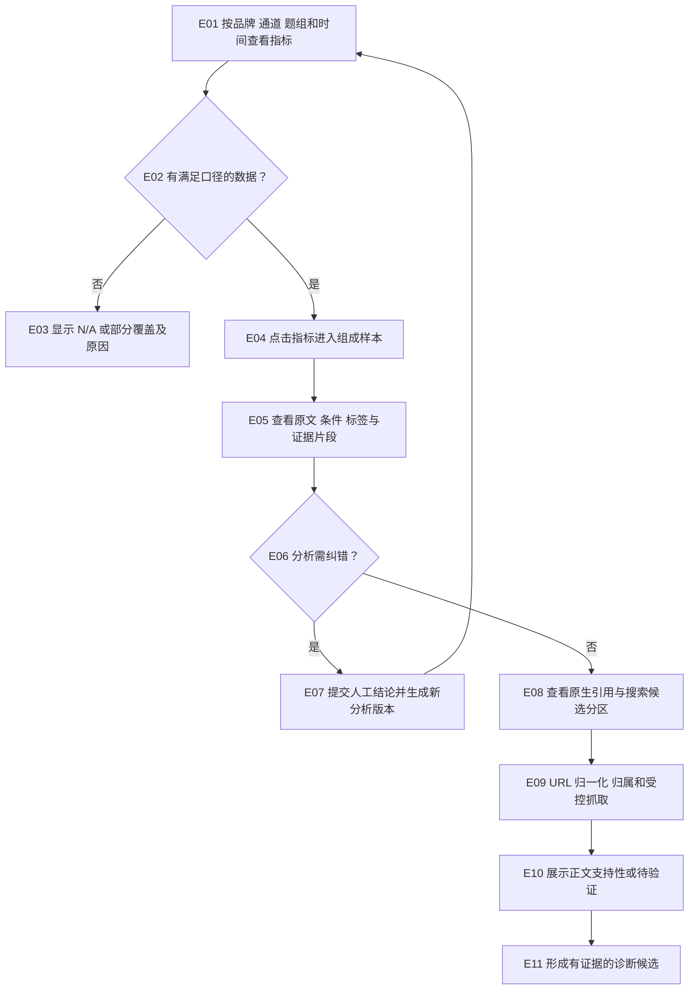

| 节点 | 用户交互与系统处理 | 输出与异常 |
| --- | --- | --- |
| E01 | URL 保存筛选；后端返回指标值、分子分母、聚合方法、覆盖、窗口和版本 | 默认推荐率、提及率、自有页面引用率、有效覆盖及已交付任务；各通道分别展示 |
| E02 | 识别 P、V、E、Jm、Jr、C 是否存在及是否为零 | 分母为零＝N/A；缺固定题＝部分覆盖；不能把失败当未提及 |
| E03 | 显示无计划、待执行、采样失败、未合格、未知、引用不可观察等具体原因 | 对应跳转配置、进度、通道修复或复核；完整可观察且无引用才是 0 条 |
| E04 | 使用当前指标相同版本和筛选钻取，可查看纳入与排除样本 | 服务器分页；每行标记是否纳入分母及排除原因，点击进入原文 |
| E05 | 读取只追加原文、采集环境、引用字段、标签片段和理由 | 原文按不可信文本清洗展示；附件下载再次鉴权；同名、否定和比较语义可复核 |
| E06 | 分析师发现误判，选择标签和证据范围 | 不能以编辑原文的方式“修复”；品牌事实错误需有已批准事实及人工确认 |
| E07 | 填修正理由，提交预期旧版本 | 乐观锁冲突返回 409；新 analysis_version 触发新聚合；旧报告快照保持原版本 |
| E08 | 分区展示 provider_native、consumer_visible、custom_pipeline、analyst_found 和 SearchEvidence | 搜索候选、人工另找链接不计入第三方引擎原生引用；App 样本保持独立 |
| E09 | 保留原始 URL，校验重定向、去跟踪参数、canonical 与域名/账号归属，按缓存去重抓取 | 原始引用存在与正文抓取成功是两项状态；仅在允许且必要时使用浏览器渲染 |
| E10 | 展示是否自有、是否支持品牌、对应正文片段、内容簇和抓取时间 | 受限/抓取失败＝支持性待验证；共享平台不能整域算自有；转载另列页面数和内容簇数 |
| E11 | 绑定问题、回答、来源页和判断理由，进入机会池 | 不从一次引用推断固定合作关系，不从缺席直接断言唯一原因 |

### 指标显示合同

| 指标 | 计算与展示要求 |
| --- | --- |
| 覆盖 | P 为冻结计划槽位；V 为有效原文；E 为符合采集条件的有效回答。分别显示 V/P 和 E/P |
| 提及与推荐 | Jm/Jr 为 E 中分别可判断提及/推荐的样本；逐题计算后固定题等权，未知比例同时展示；推荐率主面板仅 30 道固定非品牌题 |
| 自有原生引用 | C 为 E 中原生引用完整可观察样本；含自有原生引用样本数/C，另显示 C/E；完整空列表属于 C |
| SoV 与推荐位置 | SoV 按固定竞品集合计算样本份额；明确有序推荐才有位置；缺席没有位置，不填 0 |
| 前后变化 | 20% 到 30% 为 +10 个百分点；基线 0 时相对变化不可定义；前后只比较有足够覆盖的共同题 |
| 版本与空值 | 题目、通道、模式、竞品或分析口径变化要标断点；数据不足与确认零值分别呈现 |

## 9 F06 官网审计与授权数据导入

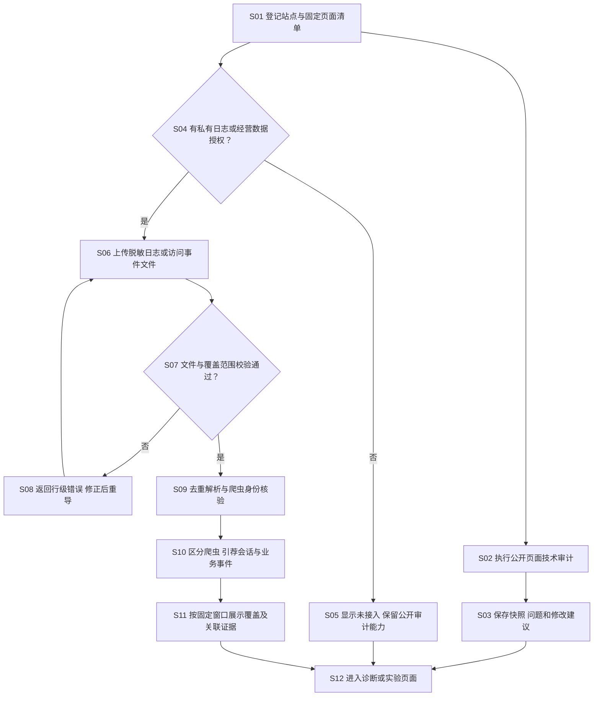

| 节点 | 输入与系统处理 | 结果及限制 |
| --- | --- | --- |
| S01 | 登记 site、页面 URL、优先级、清单版本和可修改范围 | 页面清单固定后作为覆盖分母；公开审计不要求官网管理员权限 |
| S02 | 检查 HTTP、主体内容、内链、robots、sitemap、canonical、标题描述、结构化信息和事实一致性 | SSRF 防护覆盖初始 URL、重定向、实际连接 IP 及浏览器子资源；限速、超时和大小上限 |
| S03 | 保存 page_snapshot、检查规则版本、具体 URL、前置证据和可执行修改 | HTTP 200 不等于正文可读，正文可读不等于已收录；llms.txt 仅可选实验 |
| S04 | 客户授权日志、访问和目标事件的数据范围 | 无授权不读取私有数据；日志/业务数据连接与发布权限独立 |
| S05 | 页面显示“未接入日志/业务数据”并给导入入口 | 爬虫覆盖、引荐转化为 N/A；不阻断公开监测、审计和内容交付 |
| S06 | 上传 CSV/JSON 或约定数据格式，申明节点、时间、时区与缺口 | 上传前去不必要 IP、鉴权头和敏感参数；临时区 finalize 后才能由 Worker 解析 |
| S07 | 检查归属、类型、大小、hash、必填字段、时间范围和行数量；限解压比例 | 保存 log_import 批次、源行标识、错误数量与覆盖说明；部分有效时明确纳入范围 |
| S08 | 下载可读错误明细，修正字段后重导 | 不能静默丢弃坏行再声称全量覆盖；敏感原始行不进入普通日志 |
| S09 | 批次 hash 和事件键防重；记录 UA 声明及身份核验方法/版本 | UA 字符串只代表声明，无法核验时保留未核验；重复导入不增加访问量 |
| S10 | crawler_visit、referral_session、conversion_event 分开存；排除机器人/测试流量 | 明确来源、活动参数、自报和未知分层；咨询按事件键及会话去重 |
| S11 | 覆盖按同一窗口固定清单计算；转化按冻结目标事件、会话与关联窗口计算 | 局部日志显示局部范围；无稳定关联键只展示同会话/聚合趋势，不猜跨设备关系 |
| S12 | 将页面问题送 G01，将授权访问证据送 J07 | 发布、爬取、引用、访问、咨询分别是事件，缺共享标识时不能串成同一用户路径 |

## 10 F07 诊断任务与实验注册

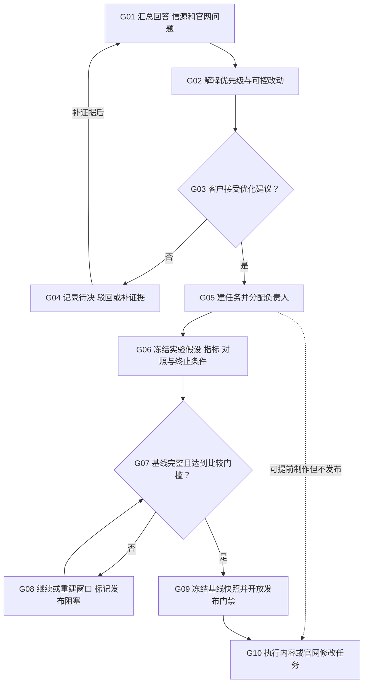

| 节点 | 用户操作与系统处理 | 记录和下一步 |
| --- | --- | --- |
| G01 | 从低表现问题、事实错误、引用差异、页面不可读等生成候选 | opportunity 关联样本/页面、采集条件及理由；诊断因果仅作为待验证假设 |
| G02 | 按商业重要性、证据强度、可控性和工作量排列 | 显示依据和工时，不只选容易涨分的题；无证据的泛化建议不能直接成工单 |
| G03 | 品牌方确认修改范围、负责人配合与预算 | 接受、待决、驳回分别记录；客户未确认不能记 accepted |
| G04 | 补样本、补事实或登记不做原因 | 保留决策历史；已驳回机会不自动生成发布任务 |
| G05 | 指定目标问题版本、目标 URL、预期改动、事实范围、负责人、工时、截止日 | task 还须有验收步骤、客户依赖、发布方式、回滚方案、opportunity_id 和 experiment_id |
| G06 | 分析师登记假设、处理/对照组、目标题集、通道、主指标、观察窗和终止条件 | experiment 版本冻结；没有对照可做前后观察，结论不得标为因果提升 |
| G07 | 验证 14 个完整自然日结束、总体 E/P≥90%、每题每窗合格覆盖≥80%、覆盖冻结非品牌题≥80% | 这些为待阶段 0 冻结的设计阈值；V/P≥95% 是运营目标，不能代替比较门槛 |
| G08 | 分析师处理缺采、外部更新或紧急改页影响 | 延长/重建窗口产生明确新边界，不伪造历史；若只能探索观察，标明不能通过正式比较验收 |
| G09 | 生成包含样本清单、条件、分析/指标版本、排除项的 baseline 快照 | 只有通过后才允许正式实验优化发布；后续同口径重算产生新比较版本 |
| G10 | 运营接单，选择官网修改包、内容草稿或 P1 CMS 草稿 | in_progress；资料/权限缺失进入 blocked 并指明依赖；草稿可提前准备但不得提前上线 |

## 11 F08 内容制作与版本审批

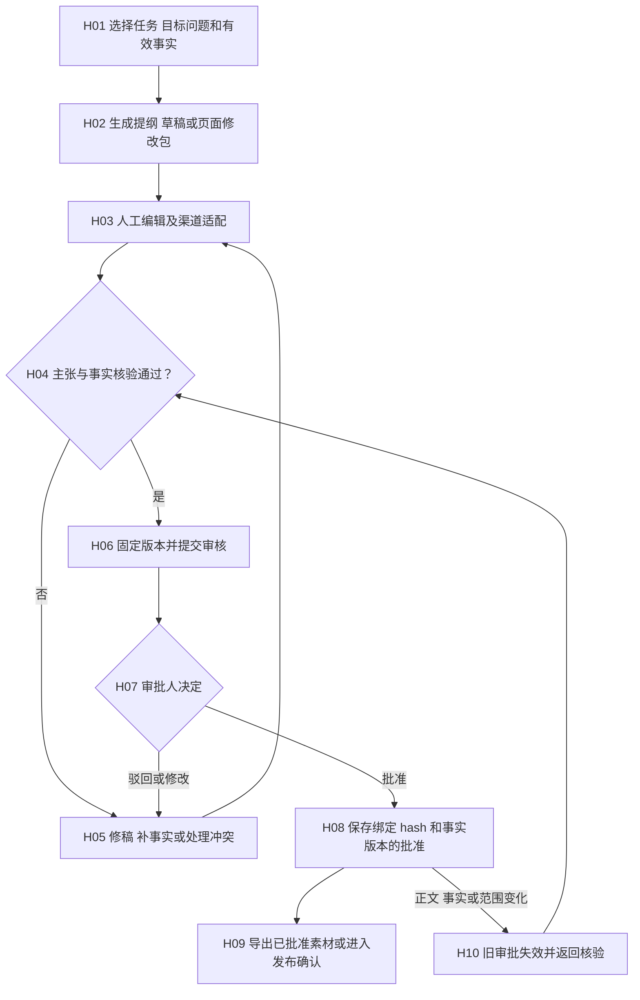

| 节点 | 操作与处理细节 | 数据及异常回路 |
| --- | --- | --- |
| H01 | 从已接受工单选择目标页/问题和可用事实；按模型外发范围筛选 | 只向 GenerationPort 提供必要资料；关键事实过期/冲突先回 B05 |
| H02 | 异步生成提纲、草稿或修改建议；按“回答、条件、证据、限制、更新日期”组织 | content_version 关联任务、事实和生成记录；未知值保留待补充；失败可重试但计费留痕 |
| H03 | 编辑正文、图文说明、脚本、标题和渠道表达 | 每次提交形成可比对版本；不同渠道关键参数、价格、承诺一致 |
| H04 | 检查关键主张 fact_id、值/单位/条件、有效期、来源、公开范围和重复内容 | JSON 格式正确不等于事实正确；无法判断的主张转人工确认，不能虚构来源 |
| H05 | 填审核意见并修稿；需要新事实时走 B03 至 B06 | 不能把修改事实和批准事实合并成一个隐式动作 |
| H06 | 展示版本 diff、事实引用、生成属性、目标渠道/账号、拟发布时间 | content_hash 与 factRevision 固定；修改期间提交用 expectedVersion 防止覆盖 |
| H07 | 具备审批权限的用户明确批准、驳回或要求修改 | 评论不等于批准；驳回理由进入 approval/audit；运营默认不能自行授予审批权限 |
| H08 | approval 绑定内容 hash、事实版本、批准人及账号/渠道范围 | approved；只代表内容可在指定范围使用，正式发布仍需 I01 确认 |
| H09 | 导出文案、图片说明、脚本、来源、生成声明和发布说明，或选择发布 | 包内统一版本和 manifest；官网可输出补丁/修改清单，CMS P1 只写获准草稿范围 |
| H10 | 检测正文变化、事实撤销/过期、账号或用途超出批准范围 | 待执行发布阻断；重新核验并按变化重新审批；旧批准记录保留供追溯 |

## 12 F09 发布确认回填与验证

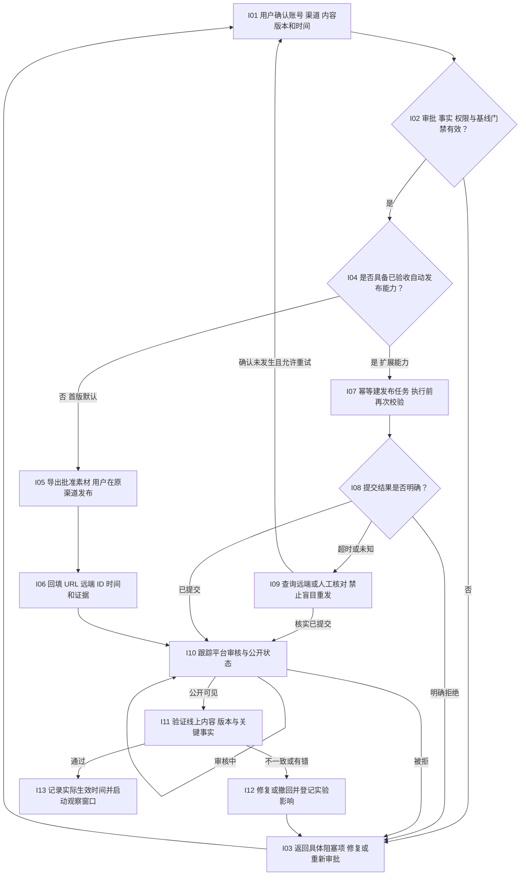

| 节点 | 操作与系统处理 | 记录和边界 |
| --- | --- | --- |
| I01 | 用户看到具体账号、渠道、批准内容、发布时间并明确确认 | 确认绑定 content_version/hash、approval_id 和操作；OAuth 同意不能代替本次确认 |
| I02 | Web 校验本平台操作权限、有效审批、事实、内容版本、目标账号范围和基线快照；自动方式另验账号 scope 及服务授权 | 不满足时不可进入对应发布路径；人工方式无须提供自动发布 Token，但操作者须有原渠道发布权；素材包可提前准备，实验正式上线须通过 G09 |
| I03 | 提供重新审批、更新事实、补授权、等待基线或修改平台拒绝项入口 | 保留失败原因，不能直接跳回执行节点绕过校验 |
| I04 | 按真实 capability/scope、应用审核、授权期限和验收记录选路径 | P0 默认人工；P1 CMS 草稿不等于正式发布能力；不展示不可用的自动发布按钮 |
| I05 | 用户下载指定版本材料，在获准的原平台操作 | “已导出”只代表已交付材料，不等于已上线；等待客户发布则显示客户阻塞 |
| I06 | 填 URL、远端 ID、实际发布时间、版本和回执 | 建 publication，初始待验证；无公开 URL 时记录远端 ID 与访问条件，明确验证限制 |
| I07 | 事务创建 publication/outbox；键由租户、账号、内容版本与操作构成；Worker 调用前再验授权 | 同键同请求返回原操作，同键不同请求 409；真实调用不占用长数据库事务 |
| I08 | 收到回执、拒绝或超时；记录 provider_request_id、远端 ID 和原始回执 | submitted 不等于 public；超时不能当失败直接重发 |
| I09 | 查询供应商幂等/远端状态，无查询能力时创建人工核对任务 | unknown 未解除前禁止重发；人工改状态需证据及审计；确认没发生后才可新尝试 |
| I10 | 轮询或验签回调推进 submitted、platform_review、public/rejected | 防回调重放与乱序；不能把 withdrawn 用旧回调恢复为 public；人工路径同样需状态核实 |
| I11 | 检查 URL/远端内容公开状态、正文与批准版本一致性、事实及抓取情况 | 发布记录、公开可见、执行验收分开；不可访问时保留待验证，不伪造成功 |
| I12 | 发现错误优先修复/撤回，保存原发布、修订或回滚版本和时间 | 授权撤销不会自动撤下内容；撤回独立执行；修改干预条件需评估实验可比性 |
| I13 | 保存有证据的实际生效时间、验证人/规则及任务验收 | task 从 published 到 verified；按实际上线批次建立 D+7/14/28；回填时间不能替代实际生效时间 |

若客户在平台外提前改页，系统无法阻止真实变更；回填时必须登记实际时间与偏离，标记原实验受污染，重新建立比较条件，不能倒填成合规发布。

## 13 F10 复测与效果判断

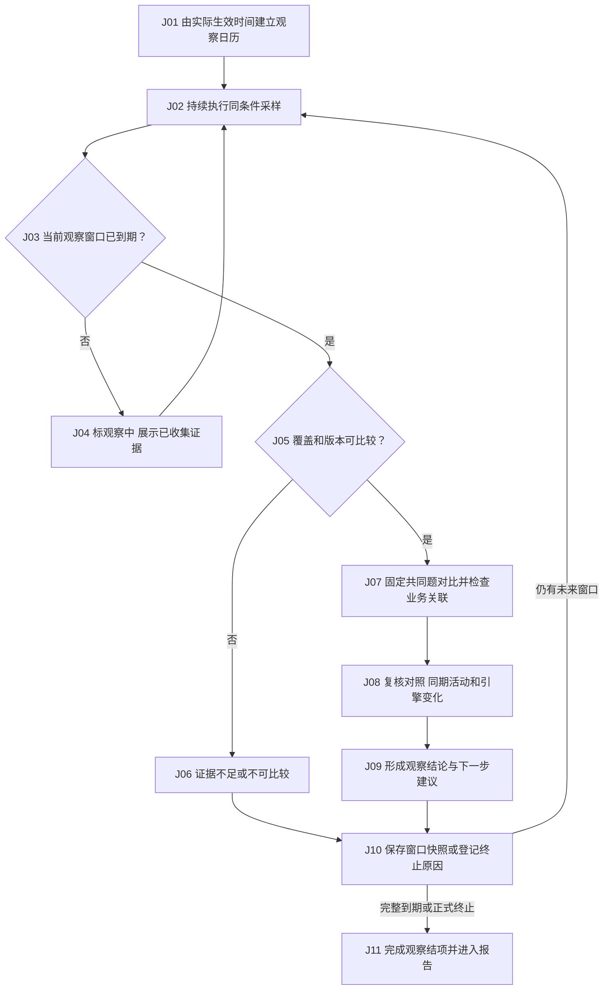

| 节点 | 系统处理与用户动作 | 结果及限制 |
| --- | --- | --- |
| J01 | 按实际生效时间和已冻结规则计算窗口；多批页面分别记录 | 基线为独立 14 天；D+7 看第 1—7 天，D+14 看第 1—14 天，D+28 看第 15—28 天持续性 |
| J02 | 延续固定题、通道、日内槽位、地区与口径；记录期间变化 | 日常采样不停；模型未知/变化、改页、营销活动均进入环境记录 |
| J03 | 当前时间与冻结窗口结束时点比较 | 未到期不能结论为成功；第 8 周交付不要求假装 D+28 已完成 |
| J04 | 用户可看已完成交付和阶段趋势 | 显示下一观察日期、缺采和当前覆盖；预览不替代到期快照 |
| J05 | 校验双方总体/逐题覆盖及固定共同题，比较题集/通道/分析版本 | 解析版本不同可用原文做同版本重算并另存结果；不可比则不拼接趋势 |
| J06 | 明示 insufficient_evidence 或 not_comparable、原因和受影响题 | 低覆盖只作探索观察；补充观察需登记新窗口，不修改既有失败记录 |
| J07 | 逐题等权比较推荐、提及、引用；列题数、样本数、未知和百分点变化 | 同时查看页面、引荐会话及目标事件；无授权业务数据为未测量，不阻断监测报告 |
| J08 | 检查对照组、同期推广、引擎变化和采集条件变化 | URL 相同只说明页面关联；缺共享标识不能拼接回答至订单；未实现统计区间不显示显著性 |
| J09 | 分析师复核为 observed_improvement 或 no_clear_change，或转证据不足/不可比 | 观察改善不等于因果收益；建议继续、调整或停止均关联证据 |
| J10 | 固定 report_sample、窗口、版本、排除项、发布版本、混杂因素和结论等级 | 每窗保留快照；回滚记 rolled_back；无改善同样保留，不删掉失败实验 |
| J11 | 最后窗口结束，或因退出/故障/回滚正式终止 | G5b 评价证据完整与结论可信，不要求所有实验提升；还有未来窗口则继续 running |

D+7 与 D+14 窗口存在重叠，不能把二者当作独立样本叠加。归因窗口和目标事件在实验前约定；缺稳定关联键时仅展示同会话或聚合信息，不能事后调大窗口制造转化。

## 14 F11 报告验收与客户生命周期

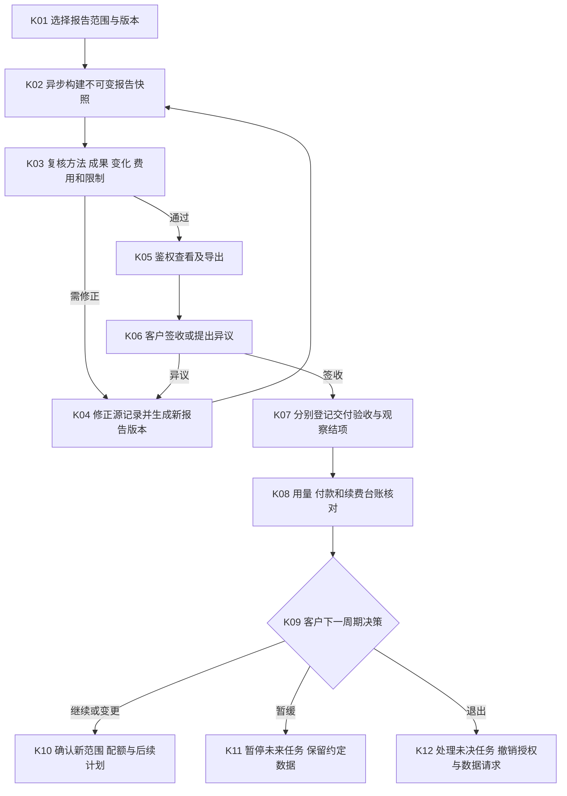

| 节点 | 用户操作与处理细节 | 输出与异常 |
| --- | --- | --- |
| K01 | 指定品牌、题集、通道、窗口和读者范围 | 从授权范围冻结样本集合；不能跨客户汇总私密明细 |
| K02 | report.build 生成快照和导出对象，读取固定版本数据 | 保存 report_snapshot、report_sample、原始证据引用与对象 hash；失败可按同输入重做 |
| K03 | 检查方法、工单及上线记录、观测变化、官网数据、业务关联、费用、限制和下期行动 | 报告含分子/分母、聚合方式、缺数与排除列表；观察中和未知费用明确展示 |
| K04 | 对分析、验收或费用纠错，新增相应版本/冲正记录 | 原报告不覆写；更正报告注明版本和变更原因，签收绑定具体版本 |
| K05 | 用户查看/下载，服务端重验当前权限和字段范围 | 私密事实、令牌及其他客户数据不导出；即时撤销要求使用下载代理，不能仅依赖已签发 URL |
| K06 | 客户逐项签收成果，或提交缺项/事实/费用异议 | 验收意见、签收人、时间、任务和报告版本留痕；平台不能代客户默认签收 |
| K07 | 分开登记 G5a 执行交付与 G5b 观察结项 | 未到期观察继续运行；试点整体 G5a 还需至少 3 家客户各 3 项确认改动及安全/恢复等条件，单客户签收不自动等于整体通过 |
| K08 | 核对套餐额度、客户账单、实际付款、合同期、续费日、工时与支持 | 供应商失败/重试成本与客户收费分账；付款、意向、续费分别记录；内部成本按角色可见 |
| K09 | 用户决定续用、改范围、暂停或退出 | 不默认扣款或自动续费；续费日期未到标“未到续费”，不记成流失 |
| K10 | 确认品牌、题目、通道、次数、内容/审核量、预算和生效日 | 回 C03 新建/修订计划，回 G01 建下一期任务；新增渠道先验收 |
| K11 | 确认暂停的未来范围和保留策略 | 未来任务停止或按新计划调整；已发生调用结算，unknown 发布继续核查，恢复须重新验权 |
| K12 | 具备权限的管理员查看退出影响，分别确认停用委托、服务授权和数据处理范围 | 停止待执行调用/刷新；处理中发布先核对远端；实验正式终止；已公开内容撤回另办；数据按既定合同和保留规则处理 |

退出采用以下拟建细则：用户可在撤销前导出允许保留的交付资料；撤销后新的读取、任务和导出均拒绝。若提交数据删除请求，异步任务覆盖对象、索引、派生缓存及可访问报告，返回完成状态与仍需按保留策略处理的范围；备份遵循生命周期及恢复后再删除规则。只退出代理商委托时，不删除客户租户自有数据；账号注销也不隐式删除整个组织。

## 15 F12 异常待办与恢复

异常由各业务节点写入 operation 或待办，工作台展示所属品牌、阶段、发生时间、影响、责任人和可执行动作。站内待办是默认渠道；外部通知只有客户完成渠道配置后才启用。

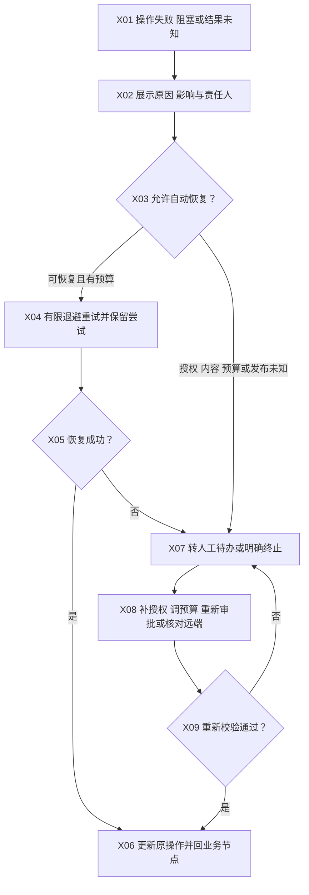

| 节点 | 技术处理 | 用户结果 |
| --- | --- | --- |
| X01 | 分类业务阻塞、运行错误和外部结果未知，不统一转成 failed | 显示原 operationId 与业务对象，不要求重复创建任务 |
| X02 | 错误响应返回 code、message、traceId 与字段错误；内部堆栈仅留脱敏日志 | 提供具体动作及对采样覆盖、发布时间、费用的影响 |
| X03 | 根据阶段、错误类别、次数、预算及外部副作用判断 | 发布 unknown 不属于可自动重发故障；权限拒绝不通过重试解决 |
| X04 | 同业务对象增加 attempt，保存退避、费用和幂等关系 | 重试进度可见，不增加样本分母或重复客户扣费 |
| X05 | 成功回原对象；失败达到上限转人工 | 不无限 loading；保留部分成功结果和失败清单 |
| X06 | 更新 operation，失效相关客户端查询缓存，保留审计 | 返回原页面和原筛选，继续未完成步骤 |
| X07 | 指定管理员/运营/分析师负责；不可恢复时终止并写明原因 | 待办不被静默关闭，计划/实验是否终止须按业务规则判断 |
| X08 | 根据动作重新读取授权、内容版本、预算或远端回执 | 可能返回原流程重新审批；不复用过期确认 |
| X09 | 服务端再次核验所有前置，不以按钮已解锁为依据 | 通过后恢复未发生的动作；已发生的外部操作只对账或补记录 |

| 典型情况 | 前端状态与恢复动作 | 必须保持的不变量 |
| --- | --- | --- |
| 会话到期 | 重新登录后返回原页面 | 后台任务不因登录会话失效消失，执行依赖独立服务授权 |
| 委托或渠道授权撤销 | 无访问权/授权失效；由有权管理员重新配置 | Worker、导出、对象下载同样阻断；旧 UI 状态不能继续执行 |
| 重复点击 | 显示原操作进度 | 同键同请求复用结果；同键不同请求返回 409 |
| 并发编辑 | 显示版本冲突并重新载入差异 | 不覆盖别人的审批或改稿 |
| 预算不足/供应商费用未知 | 暂停、待对账，允许管理员按新预算恢复 | 未知不填零；不得用重试绕过额度 |
| 限流/短暂故障 | 重试中，耗尽后失败待办 | 历史失败槽位和所有尝试成本保留 |
| 原文存在但解析失败 | 分析待处理 | 只重做分析，不重采引擎 |
| URL/日志缺失 | 待验证/未接入/部分覆盖 | 不用 0 替代 N/A，不把引用存在等同正文可得 |
| 内容变更/事实失效 | 审批失效，重新提审 | 待发布任务必须重验；旧批准不能继续授权 |
| 发布超时 | 结果未知，核对远端 | 未确认没发生前禁止重发 |
| 退出页面或刷新 | 重新查询 operation | 关闭浏览器不取消持久化业务任务 |
| 显式取消 | 说明可取消的未来工作和已发生部分 | 取消不回滚已计费调用或外部公开内容；外部结果未知先核查 |

## 16 端到端技术调用链

页面通过 Server Components 读取首屏 DTO，通过 Server Actions 提交站内短表单；轮询、附件、回调及 HTTP 接口由 Route Handlers 提供。三类入口共用业务服务，服务负责校验、授权、幂等和事务。长任务由 Worker 执行，界面只等待持久化结果。

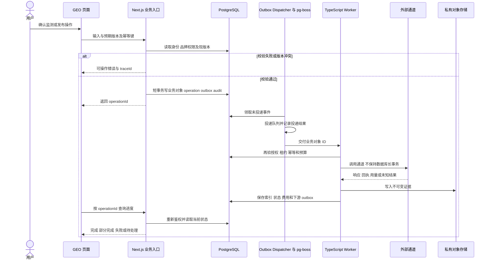

该图描述外部调用型长任务；报告生成、日志导入复用队列与证据落库部分，无须调用供应商。对象写入成功但数据库提交失败由 reconcile 处理；对外副作用不能依靠数据库回滚撤销。

### 接口与业务用例映射

下列路径沿用架构文档的已有提议，其余操作使用对应共享服务用例名，避免在两个文档中定义相互冲突的 API。

| 流程 | 入口或用例 | 输入和返回要点 | 异步任务 |
| --- | --- | --- | --- |
| F01 | `/api/auth/[...all]`；`resolveWorkspaceAccess` | 会话、成员、委托；返回授权工作区 DTO | 邀请邮件采用有状态发送与失败处理 |
| F02 | `createBrand`、`saveFactVersion`、`approveFact` | 目标品牌、版本、来源与公开范围；返回记录及版本 | 附件处理按需异步 |
| F03 | `freezeMeasurementPlan`；`POST /api/v1/brands/:id/monitoring-runs` | 冻结计划版本、预算、幂等键；HTTP 202 + operationId | `sample.collect` |
| F04 | `GET /api/v1/operations/:id` | 校验操作真实租户/品牌；返回进度、计数、原因与费用状态 | `sample.collect`、`sample.analyze`、`usage.reconcile` |
| F05 | `GET /api/v1/brands/:id/observations`；`reviseAnalysis` | 筛选、游标、分析版本；纠错带预期版本和理由 | `sample.analyze`、`source.fetch` |
| F06 | `POST /api/v1/uploads/intents`；`finalizeUpload`、`importSiteData` | 归属、类型、大小、hash、覆盖范围；上传完成不等于导入成功 | `site.import`、`source.fetch` |
| F07 | `acceptOpportunity`、`createTask`、`registerExperiment`、`freezeBaseline` | 证据、目标页、验收、回滚、固定窗口与样本清单 | 基线快照/报告构建复用 `report.build` |
| F08 | `generateContent`；`POST /api/v1/content/:id/approvals` | task、factRevision、contentHash、账号/渠道范围 | `content.generate` |
| F09 | `POST /api/v1/publications`；`POST /api/webhooks/:provider` | 内容/审批/账号、确认、幂等键，或人工回填；回调验签去重 | `publication.submit`、`publication.verify` |
| F10 | `compareExperimentWindow` | 基线和当前样本集合、版本、排除项；输出结论等级 | `report.build` 生成窗口快照 |
| F11 | `POST /api/v1/exports`；`acceptDelivery`、`pauseService`、`requestDataDeletion` | 固定范围；202 + operationId；签收和退出绑定具体范围 | `report.build`；删除作业作为拟增任务类型 |

Server Action 成功返回等价的操作结果对象，不强行套用 HTTP 202。前端初始按架构约定以 2—5 秒自适应轮询操作状态，后台页降低频率，终态停止；重新进入页面可恢复查询。

### 状态分层

| 层次 | 状态合同 | 不可混淆的含义 |
| --- | --- | --- |
| operation | 拟定 queued、running、waiting_action、succeeded、partially_succeeded、failed、cancelled | 操作汇总，不代替样本、任务、发布或实验状态；样本合格与否不是 operation 是否完成的唯一依据 |
| 采样槽位 | scheduled → running → succeeded/failed/paused/cancelled；停机缺采另记 missed | 每个槽位可有多个 attempt；原文存在但分析失败另记 analysis_pending |
| 事实 | 待核验、已批准、过期、撤销、冲突 | 事实批准只允许指定范围使用 |
| 工单 | proposed → accepted → in_progress → awaiting_review → ready_to_publish → published → verified | blocked、rejected、rolled_back 保留原因；verified 是交付验收，不是 GEO 生效 |
| 内容和发布 | draft → in_review → approved → awaiting_confirmation → submitted → platform_review → public | rejected、withdrawn、unknown 为独立分支；人工回填先核验，不能跳到 public |
| 实验 | running → observed_improvement/no_clear_change/insufficient_evidence/not_comparable/rolled_back | 窗口快照可以先有阶段结论，整体实验仍等待未来窗口；终止保留原因与到期情况 |

### 数据关系与安全不变量

| 关联链 | 必须落实的校验 |
| --- | --- |
| tenant → brand → fact/prompt/plan/task | 业务表带 tenant_id，父子复合关系防串租户；服务授权与 RLS 同时执行 |
| plan_version → scheduled_sample → run_attempt → observation | 槽位唯一；尝试不扩大计划分母；原文只追加，最终观察选择可追溯 |
| observation → analysis_version → mention/citation → source_page | 标签有片段和理由；引用来源类型固定；原始 URL 与归一化 URL 都保留 |
| opportunity → task → content_version → approval → publication | 每次发布可回到具体机会、任务、正文 hash、事实版本、确认与回执 |
| publication → experiment_window → report_snapshot/report_sample | 实际生效时间决定观察；报告引用固定样本、版本与排除清单 |
| site/page_inventory → log_import → visit/session/event | 固定页面分母、日志覆盖、事件去重与来源强度；不推测不存在的用户关联 |
| operation → budget_reservation → usage_event | 原子预留；供应商成本、客户计费、人工工时分开；冲正留记录，不直接抹账 |
| 对象索引 → 原文/附件/导出 | 私有对象存储；下载实时鉴权；客户端不能指定任意 bucket/key；令牌不进入文件或模型上下文 |

## 17 全流程验收与研发拆分

文档中的验收项是后续实现应验证的行为，不表示已经执行产品测试。优先用一条纵向链路完成 P0，再扩大通道和客户数量。

| 验收场景 | 覆盖流程 | 预期可观察结果 |
| --- | --- | --- |
| 新品牌首次完整交付 | F01—F11 | 登录建档、固定题集、真实通道、原文、工单、批准内容、人工上线、验证、复测及报告均可按 ID 追溯 |
| 代理商切换两个客户及访问未授权品牌 | F01、F05、F11 | 页面、API、缓存、后台任务、导出和附件均不串租户；撤销后新读取被拒 |
| 没有 CMS/日志授权 | F02、F06、F09 | 公开监测和审计可继续；素材包人工发布；缺日志为 N/A，不阻断基础交付 |
| 固定题版本变化或基线期间改页 | F03、F07、F10 | 新版本/趋势断点与混杂记录可见；必要时重建基线，不沿用不合条件的实验结论 |
| API 样本与 App 人工样本并存 | F04、F05 | 分开 channel、证据类型和报告分母；人工样本不补成 API 成功槽位 |
| 未联网、同名歧义、引用空列表及字段缺失 | F04、F05 | 分别进入有效未合格、unknown、可观察零引用和不可观察，手算符合指标合同 |
| Worker 重启、重复投递、重复点击 | F03、F04、F09 | 无重复计划槽位/客户扣费；真实尝试成本完整；旧租约结果不能覆盖新终态 |
| 原文成功但分析失败 | F04、F05 | 不重新调用目标引擎；新增分析版本后可恢复指标，旧报告可重现 |
| 预算耗尽与超时费用不明 | F03、F04、F12 | 暂停及待对账清楚可见；未知不按零处理，降频留新版本 |
| 引用页受限、重复日志、只有 UA 声明 | F05、F06 | 引用事实保留，支持性待验证；不重复计数，爬虫身份保持未核验 |
| 批准后改稿、事实撤销或更换账号 | F08、F09 | 入队和执行双重校验阻断，要求重新审批/确认，无旧版越权发布 |
| 发布超时及乱序回调 | F09、F12 | unknown 必须核查；没有盲目重发；withdrawn 不被旧回调恢复 |
| 回填 URL 与批准版本不一致 | F09 | 执行验收未通过，修正/撤回并登记实验影响，不以回填成功计交付完成 |
| D+28 未到期、缺采或没有改善 | F10、F11 | 分别显示观察中、证据不足或无明显变化；客户交付签收不把实验自动标成功 |
| 报告纠错和数据导出 | F05、F11 | 新报告版本可追溯更正，旧快照不变；下载按当前权限过滤 |
| 客户暂停、委托撤销或删除数据 | F01、F11、F12 | 未来任务、授权、未决发布、实验及数据按明确范围处理，不误删客户自有工作区 |

| 研发工作包 | 子流程 | 主要交付 | 对应阶段 |
| --- | --- | --- | --- |
| 用户接入与租户底座 | F01、F02 | 登录邀请、授权服务、品牌与事实、对象访问 | S1；先通过 S0 技术验证 |
| 监测执行与证据 | F03—F05 | 题集/计划、outbox/Worker、预算、原文、指标、纠错 | S1—S2 |
| 官网观测与优化任务 | F06、F07 | 页面审计、日志导入、机会/任务、实验及基线门禁 | S3 |
| 内容审批与发布 | F08、F09 | 事实驱动草稿、版本审核、素材包、人工回填与验证 | S4；CMS 草稿按 P1 追加 |
| 复测交付与持续经营 | F10、F11 | 固定窗口比较、报告/签收、成本和续费台账、退出流程 | S5—S6 |
| 横向可靠性 | F12、调用链与数据约束 | 错误待办、幂等、租户隔离、预算对账、恢复和删除 | 各阶段同步完成 |

首轮完成标准是一条真实可回溯的用户闭环：一个品牌、一个固定题集、一个验收通道、一条经客户接受的任务、一份批准内容、一个实际发布结果和一次到期复测。第二通道、CMS 或更多自动化能力不能替代这条闭环的完成。
